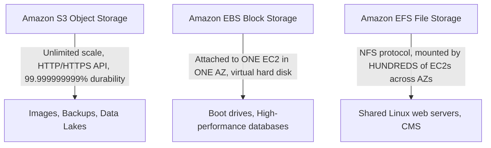

# AWS CLF-C02 Rapid Review Cheatsheet & Memory Anchors

> **Role:** Ultra-dense, high-yield review sheet for fast revision before exams and teaching sessions.  
> **Canonical Literature Grounding:** Tom Taulli (*O'Reilly 2026*), Rajesh Daswani (*Packt 2026*), Gaurav H Kankaria (*Orange 2026*), and official AWS CLF-C02 Exam Guide v1.2.

---

## ⚡ 1. The 6 Cloud Advantages in Plain Words

| Advantage | What It Really Means | Exam Trap / Clue |
|:---|:---|:---|
| **Trade CapEx for OpEx** | Stop buying servers upfront; pay monthly only for what you run. | *"Pay-as-you-go"*, *"Variable expense"* |
| **Massive Economies of Scale** | Aggregated usage of millions of customers = AWS repeatedly cuts prices. | *"Higher volume = lower pay-per-unit"* |
| **Stop Guessing Capacity** | Scale up/down automatically instead of paying for idle headroom. | *"Over-provisioning / under-provisioning"* |
| **Increase Speed & Agility** | Spin up complex infrastructure in minutes instead of waiting months for IT. | *"Reduce time to deploy from weeks to minutes"* |
| **Stop Spending Money on Undifferentiated Heavy Lifting** | Let AWS handle racking, stacking, cooling, power, hardware fixes. | *"Focus on business logic, not data center maintenance"* |
| **Go Global in Minutes** | Deploy worldwide across multiple AWS Regions with single-digit ms latency. | *"Global customer base, low latency"* |

---

## 🔒 2. Security "Who Does What?" Quick Match

| If the question mentions... | Correct Answer |
|:---|:---|
| Physical data center security, destroyed disks, cooling, hypervisor | **AWS Responsibility** |
| OS updates and patches on Amazon EC2 | **Customer Responsibility** |
| OS updates and patches on Amazon RDS | **AWS Responsibility** |
| Database engine version upgrade on Amazon RDS | **AWS Responsibility** |
| IAM users, passwords, MFA, permissions, security groups | **Customer Responsibility (Always!)** |
| Encryption of customer data (at rest & in transit) | **Customer Responsibility (Configuring it)** |
| Decommissioning and degaussing physical hard drives (NIST 800-88) | **AWS Responsibility** |
| Compliance audit reports (SOC 1/2/3, PCI DSS) | **AWS Artifact** |

---

## 🛡️ 3. Security Services in One Sentence

* **AWS IAM:** Controls *who* can access *what* inside your AWS account (Users, Groups, Roles, Policies).
* **AWS IAM Identity Center (Single Sign-On):** Centralizes login across multiple AWS accounts and business cloud apps.
* **AWS Secrets Manager:** Automatically **rotates**, manages, and retrieves database passwords & API keys.
* **AWS Systems Manager Parameter Store:** Secure, hierarchical storage for configuration data and secrets (no automated rotation).
* **AWS KMS:** Manages encryption keys (`aws/s3`, customer managed keys); does encryption/decryption behind the scenes.
* **AWS CloudHSM:** Dedicated, hardware security module under dedicated customer control (FIPS 140-2 Level 3).
* **AWS WAF:** Layer 7 firewall protecting web apps from **SQL Injection**, **XSS**, and **HTTP floods**.
* **AWS Shield Standard:** Automatic, free L3/L4 DDoS protection on all public AWS endpoints (Route 53, CloudFront).
* **AWS Shield Advanced:** 24/7 DDoS Response Team (SRT), financial protection against DDoS cost spikes.
* **Amazon GuardDuty:** Intelligent threat detection; monitors CloudTrail, VPC Flow Logs, and DNS logs using ML.
* **Amazon Inspector:** Automated vulnerability assessment scanning **EC2 instances, ECR container images, and Lambda code** for CVEs.
* **Amazon Macie:** Machine learning scanner that discovers and protects **sensitive data (PII, credit cards)** in **Amazon S3**.
* **AWS Security Hub:** Single pane of glass aggregating alerts from GuardDuty, Inspector, Macie, and IAM Access Analyzer.

---

## 🌐 4. Networking Cheat Matrix

| Requirement | Correct Service |
|:---|:---|
| Isolated private virtual network in the cloud | **Amazon VPC** |
| Connect VPC to the public internet | **Internet Gateway (IGW)** |
| Allow private instances to reach the internet for updates without inbound exposure | **NAT Gateway** |
| Connect two VPCs together privately using AWS internal backbone | **VPC Peering** |
| Central hub interconnecting hundreds of VPCs and on-premises networks | **AWS Transit Gateway** |
| Dedicated physical private fiber connection from corporate HQ to AWS | **AWS Direct Connect (DX)** |
| Encrypted IPsec tunnel over the public internet between on-prem and AWS | **AWS Site-to-Site VPN** |
| Low-latency global CDN edge caching for static/dynamic content | **Amazon CloudFront** |
| Global Anycast IP network routing across AWS backbone for non-HTTP / TCP/UDP | **AWS Global Accelerator** |
| Authoritative public and private DNS service with health checks | **Amazon Route 53** |
| Privately access AWS services (S3/DynamoDB) without using an Internet Gateway | **VPC Endpoints (Gateway / Interface)** |

---

## 💾 5. Storage Tiers & Distinctions

* **S3 Standard:** Frequent access, immediate availability.
* **S3 Standard-IA:** Infrequent access, lower storage price + retrieval fee.
* **S3 One Zone-IA:** Infrequent access stored in only 1 AZ (save 20% cost; data lost if AZ destroyed).
* **S3 Glacier Flexible Retrieval:** Archive (minutes to 3–5 hours retrieval).
* **S3 Glacier Deep Archive:** Lowest cost in cloud (\$0.00099/GB/mo), retrieval takes 12–48 hours.
* **S3 Intelligent-Tiering:** Automatically moves objects between frequent, infrequent, and archive tiers with **zero operational overhead and zero retrieval fees** when access patterns are unknown.

---

## 💰 6. Billing, Cost Management & Support

| Tool | Core Purpose | When Used |
|:---|:---|:---|
| **AWS Pricing Calculator** | Estimate costs of new architectures *before* deploying. | Planning & budgeting |
| **AWS Cost Explorer** | Visualize, analyze, and forecast historical spending trends *after* deploying. | Retrospective & forecasting |
| **AWS Budgets** | Set custom spend thresholds; sends alerts via email/SNS when limits are forecasted to exceed. | Active alerting & prevention |
| **AWS Cost Anomaly Detection** | Uses ML to detect unexpected spend spikes and identify root causes. | Anomaly detection |
| **AWS Cost & Usage Report (CUR)** | Most granular, raw hourly cost dataset delivered to Amazon S3 (queried with Athena). | Enterprise accounting & BI |
| **AWS Organizations + Consolidated Billing**| Combine multiple accounts for one bill, share volume discounts, and apply SCPs. | Multi-account governance |

### Support Plans in 10 Seconds:
* **Basic:** \$0/mo. Customer service, billing support, 7 core Trusted Advisor checks.
* **Developer:** \$29/mo. 1 primary contact, business hours email access, architectural guidance, response < 12h for impaired system.
* **Business:** \$100/mo. 24/7 phone/chat/email, unlimited contacts, full Trusted Advisor checks, response < 1h for production down.
* **Enterprise On-Ramp:** \$5,500/mo. 24/7 access, Technical Account Manager (TAM) pool, response < 30m for business-critical down.
* **Enterprise:** \$15,000/mo. Dedicated named **Technical Account Manager (TAM)**, Concierge Support team, response < 15m for mission-critical down, Infrastructure Event Management (IEM).
