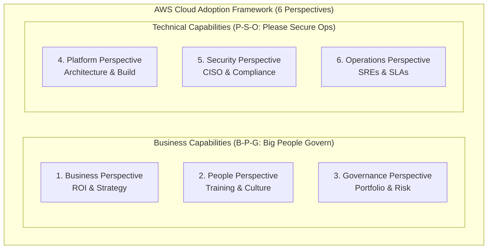
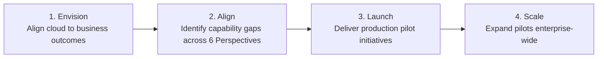
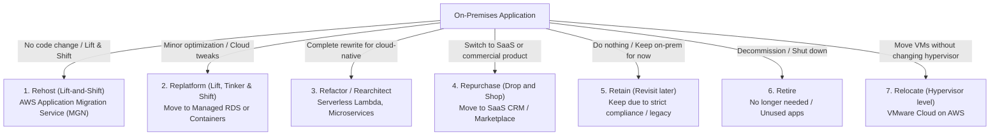
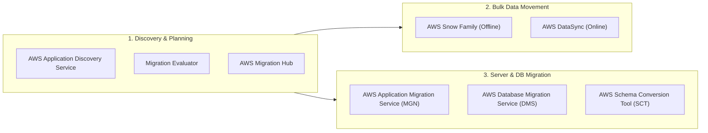

# AWS Cloud Adoption Framework (AWS CAF) & Migration Strategies

> **Knowledge Area:** Cloud Concepts (Domain 1.3) & Migration (Domain 3.8)  
> **Relevant Certifications:** [CLF-C02](../../01_Syllabus/CLF-C02_Master_Blueprint.md), SAA-C03  
> **Tags:** `#aws/concepts` `#aws/migration` `#clf-c02`

---

## 🧠 60-Second Memory Cheat Card (Memorize This First!)

### 1. The 6 Perspectives — Split into **`B-P-G`** (Business) + **`P-S-O`** (Technical)

- **Business Half — `B-P-G` (*"Big People Govern"* — Why, Who, Rules):**
  - **B**usiness = *Money & ROI* (Finance, strategy)
  - **P**eople = *Skills & Culture* (HR, training, change management)
  - **G**overnance = *Programs & Portfolio* (CIO, risk, cloud value alignment)
- **Technical Half — `P-S-O` (*"Please Secure Ops"* — Build, Lock, Run):**
  - **P**latform = *Architecture & Build* (CTO, architects, developers)
  - **S**ecurity = *Protect & Comply* (CISO, identity, privacy)
  - **O**perations = *Run & Monitor* (SREs, SLAs, IT support)

### 2. The 4 Phases — Mnemonic: **`E-A-L-S`** (*"Every Architect Loves Scaling"*)
- **E**nvision *(Dream it — tie cloud to business outcomes)* → **A**lign *(Find gaps across 6 perspectives)* → **L**aunch *(Build production pilots)* → **S**cale *(Roll out enterprise-wide)*

### 3. The 7 Rs Memory Ladder (From Least Change → Most Change)
- **Don't Move:** **Retire** *(Trash it 🗑️)* · **Retain** *(Keep on-prem 🏠)*
- **Buy Ready-Made:** **Repurchase** *(Drop & Shop → SaaS 🛒)*
- **Move As-Is:** **Relocate** *(VMware hypervisor lift 🚚)* · **Rehost** *(Lift & Shift → EC2 via MGN 📦)*
- **Improve It:** **Replatform** *(Lift, Tinker & Shift → RDS/Containers 🔧)* · **Refactor** *(Rewrite cloud-native → Lambda/Microservices 🚀)*

### 4. Snow Family Size Ladder
- **Snowcone** *(Backpack — 8 TB)* → **Snowball Edge** *(Suitcase — 80–210 TB)* → **Snowmobile** *(18-wheeler truck — 100 PB)*

---

## 1. Overview of AWS CAF 3.0

The **AWS Cloud Adoption Framework (AWS CAF)** provides actionable guidance that helps organizations digitally transform and accelerate their cloud adoption journey.

The framework organizes guidance into **6 Perspectives**, split equally between **Business Capabilities (`B-P-G`)** and **Technical Capabilities (`P-S-O`)**:

---

## 2. The 6 Perspectives Breakdown

### Business Capabilities (`B-P-G` — Focus on Business Strategy & Alignment)

| Perspective | 2-Word Hook | Target Stakeholders | Core Exam Clues |
| :--- | :--- | :--- | :--- |
| **1. Business** | *Money & ROI* | Business managers, finance managers, strategy leaders | Cloud investments align with business outcomes, **ROI**, revenue generation, business model innovation, product management. |
| **2. People** | *Skills & Culture* | HR, training leaders, organizational change managers | Workforce readiness, **bridging skill gaps**, cloud training, organizational change management, cross-functional teams. |
| **3. Governance** | *Portfolio & Rules* | CIO, program/project managers, enterprise architects | Orchestrating cloud initiatives, **portfolio management**, program management, risk management, cloud financial management, measuring cloud value. |

### Technical Capabilities (`P-S-O` — Focus on Implementation & Architecture)

| Perspective | 2-Word Hook | Target Stakeholders | Core Exam Clues |
| :--- | :--- | :--- | :--- |
| **4. Platform** | *Build & Architect* | CTO, technology leaders, solutions architects, developers | Designing **cloud architecture**, landing zones, data architecture, CI/CD, modern application development, migration architecture. |
| **5. Security** | *Lock & Comply* | CISO, security officers, compliance & risk managers | **Identity & access**, data protection, infrastructure security, threat detection, incident response, regulatory compliance. |
| **6. Operations** | *Run & Support* | Operations managers, SREs, IT support leads | **Observability**, monitoring, configuration management, incident/problem management, change management, meeting **SLAs**. |

---

## 2.5 The Four Phases of AWS CAF (`E-A-L-S`: `Envision → Align → Launch → Scale`)

AWS CAF 3.0 structures every organization's cloud transformation journey into **four sequential phases**:

| Phase | 1-Line Memory Hook | Core Objective | Key Activities & Exam Clues |
| :--- | :--- | :--- | :--- |
| **1. Envision** | *"Show the business why"* | **Demonstrate how cloud accelerates business outcomes** | Identify high-impact transformation opportunities, link them to the **4 Business Outcomes** (*Reduced Business Risk, Improved ESG, Increased Revenue, Increased Operational Efficiency*), and secure executive sponsorship. |
| **2. Align** | *"Find the gaps"* | **Identify capability gaps across all 6 Perspectives** | Assess readiness across Business, People, Governance, Platform, Security, and Operations; resolve cross-organizational dependencies and build an actionable roadmap. |
| **3. Launch** | *"Ship real pilots"* | **Deliver pilot initiatives in production** | Deploy initial production pilot workloads to demonstrate incremental business value quickly, learn from real-world feedback, and refine processes before mass migration. |
| **4. Scale** | *"Expand everywhere"* | **Expand production pilots to enterprise scale** | Replicate validated patterns across the organization, automate landing zones and governance, and realize full business value at scale. |

---

## 3. The 7 Rs of Cloud Migration

When migrating existing on-premises workloads to AWS, organizations classify each application into one of the **7 Migration Strategies ("7 Rs")**:

| Strategy | Nickname | 5-Word Rule | Effort | Speed | Typical Tools |
|---|---|---|---|---|---|
| **Rehost** | Lift-and-Shift | Move as-is, zero code change | Low | Fastest | **AWS Application Migration Service (MGN)** |
| **Replatform** | Lift, Tinker & Shift | Swap to managed DB/runtime | Medium | Fast | AWS DMS, Amazon RDS, Elastic Beanstalk |
| **Refactor** | Rearchitect | Rewrite fully cloud-native | High | Slowest | AWS Lambda, Amazon ECS/EKS, DynamoDB |
| **Repurchase** | Drop and Shop | Abandon app, buy SaaS | Low-Med | Fast | AWS Marketplace (e.g., Salesforce CRM) |
| **Retain** | Revisit Later | Keep on-premises for now | None | N/A | Hybrid VPN / Direct Connect |
| **Retire** | Decommission | Turn off unused apps | Low | Fast | AWS Application Discovery Service |
| **Relocate** | Hypervisor Shift | Move VMware VMs untouched | Low | Fast | VMware Cloud on AWS |

---

## 4. Key AWS Migration Services Portfolio

Think of migration in **3 Steps**: **Discover** → **Move Data** → **Move Servers & DBs**.

1. **AWS Migration Hub:** *The Dashboard* — single pane of glass to track migration progress across MGN, DMS, and partner tools.
2. **AWS Application Discovery Service:** *The Inventory Scanner* — discovers on-prem server specs, CPU/RAM usage, and network dependencies (*Agentless Collector* for VMware; *Discovery Agent* for physical servers).
3. **AWS Application Migration Service (AWS MGN):** *The Server Lifter* — primary service for **Rehost (lift-and-shift)** with continuous block-level replication and minimal downtime.
4. **AWS Database Migration Service (AWS DMS):** *The Live DB Mover* — migrates databases while keeping the source DB **online**. Supports homogeneous (MySQL → MySQL) and heterogeneous (Oracle → PostgreSQL) migrations.
5. **AWS Schema Conversion Tool (AWS SCT):** *The DB Translator* — converts schemas, stored procedures, and triggers for **heterogeneous** migrations (e.g., Oracle/SQL Server → Aurora/PostgreSQL).
6. **AWS DataSync:** *The Online Pipe* — automated, accelerated **online** data transfer between on-prem storage (NFS/SMB) and AWS (S3/EFS/FSx).
7. **AWS Snow Family:** *The Offline Boxes* — ruggedized physical hardware for massive transfers over slow/no internet:
   - **AWS Snowcone:** Portable, lightweight (**8 TB**).
   - **AWS Snowball Edge:** Storage & compute-optimized (**80 TB to 210 TB**).
   - **AWS Snowmobile:** 45-foot shipping container truck for exabyte-scale (**up to 100 PB** per truck — *legacy/retired for new orders, still tested on CLF-C02*).

---

## 5. Exam Trap-Busters: Easily Confused Concepts

| Confused Pair | Exact Tie-Breaker |
| :--- | :--- |
| **Business** vs. **Governance** (CAF) | **Business** = *ROI, revenue, business strategy*. **Governance** = *Portfolio/program orchestration, risk, cloud financial management*. |
| **People** vs. **Operations** (CAF) | **People** = *Training, HR, culture, change management*. **Operations** = *SREs, monitoring, observability, SLAs*. |
| **Rehost** vs. **Relocate** (7 Rs) | **Rehost** = Convert/move OS servers to EC2 (MGN). **Relocate** = Move **VMware** VMs at the hypervisor level to VMware Cloud on AWS without converting. |
| **Replatform** vs. **Refactor** (7 Rs) | **Replatform** = Keep core code, swap infrastructure (e.g., self-managed DB → **RDS**). **Refactor** = Rewrite app code into microservices / **serverless Lambda**. |
| **AWS DMS** vs. **AWS SCT** | **DMS** moves the *data* (homogeneous or heterogeneous). **SCT** converts the *schema/code* (only needed for **heterogeneous** migrations like Oracle → Aurora). |
| **AWS DataSync** vs. **Snow Family** | Good internet / ongoing sync = **DataSync**. Slow/limited internet or huge one-time offline transfer = **Snow Family**. |

---

## 6. Exam Tip Matrix

| Exam Scenario | Correct Service / Strategy |
|---|---|
| *"Wants to move 200 on-premises Windows and Linux servers to AWS with minimal configuration change"* | **Rehost** using **AWS Application Migration Service (MGN)** |
| *"Migrating Oracle to Amazon Aurora while keeping the production database running without downtime"* | **AWS Database Migration Service (DMS)** + **AWS Schema Conversion Tool (SCT)** |
| *"Company needs to transfer 500 TB of data to S3 from a remote location with limited 10 Mbps internet bandwidth"* | **AWS Snowball Edge** (physical offline transfer) |
| *"Which CAF perspective focuses on bridging staff cloud skill gaps and change management?"* | **People Perspective** |
| *"Which CAF perspective focuses on ROI, business model innovation, and financial justification?"* | **Business Perspective** |
| *"Single pane of glass to monitor migration progress across servers and databases"* | **AWS Migration Hub** |

---

## 7. Active Recall Flashcards (Test Yourself!)

<b>Q1: What are the 3 Business perspectives and 3 Technical perspectives of AWS CAF?</b>

- **Business (`B-P-G`):** Business, People, Governance.
- **Technical (`P-S-O`):** Platform, Security, Operations.

<b>Q2: Put the 4 Phases of AWS CAF in exact order.</b>

**Envision → Align → Launch → Scale** (`E-A-L-S`).

<b>Q3: A company moves its on-prem MySQL database to Amazon RDS without rewriting the application. Which "R" is this?</b>

**Replatform** (*Lift, Tinker & Shift*).

<b>Q4: A company replaces its custom on-prem CRM with Salesforce SaaS. Which "R" is this?</b>

**Repurchase** (*Drop and Shop*).

<b>Q5: A company moves VMware vSphere VMs directly to VMware Cloud on AWS without modifying them. Which "R" is this?</b>

**Relocate** (*Hypervisor-level lift*).

<b>Q6: Which TWO services work together to migrate an on-prem Oracle database to Amazon Aurora PostgreSQL with minimal downtime?</b>

**AWS Schema Conversion Tool (SCT)** (converts Oracle schema to PostgreSQL) + **AWS Database Migration Service (DMS)** (migrates data while source stays online).

<b>Q7: Which CAF phase focuses on identifying capability gaps across all 6 perspectives?</b>

**Align** (Phase 2).

<b>Q8: Which CAF phase delivers initial pilot workloads in production?</b>

**Launch** (Phase 3).

