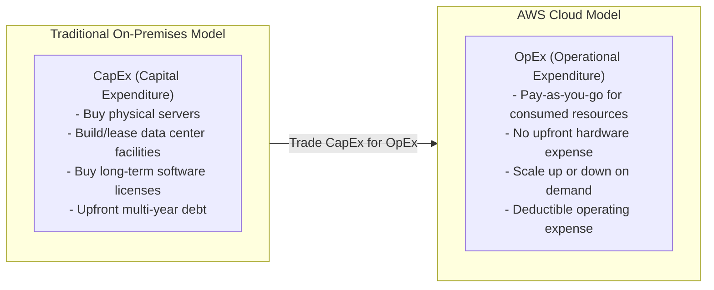
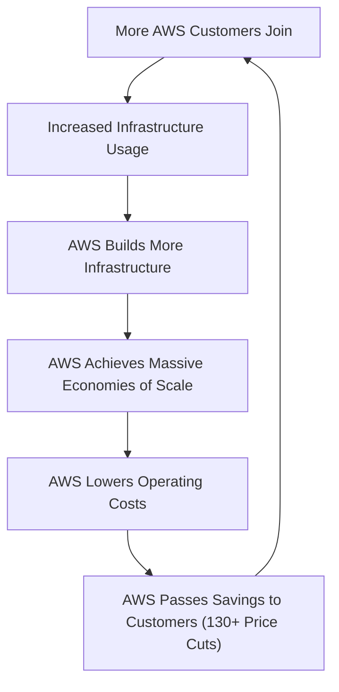
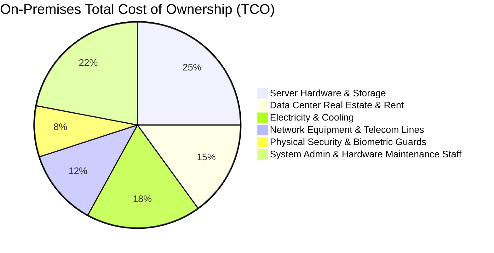
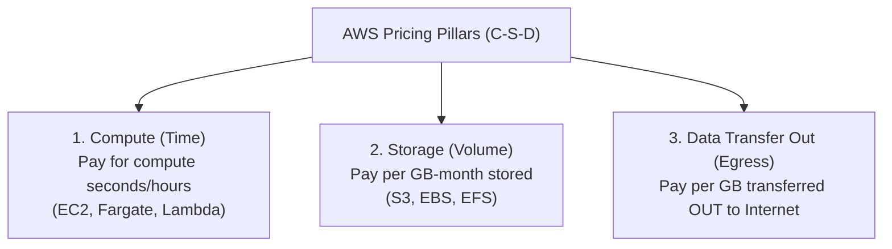

# Cloud Economics and AWS Pricing Principles

> **Knowledge Area:** Cloud Concepts (Domain 1.4) & Billing and Pricing (Domain 4.1)  
> **Relevant Certifications:** [CLF-C02](../../01_Syllabus/CLF-C02_Master_Blueprint.md), SAA-C03  
> **Tags:** `#aws/economics` `#aws/billing` `#clf-c02`

---

## 🧠 60-Second Memory Cheat Card (Memorize This First!)

### 1. CapEx vs. OpEx — 1-Line Analogy
- **CapEx** (*On-Premises*) = **Buying a house** — huge upfront cash, locked in for years, depreciated over 3–7 years.
- **OpEx** (*AWS Cloud*) = **Renting / paying an electric bill** — pay monthly only for what you use, stop anytime.

### 2. The 3 AWS Pricing Pillars — Mnemonic: **`C-S-D`** (*"Cloud Spending Drivers"*)
- **C**ompute *(pay by time: seconds/hours)*
- **S**torage *(pay by volume: GB-month)*
- **D**ata Transfer **OUT** *(pay per GB leaving AWS to the Internet)*

### 3. Data Transfer Golden Rule — **"FREE IN · FREE SAME-AZ · PAY TO CROSS OR LEAVE"**
- **Internet → AWS (Inbound):** **\$0 (ALWAYS FREE)**
- **Same Region + Same AZ:** **\$0 (FREE)**
- **Cross-AZ (same Region):** **Small fee** (~\$0.01/GB)
- **Cross-Region:** **Paid**
- **AWS → Internet (Outbound / Egress):** **Paid** *(tiered — cheaper per GB as volume grows)*

### 4. Four Ways AWS Pricing Saves You Money
1. **Pay-as-you-go** *(No upfront commitment — On-Demand)*
2. **Save when you reserve** *(1-yr or 3-yr Reserved Instances / Savings Plans — up to 72% off)*
3. **Pay less by using more** *(Volume-based tiered discounts on S3 & Data Transfer Out)*
4. **Pay less as AWS grows** *(Massive Economies of Scale → 130+ price reductions)*

### 5. Software Licensing — 1-Line Rule
- **License Included** = *Rent the car WITH insurance* (AWS bundles Windows/SQL license into the hourly price).
- **BYOL (Bring Your Own License)** = *Use your existing insurance* (Reuse on-prem enterprise licenses on **EC2 Dedicated Hosts** + track with **AWS License Manager**).

---

## 1. Fundamental Financial Shift: CapEx vs. OpEx

Cloud computing transforms corporate finance by shifting IT spending from upfront capital investments to ongoing operational expenses:

| Dimension | Capital Expenditure (CapEx) | Operational Expenditure (OpEx) |
|---|---|---|
| **Analogy** | Buying a building | Paying a utility bill |
| **Payment Timing** | Heavy upfront payment before any business value is realized. | Pay as you consume; billed monthly based on usage. |
| **Capacity Risk** | High: Risk of over-provisioning (wasted money) or under-provisioning (crashed sites). | Zero: Scale compute resources in real time to match exact demand. |
| **Tax Treatment** | Depreciated as an asset over 3 to 7 years. | Fully deductible operating expense in the current tax year. |
| **Commitment** | Locked into physical hardware for years. | Terminate resources anytime with zero lingering penalties. |

---

## 2. Economies of Scale & The AWS Virtuous Cycle

Because AWS aggregates the usage of millions of customers globally, it achieves massive economies of scale that no single company can replicate.

* **Memory Hook:** *More Customers → More Volume → Lower AWS Cost → Lower Customer Prices → Repeat.*

---

## 3. Total Cost of Ownership (TCO): Direct vs. Indirect Costs

When comparing on-premises IT costs with AWS Cloud costs, remember that **server hardware is only ~25%** of the real bill — the other **75% is hidden overhead**!

### On-Premises Hidden Costs Eliminated by AWS — Mnemonic: **`F-E-O-S`** (*"Facilities, Electricity, Ops, Staff"*)
1. **F — Facility Costs:** Land, building lease, fire suppression, diesel generators, UPS batteries.
2. **E — Environmental Costs:** Electricity bills and heavy HVAC cooling.
3. **O — Operational Overhead (Undifferentiated Heavy Lifting):** Racking servers, cabling, replacing failed disks, firmware swaps.
4. **S — Staffing:** 24/7 physical security guards and on-site facility technicians.

---

## 4. AWS 3 Fundamental Pricing Pillars (`C-S-D`)

Across all AWS services, pricing adheres to three core charging rules:

### Data Transfer Rules Cheat Table (*"FREE IN · FREE SAME-AZ · PAY TO CROSS OR LEAVE"*)

| Traffic Direction | Cost? | Exam Note |
| :--- | :---: | :--- |
| **Internet → AWS (Inbound)** | **FREE (\$0)** | Uploading 50 TB to S3 from on-prem costs \$0 in transfer fees. |
| **Same Region + Same AZ** | **FREE (\$0)** | Generally free between AWS services in the same AZ. |
| **Cross-AZ (Same Region)** | **Paid (small)** | ~\$0.01/GB each way (trade-off for Multi-AZ high availability). |
| **Cross-Region** | **Paid** | Standard inter-region data transfer rates apply. |
| **AWS → Internet (Outbound)** | **Paid (tiered)** | Aggregated across services; per-GB price drops as volume rises. |

---

## 5. Software Licensing in the Cloud

| Licensing Model | Memory Hook | Best For | Supported Services |
|---|---|---|---|
| **License Included** | *All-in-one rental* — license bundled into AWS hourly/secondly rate | New workloads, auto-scaling fleets, dev/test | Amazon EC2, Amazon RDS |
| **Bring Your Own License (BYOL)** | *Bring your existing contract* — reuse on-prem Microsoft/Oracle/SAP licenses | Enterprises with existing Software Assurance / per-core licenses | Amazon EC2 (**Dedicated Hosts** / Dedicated Instances), **AWS License Manager** |

* **AWS License Manager:** Centrally tracks and enforces software license rules (Microsoft, SAP, Oracle, IBM) across AWS and on-premises to prevent compliance fines.

---

## 6. Exam Trap-Busters: Easily Confused Economics & Billing Concepts

| Confused Pair | Exact Tie-Breaker |
| :--- | :--- |
| **Data Transfer IN** vs. **Data Transfer OUT** | **IN** to AWS = **FREE**. **OUT** to Internet = **PAID** (tiered). |
| **Dedicated Hosts** vs. **Dedicated Instances** (BYOL) | Need visibility into **physical sockets & cores** for strict per-socket/per-core BYOL? Pick **Dedicated Hosts**. |
| **AWS Pricing Calculator** vs. **Cost Explorer** vs. **AWS Budgets** | Estimate **before** deploying = **Pricing Calculator**. Analyze **past/current** spend & forecast = **Cost Explorer**. Send **alerts** when spend crosses a threshold = **AWS Budgets**. |
| **Pay less by using more** vs. **Pay less as AWS grows** | **Using more** = *Your* volume tiered discounts (e.g., S3 TB tiers). **AWS grows** = *AWS's* economies of scale causing global price cuts. |

---

## 7. Exam Tip Matrix

| Question Scenario | Correct Financial Concept |
|---|---|
| *"Trading large upfront hardware expenditures for low, variable monthly costs"* | **Trading CapEx for OpEx** |
| *"Why can AWS offer lower prices than a private on-premises data center?"* | **Massive Economies of Scale** |
| *"Customer wants to migrate existing Microsoft SQL Server licenses to EC2 to reduce costs"* | **Bring Your Own License (BYOL)** via **Dedicated Hosts** & **AWS License Manager** |
| *"Is there a charge for uploading 50 TB of data from an on-prem server to Amazon S3?"* | **No (Inbound Data Transfer into AWS is always free)** |
| *"Which costs are included in on-prem TCO that are eliminated when moving to AWS?"* | **Power, cooling, data center real estate, and hardware maintenance (`F-E-O-S`)** |

---

## 8. Active Recall Flashcards (Test Yourself!)

<b>Q1: What are the 3 fundamental AWS Pricing Pillars (C-S-D)?</b>

**Compute** (time), **Storage** (GB-month volume), and **Data Transfer Out** (egress to the Internet).

<b>Q2: A company uploads 100 TB of video files from its office into Amazon S3. What is the data transfer charge?</b>

**\$0.00** — Inbound data transfer from the Internet into AWS is always **FREE**.

<b>Q3: Does transferring data across two Availability Zones in the same Region incur a fee?</b>

**Yes** — Cross-AZ transfer incurs a small fee (~\$0.01/GB). Same-Region, Same-AZ transfer is generally free.

<b>Q4: Which EC2 tenancy option is required for strict per-socket or per-core BYOL licensing?</b>

**Amazon EC2 Dedicated Hosts** (paired with **AWS License Manager** to track compliance).

<b>Q5: What is the difference between CapEx and OpEx?</b>

**CapEx** = large upfront capital purchase (buying servers/data centers, depreciated over years). **OpEx** = pay-as-you-go operational expense (monthly AWS bill based on actual usage).

<b>Q6: Why has AWS lowered its prices over 130 times since launch?</b>

**Economies of Scale** (the AWS Virtuous Cycle: more customers → higher volume → lower AWS infrastructure costs → savings passed to customers).

<b>Q7: You want to estimate monthly AWS costs BEFORE creating an AWS account. Which tool do you use?</b>

**AWS Pricing Calculator** (Cost Explorer and Budgets only work for active accounts with usage).

