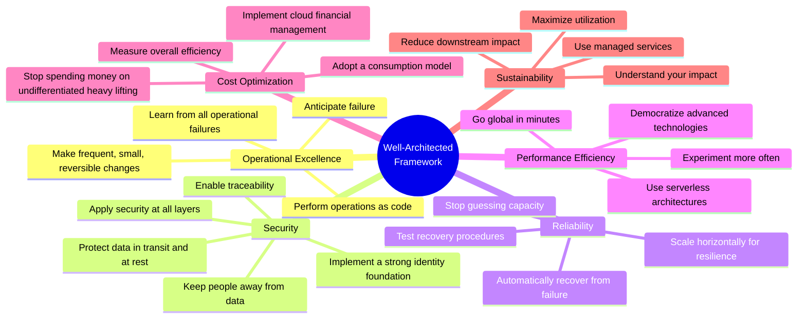
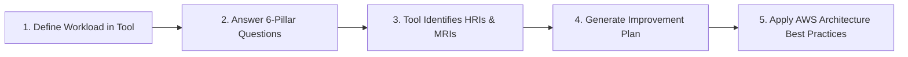

# AWS Well-Architected Framework

> **Knowledge Area:** Cloud Concepts (Domain 1.2)  
> **Relevant Certifications:** [CLF-C02](../../01_Syllabus/CLF-C02_Master_Blueprint.md), SAA-C03, SAP-C02  
> **Tags:** `#aws/concepts` `#aws/architecture` `#clf-c02`

---

## 🧠 60-Second Memory Cheat Card (Memorize This First!)

### 1. The 6 Pillars — Mnemonic: **`C-R-O-P-S-S`** (*"Healthy Cloud CROPS + Sustainability"*)

| Letter | Pillar | 3-Word Memory Hook | Real-World Analogy |
| :---: | :--- | :--- | :--- |
| **C** | **Cost Optimization** | *Spend less money* | Turning off lights when you leave a room |
| **R** | **Reliability** | *Recover from failure* | Backup generator + spare tire |
| **O** | **Operational Excellence** | *Run & improve smoothly* | Pilot checklist + post-flight review |
| **P** | **Performance Efficiency** | *Fast, right-sized tech* | Tuning a sports car engine for the track |
| **S** | **Security** | *Lock everything down* | Bank vault with cameras, guards, and keys |
| **S** | **Sustainability** | *Go green, save energy* | Driving an EV instead of a gas guzzler |

### 2. The 6 General Design Principles — Mnemonic: **`S-T-A-E-D-G`** (*"Stop Testing? Always Evolve Data Games"*)

- **S** — **S**top guessing capacity
- **T** — **T**est systems at production scale
- **A** — **A**utomate to make experimentation easier
- **E** — Allow for **E**volutionary architectures
- **D** — **D**rive architectures using data
- **G** — Improve through **G**ame days

---

## 1. Overview of the Well-Architected Framework

The **AWS Well-Architected Framework** provides a consistent approach for cloud architects to evaluate architectures and implement scalable, secure, high-performing, resilient, and cost-effective cloud designs.

It is structured around **6 Pillars** and supported by the free **AWS Well-Architected Tool** in the AWS Management Console.

---

## 2. General Design Principles (Across All Pillars)

Remember **`S-T-A-E-D-G`**:

1. **Stop guessing your capacity needs:** Eliminate upfront guesswork by scaling dynamically with Auto Scaling and serverless services.
2. **Test systems at production scale:** Spin up a production-sized environment, test its performance and failover, and terminate it immediately — paying only for the hours used.
3. **Automate to make architectural experimentation easier:** Use Infrastructure as Code (AWS CloudFormation / CDK) to automate deployments and track changes.
4. **Allow for evolutionary architectures:** Let architectures evolve over time as new AWS services emerge without painful full rewrites.
5. **Drive architectures using data:** Collect and analyze CloudWatch metrics and CloudTrail audit data to make evidence-based decisions.
6. **Improve through game days:** Regularly simulate outages, failovers, and security breaches to train teams and validate runbooks.

---

## 3. Deep-Dive into the 6 Pillars (With Memory Hooks)

### Pillar 1: Operational Excellence
> **Memory Hook:** *"Code it, change small, expect failure, learn from it."*  
> **Principle Mnemonic — `C-S-R-A-L` (*"Careful SREs Runbooks Always Learn"*):** **C**ode · **S**mall changes · **R**efine runbooks · **A**nticipate failure · **L**earn from failures

* **Core Focus:** Running and monitoring systems to deliver business value and continually improving processes and procedures.
* **Key Design Principles:**
  - *Perform operations as **C**ode:* Define infrastructure and operational runbooks using software templates (CloudFormation).
  - *Make frequent, **S**mall, reversible changes:* Deploy small incremental updates that roll back cleanly if errors occur.
  - ***R**efine operations procedures frequently:* Continuously update runbooks and playbooks as systems evolve.
  - ***A**nticipate failure:* Conduct "pre-mortem" exercises and game days to test response procedures before real incidents.
  - ***L**earn from all operational failures:* Run root cause analysis (RCA) and share lessons across teams.
* **Key Services:** AWS CloudFormation, AWS Systems Manager, Amazon CloudWatch, AWS Config.

---

### Pillar 2: Security
> **Memory Hook:** *"Strong ID, log everything, lock every layer, encrypt, keep humans out."*  
> **Principle Mnemonic — `I-T-L-A-E-K-P` (*"I Trust Locks And Encryption, Keep Prepared"*):** **I**dentity · **T**raceability · **L**ayers · **A**utomate · **E**ncrypt · **K**eep people away · **P**repare for events

* **Core Focus:** Protecting information, systems, and assets while delivering business value through risk assessments and mitigation strategies.
* **Key Design Principles:**
  - *Implement a strong **I**dentity foundation:* Enforce least privilege, MFA, and centralized identity management (IAM Identity Center).
  - *Enable **T**raceability:* Log, monitor, and alert on all API requests and config changes in real time (CloudTrail).
  - *Apply security at all **L**ayers (Defense in Depth):* Secure edge, VPC, subnets, OS, and application layers.
  - ***A**utomate security best practices:* Auto-remediate non-compliant resources with EventBridge + Lambda.
  - *Protect data (**E**ncrypt) in transit and at rest:* Use AWS KMS and TLS certificates.
  - ***K**eep people away from data:* Use automated pipelines and temporary credentials instead of manual access.
  - ***P**repare for security events:* Maintain an incident response plan and run security game days.
* **Key Services:** AWS IAM, AWS KMS, AWS Secrets Manager, AWS Shield, AWS WAF, Amazon GuardDuty, AWS Security Hub, Amazon Inspector, AWS CloudTrail.

---

### Pillar 3: Reliability
> **Memory Hook:** *"Auto-heal, test failover, scale wide, never guess, automate change."*  
> **Principle Mnemonic — `A-T-S-S-M` (*"Always Test Scaling Systems Mechanically"*):** **A**uto-recover · **T**est recovery · **S**cale horizontally · **S**top guessing · **M**anage change in automation

* **Core Focus:** Ensuring a workload performs its intended function correctly and consistently when expected, and quickly recovering from failures.
* **Key Design Principles:**
  - ***A**utomatically recover from failure:* Monitor KPIs and trigger automated replacement or failover (Auto Scaling, Route 53 health checks).
  - ***T**est recovery procedures:* Simulate failures to validate recovery before an actual outage occurs.
  - ***S**cale horizontally to increase aggregate workload availability:* Replace one large resource with multiple smaller ones across Multi-AZs to shrink blast radius.
  - ***S**top guessing capacity:* Automatically scale out/in to prevent resource exhaustion.
  - ***M**anage change in automation:* Apply changes via CI/CD pipelines and IaC rather than manual console edits.
* **Key Services:** AWS Auto Scaling, Elastic Load Balancing (ELB), Amazon Route 53, AWS Backup, Amazon S3 (99.999999999% durability), AWS CloudWatch.

---

### Pillar 4: Performance Efficiency
> **Memory Hook:** *"Managed tech, go global, go serverless, experiment, mechanical sympathy."*  
> **Principle Mnemonic — `D-G-S-E-M` (*"Don't Guess — Serverless Enables Max-speed"*):** **D**emocratize tech · **G**o global · **S**erverless · **E**xperiment · **M**echanical sympathy

* **Core Focus:** Using computing resources efficiently to meet system requirements and maintaining that efficiency as demand changes and technologies evolve.
* **Key Design Principles:**
  - ***D**emocratize advanced technologies:* Consume complex tech (AI/ML, databases) as managed services (SageMaker, RDS) instead of building expertise from scratch.
  - ***G**o global in minutes:* Deploy across multiple Regions and Edge Locations (CloudFront) for low latency worldwide.
  - *Use **S**erverless architectures:* Eliminate server management overhead for compute, storage, and databases (Lambda, Fargate).
  - ***E**xperiment more often:* Rapidly benchmark different instance families, storage tiers, and architectures.
  - *Consider **M**echanical sympathy:* Pick the technology best matched to the workload (e.g., memory-optimized EC2 for in-memory DBs, NoSQL for key-value).
* **Key Services:** AWS Lambda, AWS Fargate, Amazon CloudFront, Amazon ElastiCache, AWS Auto Scaling, AWS Compute Optimizer.

---

### Pillar 5: Cost Optimization
> **Memory Hook:** *"FinOps, pay-per-use, measure output, skip heavy lifting, tag spend."*  
> **Principle Mnemonic — `F-C-M-U-A` (*"FinOps Cuts Money Using Attribution"*):** **F**inOps · **C**onsumption model · **M**easure efficiency · **U**ndifferentiated heavy lifting · **A**nalyze & attribute

* **Core Focus:** Avoiding unnecessary costs and delivering business value at the lowest possible price point.
* **Key Design Principles:**
  - *Implement Cloud **F**inancial Management (FinOps):* Build cost visibility and accountability across teams.
  - *Adopt a **C**onsumption model:* Pay only for what you use; stop dev/test instances outside work hours.
  - ***M**easure overall efficiency:* Compare business output against cloud spend.
  - *Stop spending money on **U**ndifferentiated heavy lifting:* Let AWS run data centers, power, cooling, and hardware maintenance.
  - ***A**nalyze and attribute expenditure:* Tag resources (`CostCenter`, `Project`) to trace spend to exact teams.
* **Key Services:** AWS Cost Explorer, AWS Budgets, AWS Compute Optimizer, Savings Plans, Amazon EC2 Spot Instances, AWS Trusted Advisor.

---

### Pillar 6: Sustainability
> **Memory Hook:** *"Measure carbon, set goals, maximize utilization, Graviton, managed services, shrink downstream."*  
> **Principle Mnemonic — `U-G-M-H-M-D` (*"U Go Make Hardware More Decent"*):** **U**nderstand impact · **G**oals · **M**aximize utilization · Efficient **H**ardware (Graviton) · **M**anaged services · Reduce **D**ownstream

* **Core Focus:** Minimizing the environmental impacts of running cloud workloads, focusing on energy consumption and efficiency.
* **Key Design Principles:**
  - ***U**nderstand your impact:* Measure energy use and greenhouse gas emissions (Customer Carbon Footprint Tool).
  - *Establish sustainability **G**oals:* Set long-term carbon reduction targets.
  - ***M**aximize utilization:* Right-size instances and eliminate idle capacity so no electricity is wasted.
  - *Adopt efficient **H**ardware & software:* Use **AWS Graviton** processors (up to 60% less energy for the same performance).
  - *Use **M**anaged services:* Shared multi-tenant services (S3, Lambda) spread environmental overhead across millions of customers.
  - *Reduce **D**ownstream impact:* Minimize data/compute required on end-user devices (compress images, optimize payloads).
* **Key Services:** AWS Customer Carbon Footprint Tool, AWS Graviton processors, AWS Compute Optimizer.

---

## 4. The AWS Well-Architected Tool

The **AWS Well-Architected Tool** is a **free** self-service tool in the AWS Management Console that lets you:
1. Define your workload.
2. Answer interactive 6-Pillar review questions.
3. Get a report flagging **High-Risk Issues (HRIs)** and **Medium-Risk Issues (MRIs)**.
4. Follow a customized **Improvement Plan**.

---

## 5. Exam Trap-Busters: Commonly Confused Pillars

These 4 pairs cause the majority of mistakes on CLF-C02 — memorize the exact tie-breaker:

| Confused Pair | Pick the FIRST Pillar When the Question Says... | Pick the SECOND Pillar When the Question Says... |
| :--- | :--- | :--- |
| **Operational Excellence** vs. **Reliability** | *Runbooks, IaC deployments, small reversible changes, post-incident RCA, continuous improvement* | *Multi-AZ failover, auto-replacing failed instances, backups, recovery testing, high availability* |
| **Cost Optimization** vs. **Sustainability** | *Lower AWS bill, ROI, Savings Plans, Spot, cost allocation tags, stopping idle dev servers to save money* | *Carbon footprint, energy efficiency, AWS Graviton, environmental impact, downstream device energy* |
| **Reliability** vs. **Performance Efficiency** | *Auto Scaling to survive failures or traffic spikes without crashing* | *Serverless, caching (ElastiCache), CloudFront low latency, right instance family (mechanical sympathy)* |
| **Security** vs. **Operational Excellence** | *CloudTrail audit logs (enable traceability), IAM least privilege, MFA, KMS encryption, WAF/Shield* | *CloudWatch operational dashboards, Systems Manager automation, Config operational compliance* |

---

## 6. Exam Tip Matrix: Identifying Pillars from Question Scenarios

| Question Scenario Keyword / Action | Associated Pillar |
|---|---|
| *"Performing root-cause analysis after an outage"* | **Operational Excellence** |
| *"Defining infrastructure as code using AWS CloudFormation"* | **Operational Excellence** |
| *"Encrypting sensitive medical records in Amazon S3 at rest"* | **Security** |
| *"Enforcing Multi-Factor Authentication (MFA) on root user"* | **Security** |
| *"Deploying an application across multiple Availability Zones"* | **Reliability** |
| *"Automatically replacing unhealthy EC2 instances with Auto Scaling"* | **Reliability** |
| *"Migrating from self-managed servers to serverless AWS Lambda"* | **Performance Efficiency** |
| *"Caching database queries in Amazon ElastiCache"* | **Performance Efficiency** |
| *"Tagging resources to track departmental spending"* | **Cost Optimization** |
| *"Purchasing Compute Savings Plans for predictable workloads"* | **Cost Optimization** |
| *"Selecting AWS Graviton3 instances to lower carbon emissions"* | **Sustainability** |
| *"Setting up S3 Lifecycle rules to delete unneeded test datasets"* | **Sustainability** & **Cost Optimization** |

---

## 7. Active Recall Flashcards (Test Yourself!)

Cover the answers and try to answer each in under 5 seconds before expanding:

<b>Q1: What does C-R-O-P-S-S stand for?</b>

**Cost Optimization, Reliability, Operational Excellence, Performance Efficiency, Security, Sustainability.**

<b>Q2: "Democratize advanced technologies" and "Consider mechanical sympathy" belong to which pillar?</b>

**Performance Efficiency** (`D-G-S-E-M`).

<b>Q3: "Make frequent, small, reversible changes" and "Learn from all operational failures" belong to which pillar?</b>

**Operational Excellence** (`C-S-R-A-L`).

<b>Q4: "Enable traceability" (using AWS CloudTrail) belongs to which pillar?</b>

**Security** (`I-T-L-A-E-K-P`).

<b>Q5: "Scale horizontally to increase aggregate workload availability" belongs to which pillar?</b>

**Reliability** (`A-T-S-S-M`).

<b>Q6: "Stop spending money on undifferentiated heavy lifting" belongs to which pillar?</b>

**Cost Optimization** (`F-C-M-U-A`).

<b>Q7: Migrating to AWS Graviton processors to reduce energy use belongs to which pillar?</b>

**Sustainability** (`U-G-M-H-M-D`).

<b>Q8: What is the AWS Well-Architected Tool, how much does it cost, and what does it output?</b>

A **free** self-service console tool that reviews workloads against the 6 pillars and outputs **High-Risk Issues (HRIs)**, **Medium-Risk Issues (MRIs)**, and an **Improvement Plan**.

