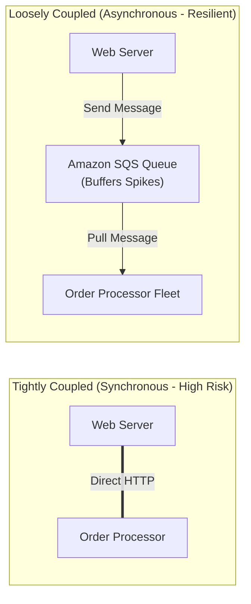
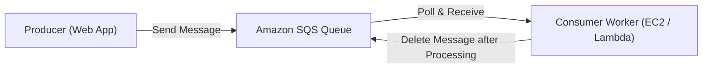
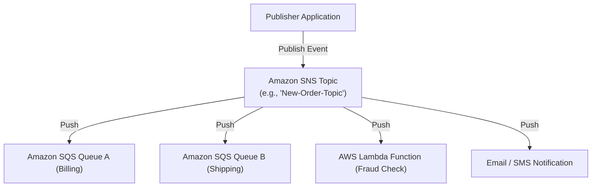
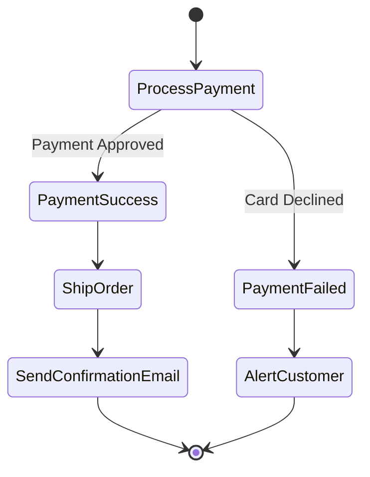

# Application Integration: SQS, SNS, EventBridge & Step Functions

> **Service Category:** Application Integration & Messaging  
> **Relevant Certifications:** [CLF-C02](../../../01_Syllabus/CLF-C02_Master_Blueprint.md), SAA-C03, DVA-C02  
> **Tags:** `#aws/services` `#aws/integration` `#clf-c02`

---

## 1. Core Principle: Decoupling and Loose Coupling

In monolithic architectures, tightly coupled components fail together when a single dependency crashes. In cloud-native architectures, applications are **loosely coupled** using messaging queues and event brokers so that components operate and scale independently:

---

## 2. Amazon SQS (Simple Queue Service)

* **What it is:** A fully managed message queuing service that enables you to decouple and scale microservices, distributed systems, and serverless applications.
* **Mechanism:** **Pull-based (Polling)**. Consumers (EC2, Lambda) periodically poll the queue to retrieve and process messages.

### Standard Queue vs. FIFO Queue:

| Feature | Standard Queue | FIFO (First-In, First-Out) Queue |
|---|---|---|
| **Message Ordering** | **Best-effort ordering** (messages might occasionally arrive out of order). | **Strict order preserved** (first in is guaranteed first out). |
| **Delivery Guarantee**| **At-least-once delivery** (occasional duplicate messages). | **Exactly-once processing** (no duplicates). |
| **Throughput** | **Unlimited** transactions per second. | High (up to 3,000 messages/sec with batching). |
| **Queue Name Suffix** | Custom name (e.g., `orders-queue`) | **Must end in `.fifo`** (e.g., `orders-queue.fifo`) |
| **Best Used For** | High-volume logging, decoupling background email tasks. | Financial transactions, inventory updates, ticket reservations. |

* **Dead-Letter Queue (DLQ):** An auxiliary SQS queue used to isolate messages that cannot be processed successfully after maximum retry attempts for debugging.

---

## 3. Amazon SNS (Simple Notification Service)

* **What it is:** A fully managed **Publish/Subscribe (Pub/Sub)** messaging service for high-throughput, push-based, many-to-many messaging.
* **Mechanism:** **Push-based**. When a message is published to an SNS Topic, SNS immediately fans out and pushes the message to all subscribed endpoints.

### SQS vs. SNS Comparison:

| Feature | Amazon SQS | Amazon SNS |
|---|---|---|
| **Communication Model** | **1-to-1 (Point-to-Point)** | **1-to-Many (Fan-Out Pub/Sub)** |
| **Delivery Method** | **Pull / Polling** (Consumer requests messages) | **Push** (SNS automatically delivers to subscribers) |
| **Data Persistence** | Messages persist in queue up to **14 days** until deleted by consumer. | Ephemeral; if no subscribers exist, messages are discarded. |

---

## 4. Amazon EventBridge (Serverless Event Bus)

* **What it is:** A serverless event bus service that makes it easy to connect applications using data from your own apps, integrated Software-as-a-Service (SaaS) applications (Zendesk, Datadog, Salesforce), and AWS services.
* **How it Works:** Ingests events, evaluates real-time rules, and routes the events to target services (Lambda, SQS, SNS, Step Functions).
* **Scheduled Cron Events:** Replaces traditional OS cron jobs to trigger automated maintenance scripts at scheduled intervals.

---

## 5. AWS Step Functions (Visual Serverless Workflows)

* **What it is:** A visual low-code workflow orchestration service (State Machine) used to coordinate multiple AWS services (Lambda, Batch, DynamoDB, SNS) into multi-step business logic workflows.
* **Features:**
  - Built-in error handling, conditional branching, retries, and timeouts.
  - Long-running workflows can run for up to **1 full year**.

---

## 6. Exam Tip Matrix

| Question Scenario | Correct Integration Service |
|---|---|
| *"Buffer incoming order requests between a web tier and backend database to prevent database overload"* | **Amazon SQS** |
| *"Send a single event notification simultaneously to multiple systems (fan-out pattern: email, billing queue, fraud Lambda)"* | **Amazon SNS** |
| *"Strict order of financial transaction messages must be preserved without any duplicates"* | **Amazon SQS FIFO Queue** |
| *"Coordinate a complex multi-step serverless order checkout process with conditional branching and error retries"* | **AWS Step Functions** |
| *"Trigger an automated Lambda function every night at 1:00 AM using a scheduled rule"* | **Amazon EventBridge** |
