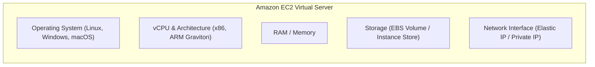
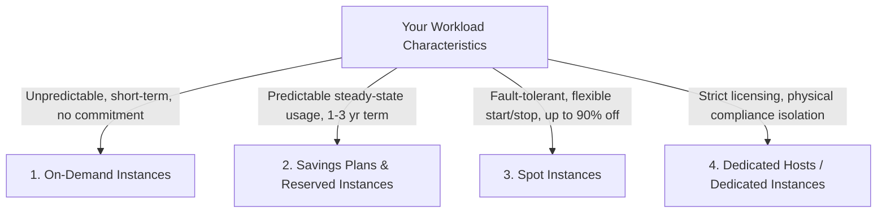
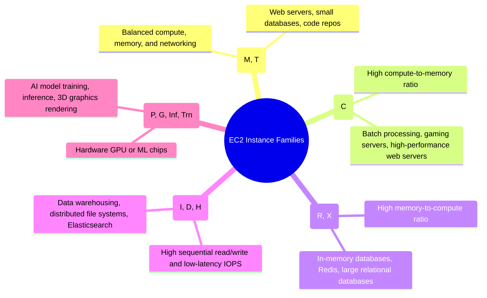
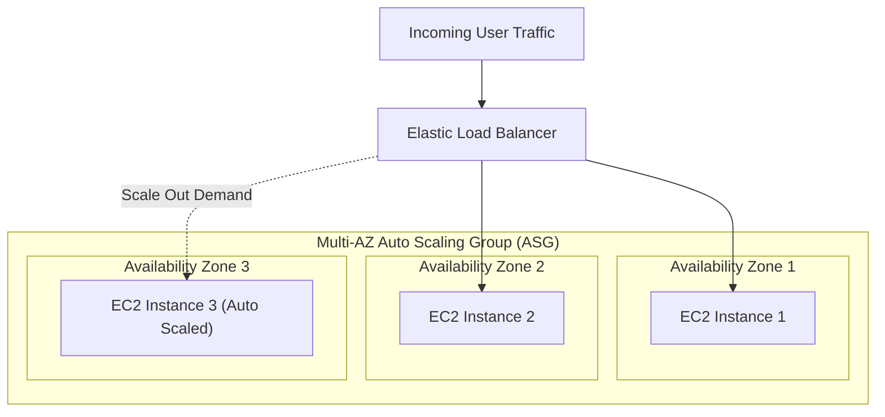

# Amazon EC2 (Elastic Compute Cloud)

> **Service Category:** Compute (IaaS)  
> **Relevant Certifications:** [CLF-C02](../../../01_Syllabus/CLF-C02_Master_Blueprint.md), SAA-C03, DVA-C02, SOA-C02  
> **Tags:** `#aws/services` `#aws/compute` `#clf-c02`

---

## 1. What is Amazon EC2?

**Amazon Elastic Compute Cloud (Amazon EC2)** is a web service that provides resizable, secure compute capacity in the cloud. It represents **Infrastructure as a Service (IaaS)**, giving customers complete control over virtual computing environments (instances).

---

## 2. EC2 Purchasing Options & Pricing Models (Heavily Tested!)

Choosing the right purchasing option is one of the most tested areas on the CLF-C02 exam.

| Purchasing Option | Commitment | Discount | Ideal Workload & Scenario |
|---|---|---|---|
| **On-Demand** | None (Pay by second/hour) | Baseline (0%) | Short-term, irregular, spiky workloads; application development/testing; apps being deployed to AWS for the very first time. |
| **Savings Plans** | 1 or 3 Years (Commit to \$/hour) | **Up to 72%** | Steady-state compute across EC2, Fargate, and Lambda. Maximum flexibility across families, sizes, and regions. |
| **Reserved Instances (RI)** | 1 or 3 Years (Commit to specific instance/AZ) | **Up to 72%** | Steady-state, predictable 24/7 workloads. Offers optional **Capacity Reservations** in a specific Availability Zone. |
| **Spot Instances** | None (AWS can reclaim with 2-minute notice) | **Up to 90%** | Fault-tolerant, stateless, batch processing, background video rendering, scientific modeling, distributed CI/CD builds. **Never for production databases!** |
| **Dedicated Hosts** | 1 or 3 Years or On-Demand | Premium | Physical server fully dedicated to your use. Required for regulatory compliance forbidding multi-tenant virtualization, or server-bound software licenses (BYOL). |
| **Dedicated Instances** | None or Term | Premium | Instances running on hardware dedicated to a single customer, but cannot control server socket/core placement like Dedicated Hosts. |

### Reserved Instance (RI) Types:
1. **Standard RI:** Highest discount (up to 72%), but cannot change instance family or OS.
2. **Convertible RI:** Moderate discount (up to 54%), allows changing instance family, OS, and tenancy during the term.
3. **Scheduled RI:** Reserved for specific recurring windows (e.g., every Thursday night or end-of-month).

---

## 3. EC2 Instance Families

AWS names instances using a structured convention (e.g., `m7g.large`):
* `m` = Instance Family (General Purpose)
* `7` = Generation (7th generation)
* `g` = Processor Architecture (`g` denotes AWS Graviton ARM processor)
* `large` = Size (determines vCPU, RAM, bandwidth)

> [!TIP]
> **Exam Mnemonic:**
> * **T / M:** **T**ypical / **M**edium (General Purpose)
> * **C:** **C**ompute (Compute Optimized)
> * **R:** **R**AM (Memory Optimized)
> * **I / D:** **I**nput/Output / **D**isk (Storage Optimized)
> * **P / G:** **P**hotos / **G**raphics / GPU (Accelerated Computing)

---

## 4. Elasticity & High Availability: ELB + Auto Scaling

To build reliable and fault-tolerant architectures, EC2 instances are paired with **Elastic Load Balancing (ELB)** and **EC2 Auto Scaling**:

* **Elastic Load Balancing (ELB):** Automatically distributes incoming application traffic across multiple targets (EC2 instances, containers, IP addresses) across multiple Availability Zones.
  - *Application Load Balancer (ALB):* Layer 7 (HTTP/HTTPS), path-based and host-based routing.
  - *Network Load Balancer (NLB):* Layer 4 (TCP/UDP), ultra-high performance, millions of requests per second with ultra-low latency.
* **EC2 Auto Scaling:** Automatically monitors workloads and adds (scales out) or removes (scales in) EC2 instances to maintain performance at the lowest possible cost.

---

## 5. Exam Tip Matrix

| Question Scenario | Correct Option / Choice |
|---|---|
| *"Batch processing job that can be interrupted at any time without data loss; needs lowest cost"* | **EC2 Spot Instances** |
| *"Predictable, continuous 24/7 database running for the next 3 years"* | **Reserved Instances (RI)** or **Compute Savings Plans** |
| *"Company deploying an unpredictable test workload for 2 weeks"* | **On-Demand Instances** |
| *"Regulatory requirement that instances must NOT share physical hardware with any other customer"* | **Dedicated Hosts** (or Dedicated Instances) |
| *"Customer has existing per-socket Microsoft licenses they want to bring to AWS (BYOL)"* | **Dedicated Hosts** |
