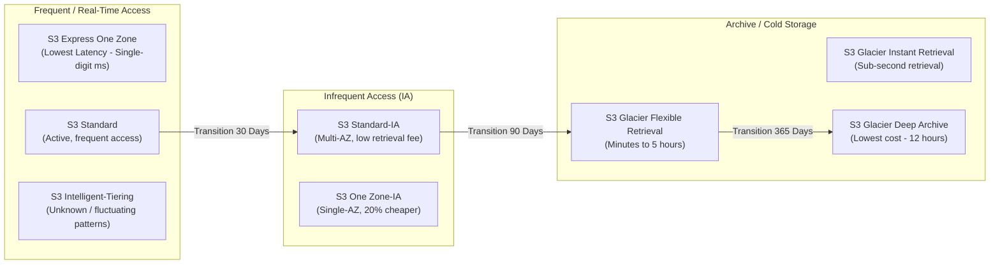
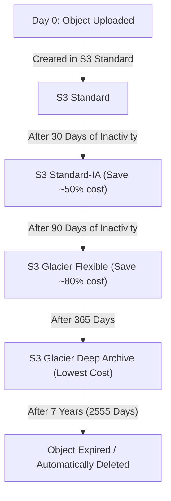

# Amazon S3 (Simple Storage Service)

> **Service Category:** Storage (Object Storage)  
> **Relevant Certifications:** [CLF-C02](../../../01_Syllabus/CLF-C02_Master_Blueprint.md), SAA-C03, DVA-C02, SOA-C02  
> **Tags:** `#aws/services` `#aws/storage` `#clf-c02`

---

## 1. What is Amazon S3?

**Amazon Simple Storage Service (Amazon S3)** is an object storage service offering industry-leading scalability, data availability, security, and performance.

### Fundamental Object Storage Concepts:
* **Buckets:** Top-level containers for storing objects. Bucket names must be **globally unique** across all AWS accounts worldwide.
* **Objects:** Files stored in buckets. Each object consists of:
  - *Data (Payload):* File size from 0 bytes up to **5 TB** maximum per object.
  - *Key:* The unique name/path assigned to the object (e.g., `photos/2026/vacation.jpg`).
  - *Metadata:* Key-value pairs describing the object (e.g., content-type, creation date).
  - *Version ID:* Used when Versioning is enabled.
* **Durability Standard:** All standard S3 storage classes provide **11 9's of data durability (99.999999999%)** across multiple Availability Zones, meaning you could store 10,000,000 objects and expect to lose one every 10,000 years!

---

## 2. S3 Storage Classes / Tiers (Heavily Tested!)

AWS provides a spectrum of storage classes designed for different access patterns and cost profiles:

| Storage Class | Availability Zones | Min Retention | Retrieval Time | Ideal Use Case |
|---|:---:|:---:|:---:|---|
| **S3 Express One Zone** | 1 AZ | None | **Single-digit ms** | High-performance AI/ML model training, financial data analysis. |
| **S3 Standard** | 3+ AZs | None | Instant (ms) | Active web assets, mobile app backends, dynamic content. |
| **S3 Intelligent-Tiering** | 3+ AZs | 30 days | Instant (ms) | **Unknown, fluctuating, or unpredictable access patterns.** Automatically moves objects between frequent and infrequent tiers without retrieval fees! |
| **S3 Standard-IA** | 3+ AZs | 30 days | Instant (ms) | Long-term backups, disaster recovery files accessed less than once a month. |
| **S3 One Zone-IA** | **1 AZ** | 30 days | Instant (ms) | Secondary non-critical backups that can be re-created if the AZ fails; 20% cheaper than Standard-IA. |
| **S3 Glacier Instant Retrieval** | 3+ AZs | 90 days | **Milliseconds** | Medical images, news media archives that are rarely accessed but need **instant retrieval**. |
| **S3 Glacier Flexible Retrieval** | 3+ AZs | 90 days | **1 min to 5 hours** | Annual compliance backups, disaster recovery archives. (Free bulk retrieval). |
| **S3 Glacier Deep Archive** | 3+ AZs | 180 days | **12 to 48 hours** | **Lowest cost storage in AWS.** 7–10 year regulatory legal retention; tape backup replacement. |

---

## 3. S3 Lifecycle Management & Automation

**S3 Lifecycle Configuration** allows you to automate the transition of objects between storage tiers and eventually expire (delete) them to minimize costs:

---

## 4. Key S3 Security & Management Features

* **S3 Block Public Access:** A centralized account-level and bucket-level guardrail enabled by default to prevent accidental public exposure of data.
* **Bucket Policies & IAM Policies:** JSON policies attached directly to S3 buckets to grant or restrict read/write access (e.g., enforce encryption, restrict access to specific IP ranges or VPC endpoints).
* **Versioning:** Preserves, retrieves, and restores every version of every object. Protects against accidental deletion or overwrite (deleting an object creates a *Delete Marker* that can be removed to restore the file).
* **MFA Delete:** Requires an MFA token code to permanently delete an object version or change bucket versioning state.
* **S3 Object Lock (WORM):** Write Once, Read Many. Prevents objects from being deleted or modified for a fixed retention period or indefinite legal hold (meets SEC Rule 17a-4 compliance).
* **Static Website Hosting:** Hosts static HTML, CSS, JavaScript, and client-side images directly from an S3 bucket without needing a web server (EC2).

---

## 5. Exam Tip Matrix

| Question Scenario | Correct S3 Storage Class / Feature |
|---|---|
| *"Store data with unknown or unpredictable access patterns with zero operational overhead"* | **S3 Intelligent-Tiering** |
| *"Lowest cost storage option in AWS for legal compliance archives that can wait 12 hours for retrieval"* | **S3 Glacier Deep Archive** |
| *"Rarely accessed archive data that must be accessible in milliseconds when requested"* | **S3 Glacier Instant Retrieval** |
| *"Secondary backup copies that can be easily recreated; customer wants lowest cost without Glacier"* | **S3 One Zone-IA** |
| *"Protect files from accidental deletion by maintaining previous revisions of every file"* | **S3 Versioning** |
| *"Host a company landing page consisting of static HTML, CSS, and client-side JavaScript"* | **Amazon S3 Static Website Hosting** |
