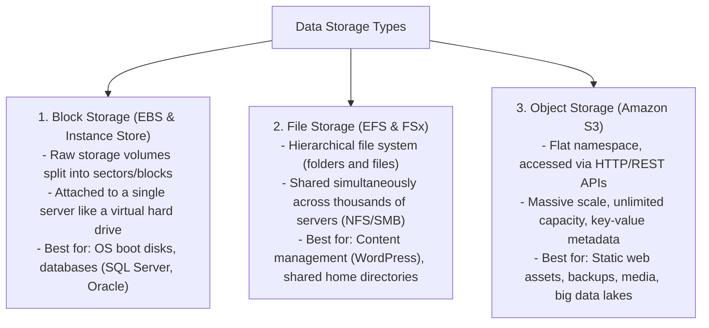
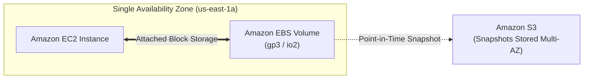
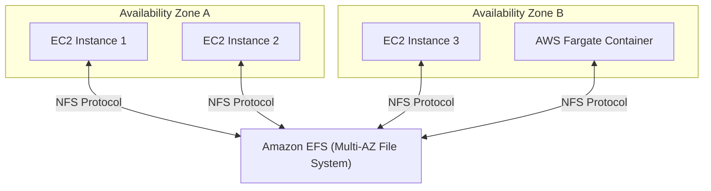
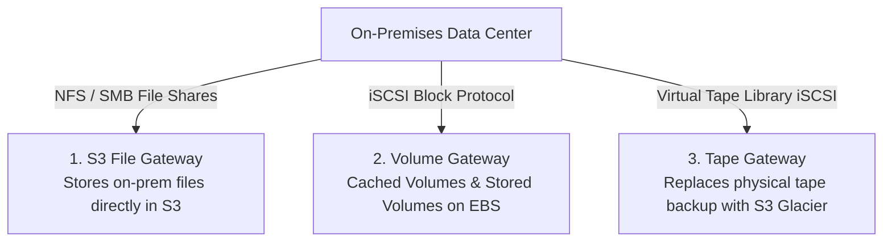

# Block & File Storage: EBS, Instance Store, EFS & Storage Gateway

> **Service Category:** Storage  
> **Relevant Certifications:** [CLF-C02](../../../01_Syllabus/CLF-C02_Master_Blueprint.md), SAA-C03, SOA-C02  
> **Tags:** `#aws/services` `#aws/storage` `#clf-c02`

---

## 1. Storage Paradigms: Block vs. File vs. Object Storage

---

## 2. Amazon Elastic Block Store (Amazon EBS)

**Amazon EBS** provides persistent block-level storage volumes for use with Amazon EC2 instances. Think of an EBS volume as a **virtual hard drive in the cloud**.

### Key EBS Characteristics:
* **AZ-Locked:** An EBS volume is created inside a specific Availability Zone and **can only be attached to an EC2 instance in that same AZ**.
* **Persistence:** Unlike the temporary EC2 instance store, EBS volume data persists independently of the instance lifecycle. If you stop or restart the EC2 instance, EBS data remains intact.
* **EBS Snapshots:** Point-in-time backups of EBS volumes backed up incrementally to **Amazon S3**. Because snapshots reside in S3, they are replicated across multiple AZs and can be used to restore new volumes in *any* AZ or Region!

### EBS Volume Types Overview:
1. **General Purpose SSD (gp2 / gp3):** Recommended default volume for most workloads (virtual desktops, test/dev environments, low-latency interactive applications).
2. **Provisioned IOPS SSD (io1 / io2 Block Express):** Highest performance, sub-millisecond latency for mission-critical I/O-intensive databases (Oracle, SAP HANA, SQL Server).
3. **Throughput Optimized HDD (st1):** Low-cost magnetic storage for frequently accessed, throughput-intensive workloads with large sequential datasets (Big Data, data warehouses, log processing). Cannot be a boot volume!
4. **Cold HDD (sc1):** Lowest cost HDD for infrequently accessed sequential workloads. Cannot be a boot volume!

---

## 3. EC2 Instance Store (Ephemeral Storage)

* **What it is:** High-performance physical solid-state drives (NVMe SSD) directly attached to the physical server hosting your EC2 instance.
* **The Catch (Ephemeral):** Instance store data is **temporary (ephemeral)**. If the EC2 instance is **stopped, terminated, or suffers a hardware failure, ALL data on the instance store is permanently lost!** (Data survives a simple OS reboot).
* **Ideal for:** Temporary caches, scratch pads, buffers, or distributed replicated databases (e.g., Elasticsearch, Cassandra clusters with multiple node replicas).

---

## 4. Amazon Elastic File System (Amazon EFS)

* **What it is:** A fully managed, serverless, elastic Network File System (NFS v4) that can be **mounted simultaneously by thousands of EC2 instances, containers, and Lambda functions** across multiple Availability Zones.

### EBS vs. EFS Comparison:

| Feature | Amazon EBS | Amazon EFS |
|---|---|---|
| **Storage Type** | Block Storage (virtual hard drive) | File Storage (shared network drive) |
| **Concurrent Access** | Attached to **1 EC2 instance** at a time (unless using io2 Multi-Attach in 1 AZ). | Mounted concurrently by **thousands of instances**. |
| **Availability Scope** | **Single Availability Zone** (AZ-locked). | **Multi-AZ** (replicated across 3+ AZs automatically). |
| **Operating System** | Linux, Windows, macOS. | Linux-based file systems (POSIX compliant). |
| **Elasticity** | Pre-provisioned capacity (e.g., allocate 100 GB). | Automatically scales up or down as you add/remove files. |

---

## 5. Amazon FSx: Specialty File Systems

When workloads require Windows compatibility or extreme high-performance computing (HPC), use **Amazon FSx**:
1. **Amazon FSx for Windows File Server:** Fully managed native Microsoft Windows file system (SMB protocol, Active Directory integration, NTFS).
2. **Amazon FSx for Lustre:** Ultra-high performance file system designed for fast processing of compute-intensive workloads (Machine Learning, High-Performance Computing HPC, financial modeling, video rendering).

---

## 6. AWS Storage Gateway (Hybrid Cloud Storage)

Connects an on-premises software appliance with cloud-based storage to provide seamless integration between on-premises environments and the AWS Cloud:

1. **S3 File Gateway:** Exposes NFS/SMB file shares on-prem backed directly by Amazon S3 objects.
2. **Volume Gateway:** Exposes block storage volumes over iSCSI to on-prem servers. (Cached mode stores primary data in S3 with frequently accessed data cached locally; Stored mode keeps all data on-prem with scheduled EBS snapshot backups).
3. **Tape Gateway:** Emulates a physical Virtual Tape Library (VTL), seamlessly replacing costly on-premises magnetic tape robots with S3 Glacier and Deep Archive.

---

## 7. Exam Tip Matrix

| Question Scenario | Correct Storage Service |
|---|---|
| *"Shared network file system that hundreds of Linux EC2 instances across multiple AZs can read and write to concurrently"* | **Amazon EFS** |
| *"Boot drive for an EC2 instance that must persist after the instance is stopped and restarted"* | **Amazon EBS** |
| *"Ultra-low latency temporary storage for video scratch buffers where data can be lost if the server stops"* | **EC2 Instance Store** (Ephemeral) |
| *"Point-in-time incremental backup of an Amazon EBS volume"* | **Amazon EBS Snapshot** (stored in S3) |
| *"Shared file storage for enterprise Windows applications requiring SMB protocol and Active Directory"* | **Amazon FSx for Windows File Server** |
| *"Replace physical on-premises magnetic tape backup hardware without modifying backup software workflows"* | **AWS Storage Gateway (Tape Gateway)** |
