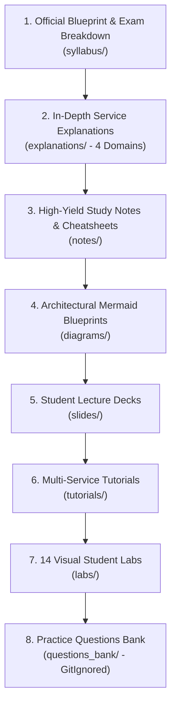

# AWS Cloud Foundation: CLF-C02 Course Portal

> **Domain / Track:** Cloud / Foundation  
> **Exam Code:** `CLF-C02` (AWS Certified Cloud Practitioner)  
> **Course Author & Lead Trainer:** Mohamed Fakhruldeen  
> **Repository Path:** `Cloud/Practitioner/CLF-C02/`  
> **Version:** 2.5.0 (Full Standalone Visual Curriculum)

---

## 🎯 Course Overview & Learning Architecture

The Cloud Foundation (CLF-C02) curriculum delivers an end-to-end, evidence-based learning journey combining theoretical rigor, architectural diagrams, multi-service tutorials, and hands-on visual labs:



---

## 📁 Directory Structure

```text
Cloud/Practitioner/CLF-C02/
├── README.md                                  <-- Master Course Portal (This File)
│
├── syllabus/                                  <-- Official Exam Blueprints & Preparation Plans
│   ├── CLF-C02_Master_Blueprint.md
│   ├── SkillBuilder_Prep_Plan.md              (AWS Official 4-Step Prep Framework)
│   ├── Domain_1_Cloud_Concepts.md
│   ├── Domain_2_Security_Compliance.md
│   ├── Domain_3_Cloud_Technology.md
│   ├── Domain_4_Billing_Pricing.md
│   └── Exam_Distinction_CheatSheet.md
│
├── prerequisites/                          <-- Computer Science & Cloud Foundations
│   ├── README.md                              (Prerequisite modules roadmap)
│   ├── 01_Operating_Systems_and_Virtualization.md (Hypervisors, VMs vs Containers, Nitro)
│   ├── 02_Networking_and_OSI_Model.md         (OSI 7 layers, TCP/IP, CIDR math, Subnetting)
│   ├── 03_Storage_Paradigms.md                (Block vs File vs Object, IOPS vs Throughput)
│   ├── 04_Security_and_Cryptography.md        (Symmetric/Asymmetric, TLS, Envelope Encryption)
│   └── 05_Cloud_Economics_and_FinOps.md       (CapEx vs OpEx, TCO, Elasticity, Economies of Scale)
│
├── lectures/                                  <-- Instructor Delivery Guides & Lesson Plans
│   ├── README.md                              (Lecture delivery catalog)
│   ├── Lecture_01_Introduction_to_Cloud_and_Global_Infra.md
│   ├── Lecture_02_Compute_Virtualization_and_Containers.md
│   ├── Lecture_03_Storage_and_Database_Architectures.md
│   ├── Lecture_04_Networking_Perimeter_Security_and_Identity.md
│   ├── Lecture_05_Observability_Auditing_and_Governance.md
│   └── Lecture_06_Billing_FinOps_and_Exam_Strategy.md
│
├── slides/                                    <-- Student Presentation Slide Decks (Marp Format)
│   ├── Module_01_Cloud_Concepts_and_Architecture_Slides.md
│   ├── Module_02_Compute_Storage_and_Databases_Slides.md
│   ├── Module_03_Networking_Security_and_Identity_Slides.md
│   ├── Module_04_Monitoring_Governance_and_DevOps_Slides.md
│   └── Module_05_Billing_Pricing_and_Support_Slides.md
│
├── notes/                                     <-- High-Yield Study Notes & Rapid Review Sheets
│   ├── Rapid_Review_Cheatsheet.md             (Ultra-dense quick reference sheet)
│   ├── concepts/                              (Global Infra, Well-Architected, Shared Responsibility, CAF)
│   ├── services/                              (Compute, Storage, Database, Networking, Security, Billing)
│   └── distinctions/                          (Pairwise "X vs Y" Comparison Cheat Sheets)
│
├── explanations/                              <-- Comprehensive Conceptual & Service Guides
│   ├── README.md                              (CLF-C02 4-domain reference portal)
│   ├── 01_Cloud_Concepts/                     (Economics, TCO, CAF, Well-Architected, Global Infra, DR)
│   ├── 02_Security_and_Compliance/            (IAM, WAF/Shield, Threat Detection, KMS & Secrets)
│   ├── 03_Technology_and_Services/            (Compute, Storage, Database, Networking, Ops, Integration)
│   └── 04_Billing_and_Pricing/                (Pricing Models, Billing Tools, Support Plans, Marketplace)
│
├── tutorials/                                 <-- Architectural Multi-Service Tutorials
│   ├── README.md                              (Curriculum roadmap & learning paths)
│   ├── Tutorial_00_AWS_Account_Creation_and_Security_Baseline.md
│   ├── Tutorial_01_Multi_Tier_VPC_and_Bastion_Host.md
│   ├── Tutorial_02_Highly_Available_AutoScaling_Web_Tier.md
│   ├── Tutorial_03_Secure_Multi_AZ_RDS_with_Secrets_Manager.md
│   ├── Tutorial_04_Serverless_Event_Driven_Pipeline.md
│   ├── Tutorial_05_Automating_Infrastructure_with_CloudFormation.md
│   └── Tutorial_06_Enterprise_Governance_Organizations_and_SCPs.md
│
├── diagrams/                                  <-- 10 Standalone Production Mermaid Blueprints
│   ├── README.md                              (Master diagram index & visual specs)
│   ├── Diagram_01_Global_Infrastructure_Map.md
│   ├── Diagram_02_Shared_Responsibility_Matrix.md
│   ├── Diagram_03_Well_Architected_Six_Pillars.md
│   ├── Diagram_04_Resilient_Three_Tier_Web_Architecture.md
│   ├── Diagram_05_S3_Storage_Classes_and_Lifecycle_Flow.md
│   ├── Diagram_06_Hybrid_Network_Connectivity_Topology.md
│   ├── Diagram_07_Security_Defense_in_Depth_Pipeline.md
│   ├── Diagram_08_Disaster_Recovery_Spectrum.md
│   ├── Diagram_09_Cloud_Adoption_Framework_CAF.md
│   └── Diagram_10_Enterprise_Billing_and_Governance_Hierarchy.md
│
├── labs/                                      <-- Visual Student Labs & Console Screenshots
│   ├── README.md                              (Complete 14-lab directory & concept syllabus)
│   ├── 00_Account_Creation_Walkthrough.md     (Safe account setup, root MFA, free-tier guardrails)
│   ├── lab_01_vpc_networking.md               (Multi-AZ VPC, subnets, route tables, IGW, NAT GW)
│   ├── lab_02_vpc_security_controls.md        (Security Groups vs NACLs, VPC Flow Logs)
│   ├── lab_03_ec2_compute_bootstrap.md        (EC2 launch, User Data, Elastic IPs, systemctl)
│   ├── lab_04_alb_autoscaling_ha.md           (Application Load Balancer, ASG dynamic scaling)
│   ├── lab_05_serverless_lambda_apigateway.md (AWS Lambda, REST API Gateway, CloudWatch Logs)
│   ├── lab_06_containers_ecr_ecs_fargate.md   (Amazon ECR, ECS Fargate serverless containers)
│   ├── lab_07_s3_storage_lifecycle.md         (S3 bucket versioning, lifecycle transitions, OAC)
│   ├── lab_08_ebs_efs_storage.md              (EBS block storage vs EFS POSIX multi-instance share)
│   ├── lab_09_rds_database_ha.md              (Amazon RDS PostgreSQL, DB subnet groups, Multi-AZ)
│   ├── lab_10_dynamodb_nosql_dax.md           (DynamoDB NoSQL tables, primary/sort keys, streams)
│   ├── lab_11_route53_cloudfront_edge.md      (Route 53 DNS routing, CloudFront CDN, AWS WAF)
│   ├── lab_12_sqs_sns_eventbridge_messaging.md(SNS pub/sub, SQS queues, EventBridge decouple)
│   ├── lab_13_observability_cloudwatch_cloudtrail_config.md (Metrics, alarms, trails, Config rules)
│   ├── lab_14_billing_cost_management.md      (Cost allocation tags, Budgets, Cost Explorer)
│   ├── assets/                                (70+ real console screenshots & terminal outputs)
│   └── fast_track/                            (Accelerated 8-lab module)
│
├── revision_questions/                        <-- Curated Student Revision Sets & Timed Mock
│   ├── README.md                              (Revision library index)
│   ├── Domain_1_Cloud_Concepts_Revision_Questions.md
│   ├── Domain_2_Security_and_Compliance_Revision_Questions.md
│   ├── Domain_3_Cloud_Technology_and_Services_Revision_Questions.md
│   ├── Domain_4_Billing_and_Pricing_Revision_Questions.md
│   └── CLF_C02_Full_Length_Mock_Revision_Exam.md (65-question timed simulation)
│
└── knowledge_checks/                          <-- End-of-Module Diagnostic Quizzes
    ├── README.md                              (Knowledge checks catalog)
    ├── Module_01_Cloud_Foundations_Knowledge_Check.md
    ├── Module_02_Compute_and_Networking_Knowledge_Check.md
    ├── Module_03_Storage_and_Databases_Knowledge_Check.md
    ├── Module_04_Security_and_IAM_Knowledge_Check.md
    └── Module_05_Billing_and_Support_Knowledge_Check.md
```

---

## 🛠️ Hands-On Student Labs (100% Free-Tier)

All labs are designed to run within the **AWS Free Tier** with zero infrastructure cost when torn down properly:

1. **[Lab 1: IAM Least Privilege & MFA Enforcement](./labs/Lab_01_AWS_IAM_Least_Privilege_and_MFA.md)** - Setting up administrative users, custom policies, and virtual MFA devices.
2. **[Lab 2: Static S3 & CloudFront Distribution](./labs/Lab_02_Static_Website_S3_and_CloudFront.md)** - Global HTTPS content delivery using CloudFront Origin Access Control (OAC).
3. **[Lab 3: Fault-Tolerant Multi-AZ EC2 Tier](./labs/Lab_03_Resilient_MultiAZ_Web_Tier_EC2.md)** - Deploying dual Availability Zone Apache instances behind an Application Load Balancer.
4. **[Lab 4: Proactive Budget Alerts with AWS Budgets](./labs/Lab_04_Proactive_Budget_Alerts_AWS_Budgets.md)** - Setting automated actual and forecasted spending thresholds.
5. **[Lab 5: Decoupled Messaging with SNS & SQS](./labs/Lab_05_Decoupled_Messaging_SNS_and_SQS.md)** - Fan-out pub/sub messaging and asynchronous worker queue buffering.
6. **[Lab 6: Serverless Event-Driven Processing with S3 & Lambda](./labs/Lab_06_Serverless_Thumbnail_Generator_S3_Lambda.md)** - Automating serverless Python execution on object creation events.
7. **[Lab 7: Monitoring with CloudWatch Alarms & Dashboards](./labs/Lab_07_CloudWatch_Alarms_and_Monitoring_Dashboard.md)** - Setting metric thresholds, SNS email alerts, and executive telemetry dashboards.
8. **[Lab 8: Infrastructure as Code with AWS CloudFormation](./labs/Lab_08_Infrastructure_as_Code_AWS_CloudFormation.md)** - Declarative YAML template provisioning and Change Set preview verification.
