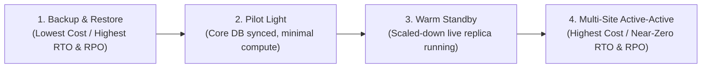

# Disaster Recovery and High Availability

> **Knowledge Area:** Cloud Concepts (Domain 1.1) & Technology (Domain 3.2, 3.6)  
> **Relevant Certifications:** [[CLF-C02_Master_Blueprint|CLF-C02]], SAA-C03, DVA-C02  
> **Tags:** `#aws/concepts` `#aws/resilience` `#clf-c02`

---

## 💡 The Real-World Analogy (ELI5)

> **The 4 DR Strategies as Spare Tire Options:**
> 1. **Backup & Restore (Hours/Days):** Keeping a patch kit and hand pump in the trunk. Cheap to carry, but takes hours on the side of the road to patch the tire and pump it up.
> 2. **Pilot Light (Tens of Minutes):** Keeping a deflated spare tire and an electric air compressor in the trunk. The core wheel is ready, but you must plug in the compressor and inflate it before you can drive.
> 3. **Warm Standby (Minutes):** Keeping an inflated donut spare tire mounted on the axle, but driving slowly until you reach a mechanic. A scaled-down version of your full system running 24/7.
> 4. **Multi-Site Active/Active (Real-Time Zero Downtime):** Driving an 18-wheel tractor-trailer with dual tires on every axle. If one tire blows out at 70 mph, the vehicle keeps rolling without skipping a beat.

---

## 1. Resilience Terminology: HA vs. FT vs. DR

* **High Availability (HA):** Systems designed to operate continuously without failure for a long period of time (typically measured in 99.9% to 99.999% uptime). Achieved by eliminating single points of failure across multiple Availability Zones (Multi-AZ).
* **Fault Tolerance (FT):** The ability of a system to continue operating properly without interruption in the event of the failure of one or more components (e.g., seamless zero-downtime failover).
* **Disaster Recovery (DR):** The processes, policies, and tools to restore vital technology infrastructure and operations following a major natural or human-induced catastrophe (typically cross-Region).

---

## 2. Recovery Metrics: RPO vs. RTO

Every disaster recovery plan is governed by two business metrics: **RPO** and **RTO**.

| Metric | Full Name | Definition | Question Answered |
|---|---|---|---|
| **RPO** | **Recovery Point Objective** | The maximum acceptable amount of data loss measured in time backward from the disaster event. | *"How much data (hours/minutes of transactions) can the business afford to lose?"* |
| **RTO** | **Recovery Time Objective** | The maximum acceptable duration of time that the system can be down before normal operations must be restored. | *"How long can the application be offline before business revenue/reputation is critically harmed?"* |

> [!TIP]
> **Memory Trick:**
> * **RPO = Point in time / Data** (How many minutes/hours of database changes are lost).
> * **RTO = Time to restore / Downtime** (How many minutes/hours until servers are running again).

---

## 3. The 4 Disaster Recovery Strategies (Cost vs. Recovery Speed)

AWS defines 4 primary DR strategies ranging from low cost / high RTO/RPO to high cost / near-zero RTO/RPO:

### 1. Backup and Restore
* **Mechanism:** Data is backed up to Amazon S3 (or AWS Backup) regularly and replicated to a secondary AWS Region. If disaster strikes, new infrastructure (EC2, RDS) is provisioned from scratch and restored from backups.
* **RTO / RPO:** Hours to days.
* **Cost:** Lowest (no secondary compute servers running; only storage costs).
* **Best for:** Non-critical internal workloads, batch processing, development environments.

---

### 2. Pilot Light
* **Mechanism:** The **core data foundation** is kept constantly running and synchronized in the secondary Region (e.g., live replicated RDS database). Compute servers (EC2) are configured as templates (AMIs, CloudFormation) but are **turned off or not provisioned**. During a disaster, the compute tier is rapidly scaled up to process live traffic.
* **RTO / RPO:** Tens of minutes to hours.
* **Cost:** Low (only minimal storage and database synchronization instances run continuously).
* **Analogy:** A gas heater with a small pilot flame always burning; when you turn the dial, the entire furnace bursts into heat.

---

### 3. Warm Standby
* **Mechanism:** A **scaled-down, fully functional version** of the production environment is always running live in the secondary Region. It actively handles minimal test traffic or stands ready. During a disaster, the standby environment scales out (via Auto Scaling) to take 100% of production traffic.
* **RTO / RPO:** Minutes.
* **Cost:** Medium to high (a functioning system runs 24/7 in two regions).
* **Best for:** Business-critical workloads where minutes of downtime are acceptable.

---

### 4. Multi-Site Active-Active
* **Mechanism:** Fully redundant, full-scale production environments run simultaneously in two or more AWS Regions. Global traffic routing (Route 53 or Global Accelerator) splits incoming requests across all regions in real time. If one region fails, traffic is routed to the surviving region with zero human intervention.
* **RTO / RPO:** Near-zero (seconds or real-time).
* **Cost:** Highest (paying for full multi-region active infrastructure).
* **Best for:** Mission-critical financial systems, global e-commerce, healthcare life-safety systems.

---

## 4. Key AWS Services for Disaster Recovery

1. **AWS Elastic Disaster Recovery (AWS DRS):**
   * Automatically replicates on-premises, cloud, or virtual physical servers directly into AWS block storage (EBS).
   * In a disaster, AWS DRS automatically launches replacement EC2 instances in minutes.
2. **AWS Backup:**
   * Fully managed, centralized policy-based service to automate data protection across multiple AWS services (EBS, S3, RDS, DynamoDB, EFS).
   * Supports cross-Region and cross-account backup copies with compliance retention locks.
3. **Amazon Route 53:**
   * Offers DNS health checks and automated DNS failover routing policies to redirect traffic away from an unhealthy Region.

---

## 5. Exam Tip Matrix

| Question Scenario Keyword | Correct DR Strategy |
|---|---|
| *"Wants the lowest possible cost, willing to tolerate several hours of downtime and data loss"* | **Backup and Restore** |
| *"Database is continuously replicated to secondary Region, but web/app servers are only provisioned after disaster"* | **Pilot Light** |
| *"Scaled-down, minimal version of application runs 24/7 in secondary Region"* | **Warm Standby** |
| *"Requires near-zero downtime and zero data loss; customer cannot afford even a minute of interruption"* | **Multi-Site Active-Active** |
| *"Wants a centralized tool to enforce automated daily backups and retention across all AWS accounts"* | **AWS Backup** |
---

## 7. Post-Topic Question Simulation & Retention Check

Test your understanding of Disaster Recovery & High Availability with these 5 exam-style questions:

## 🎯 Exam Traps & 'Clue-to-Answer' Trigger Words

| Exam Question Clue Keyword | Correct DR Strategy / Concept | Key Difference |
| :--- | :--- | :--- |
| *'Maximum acceptable downtime before system is restored'* | **RTO (Recovery Time Objective)** | Focuses on **Time** / Clock downtime. |
| *'Maximum acceptable data loss measured in time'* | **RPO (Recovery Point Objective)** | Focuses on **Data** freshness / backup frequency. |
| *'Lowest cost DR strategy, acceptable downtime of hours'* | **Backup & Restore** | Data backed up to S3; spun up only after disaster. |
| *'Core database replication live, compute spun up on disaster'* | **Pilot Light** | Database running minimal; app servers zero. |
| *'Scaled-down version of full environment running 24/7'* | **Warm Standby** | Can handle minimal production traffic immediately. |
| *'Zero downtime, full multi-region active traffic handling'* | **Multi-Site Active/Active** | Highest cost, lowest RTO/RPO (near zero). |

---

### Question 1
**An application requires a Disaster Recovery strategy that provides the lowest possible ongoing infrastructure cost while tolerating several hours of Recovery Time Objective (RTO) and Recovery Point Objective (RPO). Which DR strategy should be selected?**
- A) Multi-Site Active/Active
- B) Warm Standby
- C) Backup and Restore
- D) Pilot Light

<b>Click to View Answer & Explanation</b>

**Correct Answer:** **C) Backup and Restore**  
- **Why it's correct:** Backup and Restore is the most cost-effective DR strategy because zero compute infrastructure runs in the secondary DR region during normal operations. Data is backed up to S3, and servers are provisioned only when disaster strikes.
- **Distractor Analysis:**
  - *A is incorrect:* Multi-Site is the most expensive strategy (near-zero RTO/RPO).
  - *B & D are incorrect:* Both maintain running infrastructure in the secondary region, incurring higher baseline costs.

### Question 2
**What is the defining characteristic of a "Pilot Light" Disaster Recovery strategy?**
- A) A scaled-down version of the full application runs 24/7 in the secondary region.
- B) Critical core data is continuously replicated to the DR region, while compute servers are kept turned off until disaster strikes.
- C) Full production workloads run simultaneously in two AWS Regions.
- D) Data is backed up to tape and physically shipped off-site.

<b>Click to View Answer & Explanation</b>

**Correct Answer:** **B) Critical core data is continuously replicated to the DR region, while compute servers are kept turned off until disaster strikes.**  
- **Why it's correct:** Like a gas water heater's pilot light, the core database engine runs continuously to stay in sync with production, but the heavy compute servers (web/app fleet) are provisioned from AMIs only during failover.
- **Distractor Analysis:**
  - *A describes:* Warm Standby.
  - *C describes:* Multi-Site Active/Active.

### Question 3
**An e-commerce business requires that in the event of an outage, maximum data loss cannot exceed 15 minutes of customer transactions. What metric does this represent?**
- A) Recovery Time Objective (RTO)
- B) Recovery Point Objective (RPO)
- C) Mean Time to Detect (MTTD)
- D) Service Level Agreement (SLA)

<b>Click to View Answer & Explanation</b>

**Correct Answer:** **B) Recovery Point Objective (RPO)**  
- **Why it's correct:** RPO measures the maximum acceptable amount of data loss backward in time from the point of failure.
- **Distractor Analysis:**
  - *A is incorrect:* RTO measures downtime duration forward in time until service restoration.

### Question 4
**Which database configuration provides automated synchronous replication across multiple data centers and automatic failover within 60-120 seconds if an Availability Zone fails?**
- A) Amazon RDS Read Replica
- B) Amazon RDS Multi-AZ Deployment
- C) Single-AZ Amazon RDS with daily snapshots
- D) Amazon S3 Glacier archive

<b>Click to View Answer & Explanation</b>

**Correct Answer:** **B) Amazon RDS Multi-AZ Deployment**  
- **Why it's correct:** RDS Multi-AZ provisions a synchronous standby replica in a different AZ within the same region, providing automated failover with zero data loss upon primary failure.
- **Distractor Analysis:**
  - *A is incorrect:* Read Replicas use asynchronous replication primarily for read scalability, not automated synchronous failover.

### Question 5
**Which Disaster Recovery strategy delivers near-zero RTO and near-zero RPO with traffic actively served from multiple AWS Regions simultaneously?**
- A) Pilot Light
- B) Warm Standby
- C) Backup and Restore
- D) Multi-Site Active/Active

<b>Click to View Answer & Explanation</b>

**Correct Answer:** **D) Multi-Site Active/Active**  
- **Why it's correct:** Multi-Site Active/Active runs full-scale production environments in multiple regions simultaneously, routing global traffic via Route 53 with real-time bidirectional data synchronization (e.g. DynamoDB Global Tables).

