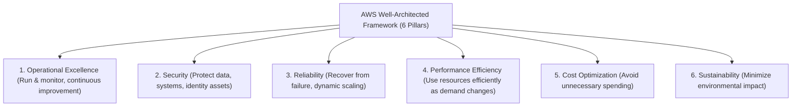
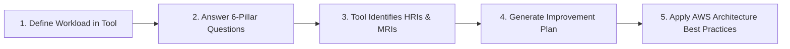

# AWS Well-Architected Framework

> **Knowledge Area:** Cloud Concepts (Domain 1.2)  
> **Relevant Certifications:** [[CLF-C02_Master_Blueprint|CLF-C02]], SAA-C03, SAP-C02  
> **Tags:** `#aws/concepts` `#aws/architecture` `#clf-c02`

---

## 💡 The Real-World Analogy (ELI5)

> Imagine designing an **earthquake-proof, ultra-modern skyscraper**:
> - **Operational Excellence:** Having automated fire sprinkler drills, written operating runbooks, and learning from small plumbing leaks before a pipe bursts.
> - **Security:** Armed lobby security, encrypted keycards for each floor, and zero-trust visitor passes.
> - **Reliability:** Dual backup generators, redundant water supply tanks on the roof, and flexible steel beams that sway during an earthquake without cracking.
> - **Performance Efficiency:** Installing high-speed magnetic elevators that adapt their speed dynamically based on morning rush-hour foot traffic.
> - **Cost Optimization:** Motion-sensor LED lighting that automatically turns off when conference rooms are empty, eliminating wasted electricity bills.
> - **Sustainability:** Rooftop solar panels, rainwater harvesting, and eco-friendly concrete to reduce the building's environmental carbon footprint.

---

## 1. Overview of the Well-Architected Framework

The **AWS Well-Architected Framework** provides a consistent approach for cloud architects to evaluate architectures and implement scalable, secure, high-performing, resilient, and cost-effective cloud designs.

It is structured around **6 Pillars** and supported by the **AWS Well-Architected Tool** in the AWS Management Console.

---

## 2. General Design Principles (Across All Pillars)

The framework defines 6 overarching design principles for cloud architecture:

1. **Stop guessing your capacity needs:** Eliminate upfront guesswork by scaling dynamically with Auto Scaling and serverless services.
2. **Test systems at production scale:** In the cloud, you can spin up a production-sized environment, test its performance and failover, and immediately terminate it, paying only for the hours used.
3. **Automate to make architectural experimentation easier:** Use Infrastructure as Code (AWS CloudFormation / CDK) to automate deployments and track changes.
4. **Allow for evolutionary architectures:** Enable architectures to evolve over time as new services and technologies are introduced without major overhauls.
5. **Drive architectures using data:** Collect and analyze CloudWatch metrics and CloudTrail audit data to make evidence-based architectural adjustments.
6. **Improve through game days:** Regularly simulate disaster scenarios, failovers, and security breaches to train teams and validate recovery procedures.

---

## 3. Deep-Dive into the 6 Pillars

### Pillar 1: Operational Excellence
* **Core Focus:** Running and monitoring systems to deliver business value and continually improving processes and procedures.
* **Key Design Principles:**
  - *Perform operations as code:* Define infrastructure and operational runbooks using software templates (CloudFormation).
  - *Make frequent, small, reversible changes:* Design workloads to allow small incremental updates that can be easily rolled back if errors occur.
  - *Refine operations procedures frequently:* Continuously evaluate and update runbooks as systems evolve.
  - *Anticipate failure:* Conduct "pre-mortem" exercises to identify potential failure points and test response procedures.
  - *Learn from all operational failures:* Conduct root cause analysis (RCA) and share lessons across teams.
* **Key Services:** AWS CloudFormation, AWS Systems Manager, Amazon CloudWatch, AWS Config.

---

### Pillar 2: Security
* **Core Focus:** Protecting information, systems, and assets while delivering business value through risk assessments and mitigation strategies.
* **Key Design Principles:**
  - *Implement a strong identity foundation:* Enforce least privilege, multi-factor authentication (MFA), and centralized identity management.
  - *Enable traceability:* Log, monitor, and alert on all configuration changes and API requests in real time.
  - *Apply security at all layers (Defense in Depth):* Secure edge locations, VPC perimeters, subnets, EC2 operating systems, and application layers.
  - *Automate security best practices:* Automate remediation using EventBridge and Lambda functions.
  - *Protect data in transit and at rest:* Encrypt data using AWS KMS and TLS certificates.
  - *Keep people away from data:* Reduce manual data access using automated processing pipelines and temporary credentials.
  - *Prepare for security events:* Have an incident response plan and run simulated security game days.
* **Key Services:** AWS IAM, AWS KMS, AWS Secrets Manager, AWS Shield, AWS WAF, Amazon GuardDuty, AWS Security Hub, Amazon Inspector, AWS CloudTrail.

---

### Pillar 3: Reliability
* **Core Focus:** Ensuring a workload performs its intended function correctly and consistently when it's expected to, and quickly recovering from failures.
* **Key Design Principles:**
  - *Automatically recover from failure:* Monitor KPIs and trigger automated recovery (e.g., Auto Scaling spinning up replacement instances, Route 53 health check failovers).
  - *Test recovery procedures:* Simulate failures to validate how the system responds under distress.
  - *Scale horizontally to increase aggregate workload availability:* Replace one large resource with multiple small resources to reduce the blast radius of a single failure.
  - *Stop guessing capacity:* Monitor demand and automatically scale out/in to prevent resource exhaustion.
  - *Manage change in automation:* Implement automated changes through CI/CD pipelines and IaC.
* **Key Services:** AWS Auto Scaling, Elastic Load Balancing (ELB), Amazon Route 53, AWS Backup, Amazon S3 (99.999999999% durability), AWS CloudWatch.

---

### Pillar 4: Performance Efficiency
* **Core Focus:** Using computing resources efficiently to meet system requirements and maintaining that efficiency as demand changes and technologies evolve.
* **Key Design Principles:**
  - *Democratize advanced technologies:* Use managed and serverless services (e.g., Amazon SageMaker, AWS Lambda) rather than having your team learn complex server administration.
  - *Go global in minutes:* Deploy workloads across multiple AWS Regions and Edge Locations worldwide with low latency.
  - *Use serverless architectures:* Eliminate the need to manage servers for compute, storage, and databases.
  - *Experiment more often:* Quickly test different instance types, storage classes, and architectural options.
  - *Consider mechanical sympathy:* Align workloads with the optimal technology (e.g., using memory-optimized instances for in-memory databases).
* **Key Services:** AWS Lambda, AWS Fargate, Amazon CloudFront, Amazon ElastiCache, AWS Auto Scaling, AWS Compute Optimizer.

---

### Pillar 5: Cost Optimization
* **Core Focus:** Avoiding unnecessary costs and delivering business value at the lowest possible price point.
* **Key Design Principles:**
  - *Implement Cloud Financial Management (FinOps):* Establish financial accountability and cost visibility across teams.
  - *Adopt a consumption model:* Pay only for the computing resources you consume; shut down development servers outside work hours.
  - *Measure overall efficiency:* Measure output vs cost to optimize return on investment.
  - *Stop spending money on undifferentiated heavy lifting:* Let AWS handle data center racking, cooling, power, and physical maintenance.
  - *Analyze and attribute expenditure:* Use cost allocation tags to accurately track which project or business unit incurred costs.
* **Key Services:** AWS Cost Explorer, AWS Budgets, AWS Compute Optimizer, Savings Plans, Amazon EC2 Spot Instances, AWS Trusted Advisor.

---

### Pillar 6: Sustainability
* **Core Focus:** Minimizing the environmental impacts of running cloud workloads, with an emphasis on energy consumption and efficiency.
* **Key Design Principles:**
  - *Understand your impact:* Quantify energy consumption and greenhouse gas emissions associated with your workload.
  - *Establish sustainability goals:* Set long-term carbon reduction targets for all cloud workloads.
  - *Maximize utilization:* Right-size instances and eliminate idle compute capacity to avoid energy waste.
  - *Anticipate and adopt new, more efficient hardware and software offerings:* Migrate to AWS Graviton processors (which offer up to 60% less energy consumption for the same performance).
  - *Use managed services:* Shared managed services (like Amazon S3 or AWS Lambda) distribute environmental overhead across millions of customers.
  - *Reduce the downstream impact of your cloud workloads:* Minimize the data and processing required by user devices (e.g., compress images, use efficient algorithms).
* **Key Services:** AWS Customer Carbon Footprint Tool, AWS Graviton processors, AWS Compute Optimizer.

---

## 4. The AWS Well-Architected Tool

The **AWS Well-Architected Tool** is a free self-service tool available in the AWS Management Console that allows you to:
1. Document and define your workloads.
2. Complete an interactive questionnaire based on the 6 Pillars.
3. Receive a comprehensive report highlighting **High-Risk Issues (HRIs)** and **Medium-Risk Issues (MRIs)**.
4. Access a customized step-by-step **Improvement Plan** to remediate identified gaps.

---

## 5. Exam Tip Matrix: Identifying Pillars from Question Scenarios

| Question Scenario Keyword / Action | Associated Pillar |
|---|---|
| *"Performing root-cause analysis after an outage"* | **Operational Excellence** |
| *"Defining infrastructure as code using AWS CloudFormation"* | **Operational Excellence** |
| *"Encrypting sensitive medical records in Amazon S3 at rest"* | **Security** |
| *"Enforcing Multi-Factor Authentication (MFA) on root user"* | **Security** |
| *"Deploying an application across multiple Availability Zones"* | **Reliability** |
| *"Automatically replacing unhealthy EC2 instances with Auto Scaling"* | **Reliability** |
| *"Migrating from self-managed servers to serverless AWS Lambda"* | **Performance Efficiency** |
| *"Caching database queries in Amazon ElastiCache"* | **Performance Efficiency** |
| *"Tagging resources to track departmental spending"* | **Cost Optimization** |
| *"Purchasing Compute Savings Plans for predictable workloads"* | **Cost Optimization** |
| *"Selecting AWS Graviton3 instances to lower carbon emissions"* | **Sustainability** |
| *"Setting up S3 Lifecycle rules to delete unneeded test datasets"* | **Sustainability** & **Cost Optimization** |
---

## 7. Post-Topic Question Simulation & Retention Check

Test your understanding of the AWS Well-Architected Framework with these 5 exam-style questions:

## 🎯 Exam Traps & 'Clue-to-Answer' Trigger Words

| Exam Question Clue Keyword | Correct WAF Pillar | Exam Distractor Trap |
| :--- | :--- | :--- |
| *'Perform operations as code', 'learn from failures', 'runbooks', 'refine procedures'* | **Operational Excellence** | Reliability (Reliability focuses on recovery, not runbooks/operations). |
| *'Traceability', 'least privilege', 'data protection in transit and at rest', 'incident response'* | **Security** | Operational Excellence. |
| *'Automatically recover from failure', 'horizontal scaling', 'test recovery procedures'* | **Reliability** | Performance Efficiency (focuses on speed, not failure survival). |
| *'Democratize advanced technologies', 'mechanical sympathy', 'go global in minutes'* | **Performance Efficiency** | Cost Optimization. |
| *'Measure efficiency', 'stop spending money on undifferentiated heavy lifting', 'rightsizing'* | **Cost Optimization** | Operational Excellence. |
| *'Reduce environmental impact', 'maximize utilization', 'anticipate new technologies'* | **Sustainability** | Cost Optimization (Cost saves dollars; Sustainability saves carbon/energy). |

---

### Question 1
**An organization wants to evaluate its cloud workload against AWS architectural best practices and generate remediation guidance. Which AWS tool should they use?**
- A) AWS Trusted Advisor
- B) AWS Well-Architected Tool
- C) AWS Systems Manager
- D) AWS Compute Optimizer

<b>Click to View Answer & Explanation</b>

**Correct Answer:** **B) AWS Well-Architected Tool**  
- **Why it's correct:** The AWS Well-Architected Tool is a free service in the management console that guides teams through structured questions based on the 6 Pillars and produces an actionable milestone improvement plan.
- **Distractor Analysis:**
  - *A is incorrect:* Trusted Advisor performs automated checks against active infrastructure, but doesn't conduct structured architectural reviews.
  - *D is incorrect:* Compute Optimizer uses ML to recommend rightsizing instance types.

### Question 2
**Which pillar of the AWS Well-Architected Framework focuses on minimizing the environmental impact of running cloud workloads through rightsizing and efficient resource utilization?**
- A) Operational Excellence
- B) Sustainability
- C) Performance Efficiency
- D) Reliability

<b>Click to View Answer & Explanation</b>

**Correct Answer:** **B) Sustainability**  
- **Why it's correct:** The Sustainability Pillar (introduced as the 6th pillar) focuses on understanding environmental impacts, maximizing hardware utilization, reducing idle capacity, and adopting energy-efficient chips (e.g. AWS Graviton).
- **Distractor Analysis:**
  - *A is incorrect:* Operational Excellence focuses on running and monitoring systems to deliver business value.
  - *C is incorrect:* Performance Efficiency focuses on using computing resources efficiently to meet requirements.

### Question 3
**A company implements Infrastructure as Code (IaC) using AWS CloudFormation and automated CI/CD deployment pipelines to release small, frequent, and reversible changes. Which Well-Architected Pillar does this best practice represent?**
- A) Security Pillar
- B) Operational Excellence Pillar
- C) Cost Optimization Pillar
- D) Sustainability Pillar

<b>Click to View Answer & Explanation</b>

**Correct Answer:** **B) Operational Excellence Pillar**  
- **Why it's correct:** A primary design principle of the Operational Excellence Pillar is *"Perform operations as code"* and *"Make frequent, small, reversible changes"* so that issues can be detected and rolled back quickly.

### Question 4
**Which design principle is central to the Reliability Pillar of the Well-Architected Framework?**
- A) Stop spending money on undifferentiated heavy lifting
- B) Automatically recover from failure
- C) Enable traceability across all API calls
- D) Democratize advanced technologies

<b>Click to View Answer & Explanation</b>

**Correct Answer:** **B) Automatically recover from failure**  
- **Why it's correct:** The Reliability Pillar advocates designing systems that monitor Key Performance Indicators (KPIs) and trigger automated recovery (e.g. EC2 Auto Scaling, Route 53 health check failover, RDS Multi-AZ).
- **Distractor Analysis:**
  - *C is incorrect:* Traceability belongs to the Security Pillar.
  - *D is incorrect:* Democratizing technology belongs to Performance Efficiency.

### Question 5
**An architectural team chooses an Amazon S3 Intelligent-Tiering storage class and configures Amazon EC2 Auto Scaling based on CPU demand. Which Well-Architected Pillar are they directly optimizing?**
- A) Security Pillar
- B) Cost Optimization Pillar
- C) Operational Excellence Pillar
- D) Reliability Pillar

<b>Click to View Answer & Explanation</b>

**Correct Answer:** **B) Cost Optimization Pillar**  
- **Why it's correct:** Cost Optimization focuses on avoiding unnecessary spending through right-sizing, eliminating idle resources, adopting consumption models, and measuring overall expenditure efficiency.

