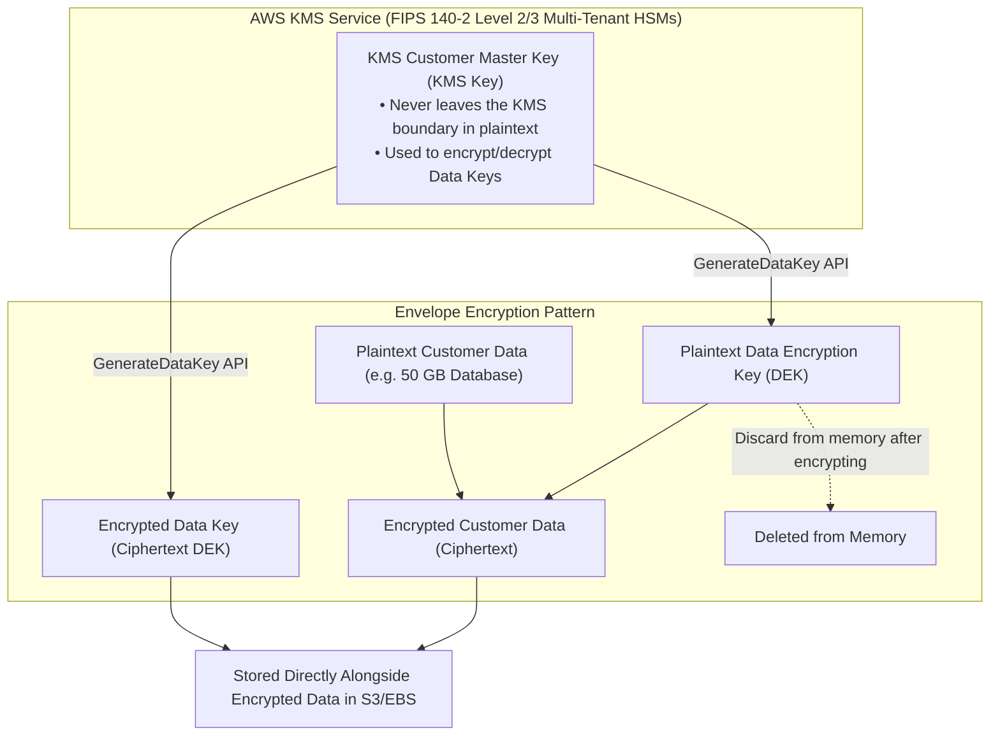

# AWS KMS (Key Management Service)

> **Service Category:** Security, Identity & Compliance (Cryptography)  
> **Service Role:** Fully managed service that makes it easy to create and control cryptographic keys used to protect your data across 100+ AWS services and in your own applications.  
> **Relevant Certifications:** [[01_Certifications/Cloud_Practitioner_CLF-C02/CLF-C02_Master_Blueprint|CLF-C02]], SAA-C03, SCS-C02  
> **Tags:** `#aws/services` `#aws/security` `#kms` `#encryption` `#keys` `#clf-c02`

---

## 💡 The Real-World Analogy (ELI5)

> **Bank Vaults & Safe Deposit Boxes:**
> - **AWS KMS (Key Management Service):** The bank manager who holds the master keys. KMS generates, manages, and audits cryptographic keys. Through *envelope encryption*, KMS uses a master key (KMS Key) to encrypt a smaller data key, which then locks your files. It is multi-tenant and scales automatically.
> - **AWS CloudHSM:** Buying your own personal, heavy-duty military-grade titanium safe inside the bank vault. It is a single-tenant dedicated hardware device (FIPS 140-2 Level 3) where you exclusively control the cryptographic keys.
> - **AWS Secrets Manager:** A high-security smart locker that automatically changes its combination lock every 30 days and notifies your databases without waking you up.
> - **AWS Systems Manager Parameter Store:** A standard digital notebook for storing configuration strings (database URLs, license keys), free of charge for basic strings.

---

## 1. What is AWS KMS?

**AWS Key Management Service (AWS KMS)** is a managed service that enables you to easily create, rotate, and manage cryptographic keys. AWS KMS uses Hardware Security Modules (HSMs) validated under **FIPS 140-2 Cryptographic Module Validation Program** to protect the security of your keys.

AWS KMS is deeply integrated with over 100 AWS services (such as [[Amazon_S3|Amazon S3]], [[Amazon_EBS|Amazon EBS]], [[Amazon_RDS|Amazon RDS]], [[Amazon_DynamoDB|DynamoDB]]) and integrates with [[AWS_CloudTrail|AWS CloudTrail]] to provide detailed audit logs of every key usage.

---

## 2. Key Categories: AWS Owned vs. AWS Managed vs. Customer Managed

| Key Type | Managed By | Rotation Policy | Custom Key Policy? | Monthly Fee | Primary Use Case |
|:---|:---:|:---:|:---:|:---:|:---|
| **AWS Owned Keys** | AWS | Managed by AWS | **NO** | **Free** | Default internal encryption in services like DynamoDB and S3. |
| **AWS Managed Keys** (e.g. `aws/s3`, `aws/ebs`) | AWS on your behalf | Automatically every 1 year | **NO** | **Free** | Out-of-the-box encryption when you don't require custom key policies. |
| **Customer Managed Keys (CMK)** | **Customer** | **Configurable** (Auto every 1 year, or custom 90-360 days, or manual) | **YES (Full IAM & Key Policy control)** | **\$1.00/month** per key | **Enterprise Best Practice:** Required when compliance demands strict key access audit and rotation control. |

---

## 3. Cryptography Master Comparison: KMS vs. CloudHSM vs. Secrets Manager vs. Parameter Store

| Feature / Dimension | AWS Key Management Service (KMS) | AWS CloudHSM | AWS Secrets Manager | AWS Systems Manager Parameter Store |
|:---|:---|:---|:---|:---|
| **Primary Role** | Cryptographic key lifecycle & envelope encryption. | Dedicated physical hardware security module appliance. | Secret lifecycle with automated credential rotation. | Configuration storage & hierarchical parameter store. |
| **Tenancy Model** | **Multi-tenant shared physical hardware** (FIPS 140-2 Level 2/3). | **Single-tenant dedicated physical hardware** (FIPS 140-2 Level 3). | Managed service (uses KMS for encryption). | Managed service (uses KMS for SecureString). |
| **Automated Rotation** | Annual automatic key rotation (or 90-360 days custom). | Customer-managed scripts/software. | **Built-in automated rotation** for RDS, Redshift, DocumentDB via Lambda. | No native automated database credential rotation. |
| **Pricing Model** | \$1.00/month per active CMK + API request fees. | Hourly appliance fee (~$1.45/hr = ~$1,050/mo). | \$0.40/month per secret + \$0.05 per 10,000 API calls. | **Free tier available** (Standard parameters); nominal fee for Advanced. |
| **Best Used For** | Encrypting S3 buckets, EBS volumes, RDS databases, Lambda vars. | Strict corporate/government compliance requiring dedicated hardware. | Database passwords, OAuth tokens needing scheduled rotation. | App config strings, license keys, AMI IDs, environment variables. |

---

## 4. Exam Tips & Distinction Criteria

> [!IMPORTANT]
> - **KMS Keys Never Leave the HSM:** The raw plaintext master key **never leaves the KMS boundary**. Data is encrypted using **Envelope Encryption** via Data Encryption Keys (DEKs).
> - **Auditing Every Single Key Decryption:** Every time an authorized user or AWS service calls `kms:Decrypt`, the event is logged immutably in **AWS CloudTrail**.
> - **Multi-Tenant vs Dedicated:**
>   - **AWS KMS:** Shared, multi-tenant hardware (standard choice for 99% of workloads).
>   - **AWS CloudHSM:** Dedicated, single-tenant hardware appliance inside your VPC.

---

## 5. Cross-Service Links
- [[AWS_CloudHSM|AWS CloudHSM (Dedicated Hardware)]]
- [[AWS_Security_Services|AWS Secrets Manager]]
- [[AWS_Config_and_Systems_Manager|SSM Parameter Store]]
- [[AWS_CloudWatch_and_CloudTrail|AWS CloudTrail Auditing]]
---

## 7. Post-Topic Question Simulation & Retention Check

Test your understanding of Encryption & Secrets Management with these 5 exam-style questions:

## 🎯 Exam Traps & 'Clue-to-Answer' Trigger Words

| Exam Question Clue Keyword | Correct Service | Key Differentiator |
| :--- | :--- | :--- |
| *'Dedicated hardware security module, single-tenant, FIPS 140-2 Level 3'* | **AWS CloudHSM** | KMS is multi-tenant; CloudHSM is single-tenant dedicated hardware. |
| *'Automatically rotate database credentials and API keys on a schedule'* | **AWS Secrets Manager** | Parameter Store does NOT provide built-in automatic rotation. |
| *'Free hierarchical key-value store for plain-text configs and passwords'* | **SSM Parameter Store** | Standard parameters are free; ideal for simple config storage. |
| *'Provision and manage public SSL/TLS certificates for CloudFront & ALB'* | **AWS Certificate Manager (ACM)** | Free public SSL/TLS certificates; auto-renews. |

---

### Question 1
**An organization needs to store database credentials and API tokens with automated, scheduled rotation every 30 days without application downtime. Which AWS service should they use?**
- A) AWS Systems Manager Parameter Store
- B) AWS Secrets Manager
- C) AWS Key Management Service (AWS KMS)
- D) Amazon S3 Glacier

<b>Click to View Answer & Explanation</b>

**Correct Answer:** **B) AWS Secrets Manager**  
- **Why it's correct:** AWS Secrets Manager is specifically engineered for storing, managing, and automatically rotating credentials (RDS databases, API keys) using built-in AWS Lambda rotation functions.
- **Distractor Analysis:**
  - *A is incorrect:* Parameter Store does not provide built-in automated rotation out of the box.
  - *C is incorrect:* KMS manages encryption keys, not plaintext database passwords.

### Question 2
**Which AWS service manages cryptographic keys and integrates natively with over 100 AWS services to perform envelope encryption?**
- A) AWS CloudHSM
- B) AWS Key Management Service (AWS KMS)
- C) AWS Secrets Manager
- D) Amazon Macie

<b>Click to View Answer & Explanation</b>

**Correct Answer:** **B) AWS Key Management Service (AWS KMS)**  
- **Why it's correct:** AWS KMS is a fully managed, FIPS 140-2/3 validated service that creates, controls, and rotates customer master keys (KMS keys) used for envelope encryption across AWS.

### Question 3
**A financial institution requires dedicated, single-tenant Hardware Security Module (HSM) appliances under their exclusive administrative control to meet strict regulatory compliance. Which service should they choose?**
- A) AWS KMS
- B) AWS CloudHSM
- C) AWS Secrets Manager
- D) AWS Shield

<b>Click to View Answer & Explanation</b>

**Correct Answer:** **B) AWS CloudHSM**  
- **Why it's correct:** AWS CloudHSM provides dedicated physical HSM appliances inside the customer's VPC. The customer has sole control of the cryptographic keys; AWS has zero visibility into keys stored inside CloudHSM.

### Question 4
**What is the difference between Server-Side Encryption (SSE) and Client-Side Encryption when storing data in Amazon S3?**
- A) Server-side encryption encrypts data on the client device before transit.
- B) Server-side encryption encrypts data after it reaches AWS S3 disks; client-side encrypts data locally before sending it across the network.
- C) Client-side encryption is managed by AWS automatically.
- D) Server-side encryption requires physical hardware tokens.

<b>Click to View Answer & Explanation</b>

**Correct Answer:** **B) Server-side encryption encrypts data after it reaches AWS S3 disks; client-side encrypts data locally before sending it across the network.**  
- **Why it's correct:** In Server-Side Encryption (SSE-S3, SSE-KMS), AWS manages encryption upon disk write. In Client-Side Encryption, data is encrypted by the application prior to transmitting over TLS to AWS.

### Question 5
**Which service allows developers to store hierarchical configuration strings and simple plaintext or encrypted strings (e.g., database hostnames or license keys) at low cost?**
- A) AWS Systems Manager Parameter Store
- B) AWS Artifact
- C) AWS CloudTrail
- D) AWS License Manager

<b>Click to View Answer & Explanation</b>

**Correct Answer:** **A) AWS Systems Manager Parameter Store**  
- **Why it's correct:** Systems Manager Parameter Store is a serverless key-value store for application configuration data and secrets, offering standard parameters free of charge.

