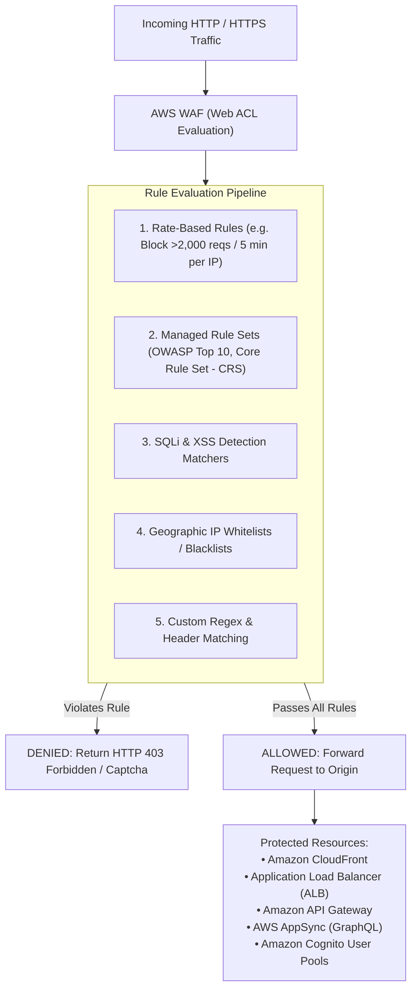

# AWS WAF (Web Application Firewall)

> **Service Category:** Security, Identity & Compliance  
> **Service Role:** Web application firewall that helps protect web applications and APIs against common web exploits, bots, and vulnerabilities that may affect availability, compromise security, or consume excessive resources.  
> **Relevant Certifications:** [[01_Certifications/Cloud_Practitioner_CLF-C02/CLF-C02_Master_Blueprint|CLF-C02]], SAA-C03, SCS-C02  
> **Tags:** `#aws/services` `#aws/security` `#waf` `#firewall` `#layer7` `#clf-c02`

---

## 1. What is AWS WAF?

**AWS WAF** is a Web Application Firewall that operates at **Layer 7 (Application Layer)** of the OSI model. It inspects incoming HTTP and HTTPS requests and blocks malicious traffic before it ever reaches your application servers.

AWS WAF protects against common web vulnerabilities defined by the **OWASP Top 10**, such as **SQL Injection (SQLi)**, **Cross-Site Scripting (XSS)**, HTTP flood attacks, and automated scraper bots.

---

## 2. Core Components of AWS WAF

1. **Web Access Control Lists (Web ACLs):**
   - The top-level resource containing a prioritized collection of rules.
   - Attached to CloudFront distributions (Global scope: `CLOUDFRONT`) or regional resources (Regional scope: `REGIONAL`).
2. **Rule Types:**
   - **AWS Managed Rules (AMR):** Pre-configured rule groups maintained by AWS security experts (e.g., Core Rule Set, Known Bad Inputs, SQL Database, Linux Operating System rules).
   - **Marketplace Managed Rules:** Rules authored and updated by third-party security vendors (Fortinet, F5, Trend Micro).
   - **Rate-Based Rules:** Automatically tracks the rate of requests from individual IP addresses and temporarily blocks or rate-limits any IP that exceeds a configured threshold (e.g., max 1,000 requests per 5 minutes) to mitigate Layer 7 HTTP floods.
   - **Custom Rules:** Custom boolean match conditions inspecting IP addresses, HTTP headers, query strings, cookies, or URI request paths.
3. **Actions:**
   - `Allow`: Request is allowed to pass to the protected application.
   - `Block`: Returns an immediate HTTP 403 Forbidden response.
   - `Count`: Logs the match without blocking (ideal for testing rules before enforcing).
   - `CAPTCHA` / `Challenge`: Presents an interactive or silent browser challenge to verify the caller is a human and not an automated bot.

---

## 3. Network ACL vs. Security Group vs. AWS WAF

| Dimension | Network ACL (NACL) | Security Group (SG) | AWS WAF |
|:---|:---:|:---:|:---:|
| **OSI Layer** | **Layer 4** (Network / Transport) | **Layer 4** (Transport / Instance) | **Layer 7 (Application)** |
| **Operation Level**| **Subnet Level** | **Instance / ENI Level** | **Application / Gateway Level** |
| **Inspection Scope**| Source/Dest IP & Port only | Source/Dest IP & Port only | **Full HTTP Body, Headers, URI, SQL strings** |
| **Rule Capabilities**| Allow & Deny (Numerical order) | Allow only (All rules evaluated) | Allow, Block, Count, CAPTCHA, Rate-limiting |
| **Attacks Prevented**| Basic IP flooding & port scans | Unauthorized network access | **SQL Injection, XSS, Scrapers, Bots** |

---

## 4. Exam Tips & Distinction Criteria

> [!IMPORTANT]
> - **SQL Injection & Cross-Site Scripting (XSS):** If an exam scenario asks how to protect an application from SQL injection or XSS, the answer is ALWAYS **AWS WAF**.
> - **Block Bad IP at Layer 7 vs Layer 4:**
>   - To block malicious web requests containing suspicious HTTP headers, use **AWS WAF**.
>   - To block a specific raw IP address at the subnet level for free, use a **Network ACL (NACL)**.
> - **Rate-Limiting Web Requests:** Use **AWS WAF Rate-Based Rules** to mitigate brute-force password guessing or web scraping.

---

## 5. Cross-Service Links
- [[AWS_Shield|AWS Shield (DDoS Protection)]]
- [[Amazon_CloudFront|Amazon CloudFront]]
- [[Amazon_VPC_and_Networking|Security Groups & Network ACLs]]
- [[AWS_Security_Services|Security Overview Hub]]
---

## 7. Post-Topic Question Simulation & Retention Check

Test your understanding of AWS Shield & WAF with these 5 exam-style questions:

### Question 1
**Which AWS service provides Layer 7 application protection against common web exploits such as SQL injection (SQLi) and Cross-Site Scripting (XSS)?**
- A) AWS Shield Standard
- B) AWS WAF (Web Application Firewall)
- C) Network Access Control Lists (NACLs)
- D) Amazon GuardDuty

<b>Click to View Answer & Explanation</b>

**Correct Answer:** **B) AWS WAF (Web Application Firewall)**  
- **Why it's correct:** AWS WAF inspects HTTP/HTTPS traffic at Layer 7, applying custom or managed rules to block SQL injection, XSS, rate-limit abusive IP addresses, and block bot scraping.
- **Distractor Analysis:**
  - *A is incorrect:* Shield Standard protects at Layer 3/4 against volumetric DDoS attacks.
  - *C is incorrect:* NACLs filter at Layer 4 (IP/port).

### Question 2
**What tier of AWS Shield is automatically enabled at no additional charge for all AWS customers globally?**
- A) AWS Shield Enterprise
- B) AWS Shield Standard
- C) AWS Shield Advanced
- D) AWS Shield Pro

<b>Click to View Answer & Explanation</b>

**Correct Answer:** **B) AWS Shield Standard**  
- **Why it's correct:** Shield Standard is free, transparent, and automatically active for all AWS services to defend against common network and transport layer (Layer 3/4) SYN floods and UDP reflection attacks.

### Question 3
**An enterprise website is experiencing a massive Distributed Denial of Service (DDoS) attack. The company wants 24/7 direct access to the AWS Shield Response Team (SRT) and financial cost protection against scaling spikes during attacks. Which service should they subscribe to?**
- A) AWS WAF Managed Rules
- B) AWS Shield Advanced
- C) AWS Network Firewall
- D) Amazon Inspector

<b>Click to View Answer & Explanation</b>

**Correct Answer:** **B) AWS Shield Advanced**  
- **Why it's correct:** Shield Advanced ($3,000/month) includes 24/7 SRT proactive engagement, advanced DDoS mitigation across CloudFront/Route53/ALB, and "DDoS cost protection" to reimburse scaling costs from attacks.

### Question 4
**On which AWS resources can AWS WAF Web ACLs be directly attached?**
- A) Amazon S3 Buckets and AWS Lambda functions directly
- B) Application Load Balancer (ALB), Amazon CloudFront, and Amazon API Gateway
- C) Amazon EC2 instances and Amazon EBS volumes
- D) AWS Storage Gateway and Direct Connect

<b>Click to View Answer & Explanation</b>

**Correct Answer:** **B) Application Load Balancer (ALB), Amazon CloudFront, and Amazon API Gateway**  
- **Why it's correct:** AWS WAF deploys at Layer 7 ingress points: ALB, CloudFront distributions, Amazon API Gateway REST APIs, and AWS AppSync GraphQL endpoints.

### Question 5
**A company wants to block web traffic originating from specific sanctioned geographic countries. Which feature in AWS WAF enables this?**
- A) Geographic Match Rule (Geo-blocking)
- B) Rate-based rules
- C) SQL injection match rules
- D) AWS Shield Standard

<b>Click to View Answer & Explanation</b>

**Correct Answer:** **A) Geographic Match Rule (Geo-blocking)**  
- **Why it's correct:** AWS WAF Geo-match condition inspects the country of origin of incoming requests based on client IP addresses and allows administrators to block or allow designated countries.

