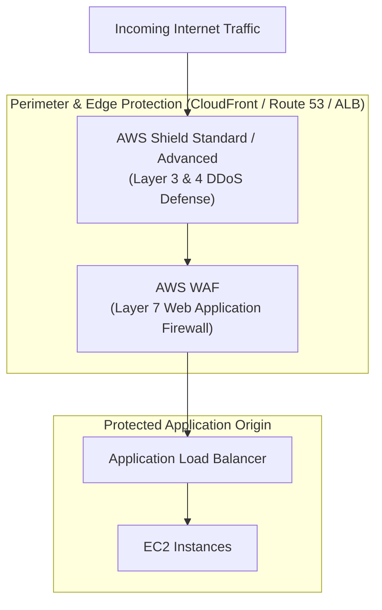
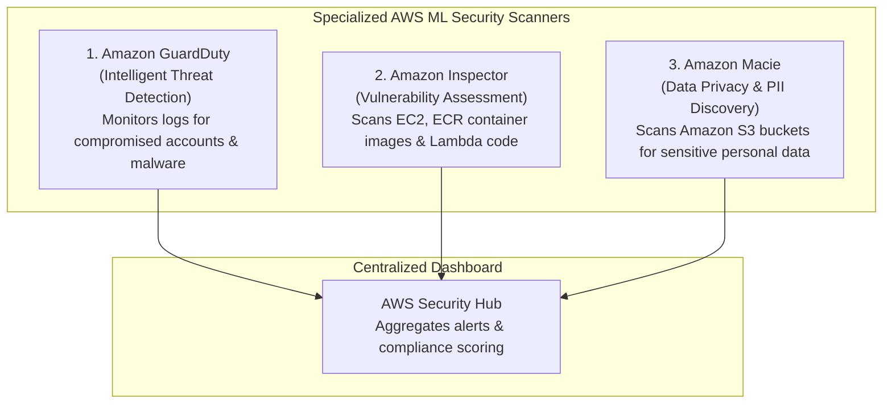
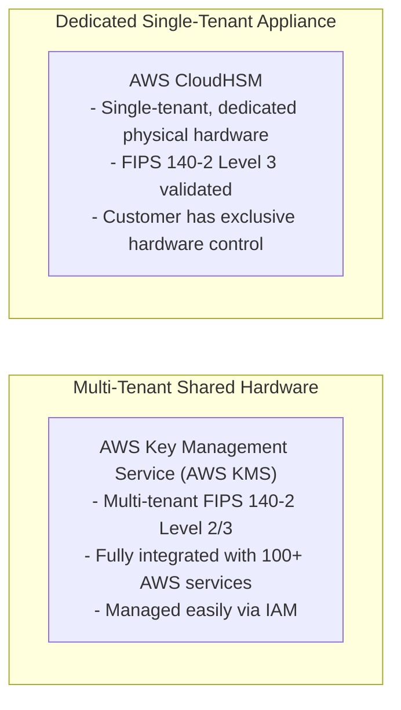
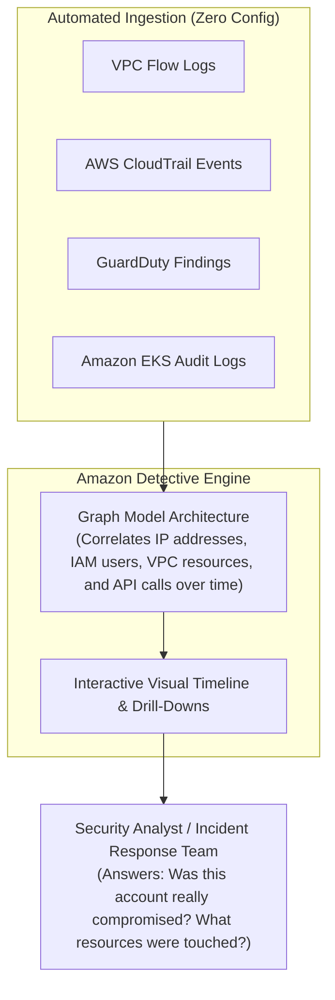
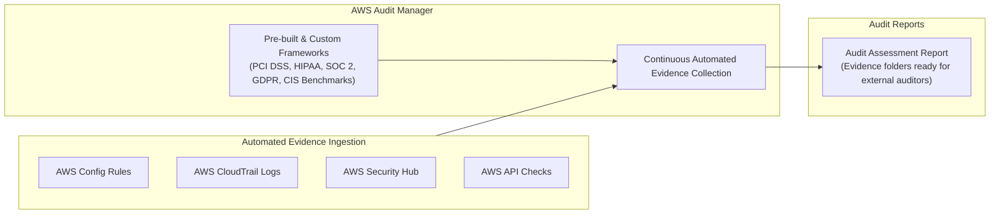

# AWS Security, Encryption & Compliance Services

> **Service Category:** Security, Identity & Compliance (Domain 2.2, 2.4)  
> **Relevant Certifications:** [[CLF-C02_Master_Blueprint|CLF-C02]], SAA-C03, SOA-C02  
> **Tags:** `#aws/services` `#aws/security` `#clf-c02`

---

## 1. Perimeter & Application Protection: Shield vs. WAF



| Service | OSI Layer | Protection Focus | Key Features |
|---|:---:|---|---|
| **AWS Shield Standard** | Layer 3 & 4 (Network/Transport) | SYN floods, UDP reflection attacks, DDoS. | **Automatically enabled for all AWS customers at NO additional charge.** |
| **AWS Shield Advanced** | Layer 3 & 4 + Layer 7 | Targeted, sophisticated DDoS attacks. | Paid monthly subscription (\$3,000/mo); 24/7 access to AWS DDoS Response Team (DRT), financial cost-protection against DDoS scaling spikes. |
| **AWS WAF** | **Layer 7 (Application Layer)** | SQL Injection (SQLi), Cross-Site Scripting (XSS), HTTP flood attacks, bot scraping. | Inspects HTTP/HTTPS requests; allows/blocks based on IP addresses, HTTP headers, URI strings, or managed rulesets. |
| **AWS Firewall Manager** | Multi-Account Management | Centralizes security rule deployment across accounts. | Automatically enforces WAF rules, Shield Advanced protections, and Security Groups across all accounts in an **AWS Organization**. |

---

## 2. Threat Detection & Auditing Trio: GuardDuty vs. Inspector vs. Macie

AWS provides three specialized machine learning security scanning services. Do not confuse their functions:



| Security Service | What It Scans | How It Operates | Key Trigger Words |
|---|---|---|---|
| **Amazon GuardDuty** | CloudTrail logs, VPC Flow Logs, DNS query logs, S3 data events, EKS audit logs. | Continuous, intelligent threat detection using machine learning; identifies cryptocurrency mining, unusual API calls, compromised credentials. | *"Detect unauthorized behavior"*, *"Compromised EC2 instances"*, *"Cryptocurrency mining"*, *"Anomaly detection"*. |
| **Amazon Inspector** | Amazon EC2 instances, Amazon ECR container images, AWS Lambda functions. | Automated vulnerability management; scans for known software vulnerabilities (CVEs) and unintended network exposure. | *"Scan for software vulnerabilities"*, *"Common Vulnerabilities and Exposures (CVE)"*, *"Assess EC2 package security"*. |
| **Amazon Macie** | **Amazon S3 Buckets** exclusively. | Data security and data privacy service using machine learning to discover, classify, and protect sensitive data (PII, credit cards, passports). | *"Identify Personally Identifiable Information (PII) in S3"*, *"Credit card numbers"*, *"S3 data privacy audit"*. |

---

## 3. Cryptography & Key Management: KMS vs. CloudHSM



* **AWS Key Management Service (AWS KMS):**
  - Easily create and control cryptographic keys used to encrypt data across AWS services and in your applications.
  - Tightly integrated with AWS CloudTrail to log every single key usage for regulatory auditing.
  - *Customer Managed Keys (CMK):* You control key rotation policies, IAM key policies, and disablement.
  - *AWS Managed Keys:* Free default keys managed automatically by AWS (e.g., `aws/s3`, `aws/ebs`).
* **AWS CloudHSM:**
  - Dedicated Hardware Security Module (HSM) running in your VPC.
  - Used when strict regulatory compliance requires that AWS employees have **zero access** to encryption keys.

### Secrets Management & Cryptography Comparison:

| Feature / Dimension | AWS Key Management Service (KMS) | AWS CloudHSM | AWS Secrets Manager | AWS Systems Manager Parameter Store |
|:---|:---|:---|:---|:---|
| **Primary Role** | Cryptographic key lifecycle & envelope encryption. | Dedicated physical hardware security module. | Secret lifecycle with automated credential rotation. | Configuration storage & hierarchical parameters. |
| **Tenancy Model** | Multi-tenant shared physical infrastructure. | **Single-tenant dedicated hardware appliance**. | Managed service (uses KMS for encryption). | Managed service (uses KMS for SecureString). |
| **FIPS Validation** | FIPS 140-2 Level 2 & 3. | **FIPS 140-2 Level 3 dedicated**. | Inherits KMS FIPS level. | Inherits KMS FIPS level. |
| **Automated Rotation** | Annual automatic key rotation (or 90-360 days custom). | Customer-managed scripts/software. | **Built-in automated rotation** for RDS, Redshift, DocumentDB via Lambda. | No native automated password rotation. |
| **Pricing Model** | \$1.00/month per active CMK + API request fees. | Hourly appliance fee (~$1.45/hr = ~$1,050/mo). | \$0.40/month per secret + \$0.05 per 10,000 API calls. | **Free tier available** (Standard parameters); nominal fee for Advanced. |
| **Best Used For** | Encrypting S3 buckets, EBS volumes, RDS databases. | Strict corporate/government compliance requiring dedicated hardware. | Database passwords, API tokens needing scheduled rotation. | App config values, license keys, AMI IDs, environment variables. |

---

## 4. Compliance Documentation: AWS Artifact

* **What it is:** A self-service portal in the AWS Management Console providing **on-demand access to AWS’s compliance documentation and agreements**.
* **Two Key Sections:**
  1. **AWS Artifact Reports:** Download official compliance reports, such as Service Organization Control (SOC 1/2/3), Payment Card Industry (PCI DSS), and International Organization for Standardization (ISO 9001/27001/27017/27018) audit reports.
  2. **AWS Artifact Agreements:** Review, accept, and manage agreements between your organization and AWS, such as the **Business Associate Addendum (BAA)** required for **HIPAA** compliance in healthcare.

---

## 5. Security Investigation & Root-Cause Analysis: Amazon Detective

While **Amazon GuardDuty** flags potential threats and generates alerts, **Amazon Detective** makes it easy to analyze, investigate, and quickly identify the **root cause** of security findings and suspicious activity.



### Key Technical Capabilities:
* **Automated Data Ingestion:** Automatically ingests and parses terabytes of event data from multiple accounts without deploying agents or configuring log forwarding.
* **Graph-Based Modeling:** Organizes data into an interactive graph model that connects users, EC2 instances, IP addresses, and actions over time.
* **Timeline Analysis:** Displays visual timelines showing whether an IP address has previously communicated with your VPC, whether a user credential was accessed from an unusual geolocation, and what API calls followed.
* **Multi-Account Investigation:** A designated administrator account can view consolidated graph visualizations covering the entire AWS Organization.

### GuardDuty vs. Detective vs. Security Hub:

| Dimension | Amazon GuardDuty | Amazon Detective | AWS Security Hub |
|---|---|---|---|
| **Primary Role** | **Threat Detection & Alerting** | **Root-Cause Investigation** | **Security Posture & Compliance Dashboard** |
| **Analogy** | The Security Alarm / Motion Sensor | The Crime Scene Investigator | The Central Security Control Room |
| **Output** | Individual security findings | Interactive graph models & visual timelines | Aggregated finding scores & compliance checks |
| **Core Question** | *"Is something suspicious happening right now?"* | *"Why did this happen, what was the impact, and who caused it?"* | *"What is my overall security score and which findings need priority?"* |

---

## 6. Automated Compliance Evidence Collection: AWS Audit Manager

While **AWS Artifact** provides on-demand download of AWS's own compliance certifications, **AWS Audit Manager** helps organizations continuously audit **their own usage of AWS** to simplify risk assessment and maintain compliance with industry standards.



### Key Technical Capabilities:
* **Prebuilt Frameworks:** Includes out-of-the-box standard frameworks (e.g., CIS AWS Foundations Benchmark, PCI DSS v4.0, HIPAA Security Rule, SOC 2).
* **Automated Evidence Collection:** Translates regulatory requirements into automated checks that map directly to data sources (AWS Config, CloudTrail, Security Hub).
* **Audit-Ready Reports:** Generates an **Assessment Report** with cryptographic evidence hashes that auditors can verify without requiring manual screenshots from administrators.
* **Audit Manager vs. Artifact:**
  - **AWS Artifact:** Proof that **AWS's infrastructure** is compliant (AWS's SOC reports, AWS's PCI reports).
  - **AWS Audit Manager:** Tool to help prove that **YOUR applications running on AWS** are compliant!

---

## 7. Verified AWS CLI Commands for Security & Encryption

```bash
# 1. List active Amazon GuardDuty detector IDs
aws guardduty list-detectors

# 2. List Amazon Inspector vulnerability findings
aws inspector2 list-findings \
    --filter-criteria '{"severity": [{"comparison": "EQUALS", "value": "CRITICAL"}]}'

# 3. Check Amazon Macie session status and sensitive data jobs
aws macie2 get-macie-session

# 4. List Amazon Detective behavior graphs
aws detective list-graphs

# 5. List Customer Managed KMS keys with their aliases
aws kms list-aliases

# 6. List AWS WAF Web ACLs in a regional scope
aws wafv2 list-web-acls \
    --scope REGIONAL

# 7. List active assessments in AWS Audit Manager
aws auditmanager list-assessments
```

---

## 8. Exam Tip Matrix

| Question Scenario | Correct Security Service |
|---|---|
| *"Discover sensitive Personally Identifiable Information (PII) like credit cards and passport numbers stored in Amazon S3"* | **Amazon Macie** |
| *"Protect web applications from common Layer 7 vulnerabilities such as SQL injection and Cross-Site Scripting (XSS)"* | **AWS WAF** |
| *"Continuous automated monitoring for cryptocurrency mining or compromised AWS account credentials using machine learning"* | **Amazon GuardDuty** |
| *"Investigate the root cause of an Amazon GuardDuty finding using interactive visual graph models and event timelines"* | **Amazon Detective** |
| *"Continuously collect automated evidence to prepare your cloud workloads for a SOC 2 or HIPAA audit"* | **AWS Audit Manager** |
| *"Download official compliance documentation demonstrating that AWS physical data centers comply with ISO 27001 or PCI DSS"* | **AWS Artifact** |
| *"Scan running EC2 instances and ECR container images for known Common Vulnerabilities and Exposures (CVEs)"* | **Amazon Inspector** |
| *"Centralized dashboard providing a comprehensive view of high-priority security alerts across GuardDuty, Inspector, and Macie"* | **AWS Security Hub** |
---

## 7. Post-Topic Question Simulation & Retention Check

Test your understanding of Threat Detection & Compliance with these 5 exam-style questions:

### Question 1
**Which AWS service provides intelligent, continuous threat detection by using machine learning to analyze VPC Flow Logs, DNS query logs, and AWS CloudTrail management events?**
- A) Amazon Inspector
- B) Amazon GuardDuty
- C) Amazon Macie
- D) AWS Artifact

<details>
<summary><b>Click to View Answer & Explanation</b></summary>

**Correct Answer:** **B) Amazon GuardDuty**  
- **Why it's correct:** Amazon GuardDuty is a 1-click intelligent threat detection service that continuously monitors telemetry sources (CloudTrail, VPC Flow Logs, DNS logs, EKS audit logs) using ML and threat intelligence feeds to identify unauthorized crypto-mining, unusual API activity, and compromised instances.
</details>

### Question 2
**A healthcare provider wants to scan its Amazon S3 buckets to identify unencrypted Personally Identifiable Information (PII) such as Social Security Numbers, patient records, and credit cards. Which service should they use?**
- A) Amazon GuardDuty
- B) Amazon Macie
- C) Amazon Inspector
- D) AWS Shield

<details>
<summary><b>Click to View Answer & Explanation</b></summary>

**Correct Answer:** **B) Amazon Macie**  
- **Why it's correct:** Amazon Macie uses machine learning and pattern matching to discover, classify, and protect sensitive data (PII, financial records, API keys) stored in Amazon S3.
</details>

### Question 3
**Which service conducts automated vulnerability assessments against Amazon EC2 instances, container images in Amazon ECR, and AWS Lambda functions for known Common Vulnerabilities and Exposures (CVEs)?**
- A) Amazon Inspector
- B) Amazon GuardDuty
- C) AWS Artifact
- D) AWS WAF

<details>
<summary><b>Click to View Answer & Explanation</b></summary>

**Correct Answer:** **A) Amazon Inspector**  
- **Why it's correct:** Amazon Inspector is an automated vulnerability management service that continually scans EC2 operating systems, container repositories in ECR, and Lambda functions for software vulnerabilities and unintended network exposure.
</details>

### Question 4
**An auditor requests official proof that AWS physical data centers comply with Payment Card Industry Data Security Standard (PCI-DSS) Level 1 requirements. Where can the customer download this report?**
- A) AWS Trusted Advisor
- B) AWS Artifact
- C) Amazon CloudWatch
- D) AWS Service Health Dashboard

<details>
<summary><b>Click to View Answer & Explanation</b></summary>

**Correct Answer:** **B) AWS Artifact**  
- **Why it's correct:** AWS Artifact is the central self-service compliance portal for accessing AWS ISO, SOC, and PCI-DSS audit certifications and executing Business Associate Agreements (BAAs).
</details>

### Question 5
**Which service acts as a centralized dashboard aggregating, organizing, and prioritizing security alerts and compliance checks across GuardDuty, Inspector, Macie, and IAM Access Analyzer?**
- A) AWS Security Hub
- B) Amazon Detective
- C) AWS Systems Manager
- D) AWS CloudTrail

<details>
<summary><b>Click to View Answer & Explanation</b></summary>

**Correct Answer:** **A) AWS Security Hub**  
- **Why it's correct:** AWS Security Hub provides a single-pane-of-glass dashboard that consolidates security findings from multiple AWS services and partners, evaluating configurations against CIS benchmarks and payment industry standards.
</details>
