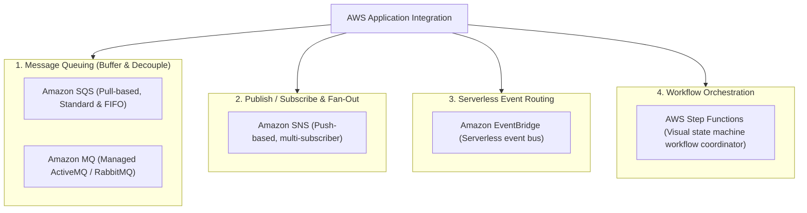
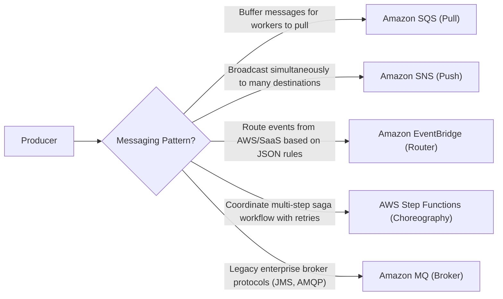

# AWS Application Integration — Map of Content (MOC)

> **Domain:** 03_Services / Application Integration  
> **Parent MOC:** [[AWS_Brain_MOC]]  
> **Certifications:** [[CLF-C02_Master_Blueprint|CLF-C02]], Developer Associate, Solutions Architect

---

## 💡 The Real-World Analogy (ELI5)

> **The Modern Post Office & Automated Factory:**
> - **Amazon SQS (Simple Queue Service):** A bank of PO Box mail slots. When the sender drops off a letter, it sits safely in the mailbox until the receiver arrives and pulls it out. If the receiver is busy, letters safely queue up without dropping (decoupling components).
> - **Amazon SNS (Simple Notification Service):** A public emergency broadcast loudspeaker. A single announcement is shouted once, and thousands of subscribers receive it immediately via SMS, email, mobile push, or webhook (Pub/Sub push model).
> - **Amazon EventBridge:** The central city traffic control hub. It listens for events from AWS services, custom apps, and third-party SaaS tools (like Zendesk or Shopify) and routes them to destinations based on routing rules.
> - **AWS CloudFormation:** The master architectural blueprint for a pre-fabricated house. You hand the blueprint (JSON/YAML template) to the builder, and AWS automatically erects the walls, plumbing, and electrical wiring identically every single time (Infrastructure as Code - IaC).

---

## 1. Architectural Taxonomy of AWS Application Integration

Application integration services enable decoupled, asynchronous communication, choreography, and event distribution across microservices and distributed cloud architectures:

---

## 2. High-Yield Architectural Comparison

| Service | Protocol / Pattern | Delivery Model | Primary Exam Trigger |
| :--- | :--- | :--- | :--- |
| **[[Amazon_SQS]]** | Queuing (point-to-point) | **Pull-based** (consumers poll queue) | *"Decouple components and absorb traffic spikes without message loss."* |
| **[[Amazon_SNS]]** | Pub/Sub Topic | **Push-based** (immediate fan-out) | *"Send a single message to multiple subscribers (email, SMS, SQS) at once."* |
| **[[Amazon_EventBridge]]** | Serverless Event Bus | **Content-based routing** | *"React to AWS service state changes or third-party SaaS events (Shopify, Zendesk)."* |
| **[[AWS_Step_Functions]]** | State Machine Workflow | **Visual coordination** | *"Coordinate multiple Lambda functions and human approvals into a multi-step workflow."* |
| **[[Amazon_MQ]]** | Open-source Broker (ActiveMQ/RabbitMQ) | Traditional broker protocols | *"Migrate existing enterprise messaging using JMS, AMQP, MQTT without rewriting code."* |

---

## 3. Atomic Notes in this Domain

| Atomic Note | Description | Key Focus / Keywords |
| :--- | :--- | :--- |
| **[[Amazon_SQS]]** | Distributed Message Queuing | Standard vs. FIFO, Visibility Timeout, Long Polling, Dead-Letter Queues (DLQ). |
| **[[Amazon_SNS]]** | Pub/Sub Notification Service | Topics, Fan-out pattern, SMS, Mobile Push, Email, Subscription filter policies. |
| **[[Amazon_EventBridge]]** | Serverless Event Bus | Default, Custom, and Partner Event Buses, declarative JSON pattern filtering. |
| **[[AWS_Step_Functions]]** | Serverless Workflow Orchestrator | State machines, Amazon States Language (ASL), error handling, sagas. |
| **[[Amazon_MQ]]** | Managed Message Broker | Apache ActiveMQ, RabbitMQ, legacy protocol migration (JMS, AMQP). |
---

## 7. Post-Topic Question Simulation & Retention Check

Test your understanding of Application Integration & DevOps with these 5 exam-style questions:

## 🎯 Exam Traps & 'Clue-to-Answer' Trigger Words

| Exam Question Clue Keyword | Correct Service | Key Differentiator |
| :--- | :--- | :--- |
| *'Decouple application components with a pull-based message queue'* | **Amazon SQS** | Pull-based queue; Standard (at-least-once) vs FIFO (strictly once). |
| *'Send push notifications, fan-out messages to multiple subscribers via SMS/email'* | **Amazon SNS** | Push-based Publisher/Subscriber (Pub/Sub) messaging. |
| *'Serverless event bus routing events from SaaS apps and AWS services'* | **Amazon EventBridge** | Formerly CloudWatch Events; supports partner SaaS integrations. |
| *'Model, provision, and version AWS infrastructure using declarative JSON/YAML templates'* | **AWS CloudFormation** | Infrastructure as Code (IaC); eliminates manual console clicks. |
| *'Automate continuous integration and continuous delivery (CI/CD) pipelines'* | **AWS CodePipeline** | Orchestrates build, test, and deploy stages. |
| *'Fully managed continuous integration service that compiles code and runs unit tests'* | **AWS CodeBuild** | Serverless build service; pay per build minute. |

---

### Question 1
**Which messaging service provides a fully managed, scalable message queuing service that allows asynchronous decoupling of distributed microservices?**
- A) Amazon SNS
- B) Amazon SQS
- C) Amazon EventBridge
- D) AWS Step Functions

<b>Click to View Answer & Explanation</b>

**Correct Answer:** **B) Amazon SQS**  
- **Why it's correct:** Amazon Simple Queue Service (SQS) is a pull-based message queuing service that decouples producers from consumers, buffering messages until downstream worker nodes process them.

### Question 2
**What is the primary difference between Amazon SQS and Amazon SNS?**
- A) SQS uses a publish/subscribe (push) model; SNS uses a message queue (pull) model.
- B) SQS is a message queue where consumers pull messages; SNS is a pub/sub messaging service that pushes messages simultaneously to multiple subscribers.
- C) SQS only supports email notifications; SNS supports video streaming.
- D) SQS requires physical server management; SNS is serverless.

<b>Click to View Answer & Explanation</b>

**Correct Answer:** **B) SQS is a message queue where consumers pull messages; SNS is a pub/sub messaging service that pushes messages simultaneously to multiple subscribers.**  
- **Why it's correct:** SQS buffers messages for individual consumers (1-to-1 asynchronous queue). SNS fans out messages to multiple subscribers (1-to-many publish/subscribe push to Lambda, SQS, email, SMS, HTTP).

### Question 3
**Which service allows developers to model, provision, and version AWS infrastructure using declarative JSON or YAML templates as Infrastructure as Code (IaC)?**
- A) AWS Elastic Beanstalk
- B) AWS CloudFormation
- C) AWS CodeDeploy
- D) AWS OpsWorks

<b>Click to View Answer & Explanation</b>

**Correct Answer:** **B) AWS CloudFormation**  
- **Why it's correct:** AWS CloudFormation lets you treat your infrastructure as code, enabling repeatable, automated provisioning and updating of complete stacks of AWS resources.

### Question 4
**Which Platform as a Service (PaaS) offering allows developers to upload application code (e.g., Java, Node.js, Python) while AWS automatically handles provisioning, load balancing, scaling, and health monitoring?**
- A) Amazon EC2
- B) AWS Elastic Beanstalk
- C) AWS CodePipeline
- D) AWS Lambda

<b>Click to View Answer & Explanation</b>

**Correct Answer:** **B) AWS Elastic Beanstalk**  
- **Why it's correct:** Elastic Beanstalk is AWS's PaaS solution for deploying web applications quickly without having to manually architect the underlying EC2, Auto Scaling, and ALB infrastructure.

### Question 5
**Which service coordinates distributed microservices and serverless workflows into visual state machines, handling branching logic, retries, and timeouts?**
- A) Amazon EventBridge
- B) AWS Step Functions
- C) Amazon SQS
- D) AWS CodeBuild

<b>Click to View Answer & Explanation</b>

**Correct Answer:** **B) AWS Step Functions**  
- **Why it's correct:** AWS Step Functions is a low-code visual workflow orchestrator that sequences Lambda functions, ECS tasks, and AWS services into resilient state machines.

