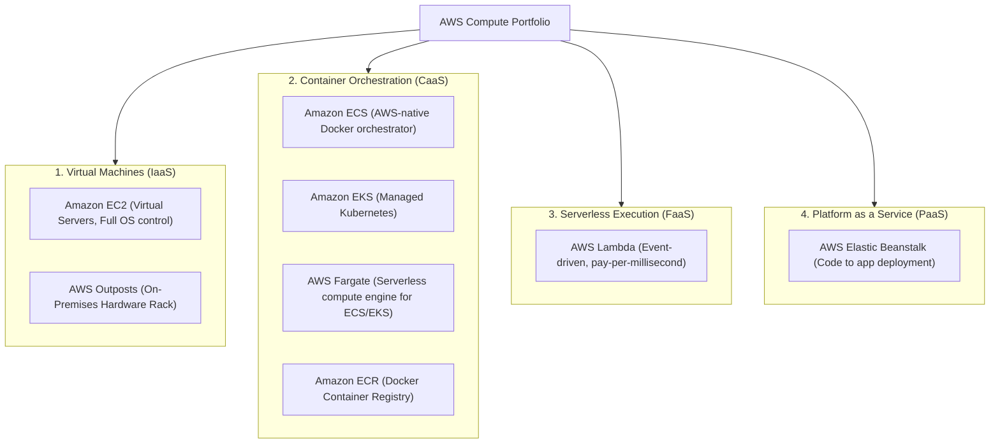
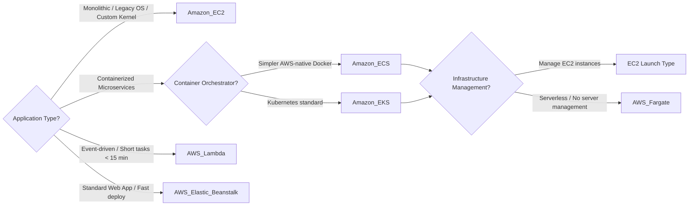

# AWS Compute Services — Map of Content (MOC)

> **Domain:** 03_Services / Compute  
> **Parent MOC:** [[AWS_Brain_MOC]]  
> **Certifications:** [[CLF-C02_Master_Blueprint|CLF-C02]], SAA-C03, DVA-C02

---

## 1. Architectural Taxonomy of AWS Compute

AWS compute services span four distinct operational models, ranging from direct virtual server control to serverless function execution:

---

## 2. Decision Tree: Choosing the Right Compute Service

---

## 3. Atomic Notes in this Domain

| Atomic Note | Description | Key Focus / Keywords |
| :--- | :--- | :--- |
| **[[Amazon_EC2]]** | Elastic Compute Cloud | Instances, AMIs, Pricing Models (On-Demand, Spot, Reserved), EBS. |
| **[[AWS_Lambda]]** | Serverless Compute Engine | Event-driven, 15-minute max execution, 0 to 10k auto-scale, pay per ms. |
| **[[Amazon_ECS]]** | Elastic Container Service | AWS-native Docker container orchestration, Task Definitions, Services. |
| **[[Amazon_EKS]]** | Elastic Kubernetes Service | Managed upstream Kubernetes clusters, Pods, control plane HA. |
| **[[AWS_Fargate]]** | Serverless Container Compute | Run containers without managing EC2 instances, per-vCPU/GB pricing. |
| **[[Amazon_ECR]]** | Elastic Container Registry | Managed private/public Docker registries, vulnerability scanning. |
| **[[AWS_Outposts]]** | Hybrid On-Premises Compute | Physical AWS racks deployed directly into customer data centers. |
| **[[Containers_ECS_EKS_Fargate]]** | Container Comparison Guide | Comprehensive architectural distinction matrix for containers. |
---

## 7. Post-Topic Question Simulation & Retention Check

Test your understanding of AWS Compute Services with these 5 exam-style questions:

### Question 1
**Which EC2 pricing option offers up to a 90% discount on on-demand rates by allowing workloads to run on spare, unused EC2 capacity with the caveat that instances can be terminated with a 2-minute notice?**
- A) Dedicated Hosts
- B) Reserved Instances
- C) Spot Instances
- D) Savings Plans

<b>Click to View Answer & Explanation</b>

**Correct Answer:** **C) Spot Instances**  
- **Why it's correct:** Spot Instances take advantage of unused EC2 capacity at steep discounts (up to 90%). They are ideal for fault-tolerant, stateless batch jobs, big data analysis, and containerized microservices that can tolerate unexpected interruptions.

### Question 2
**A developer wants to run a lightweight Python data transformation script in response to new files landing in an Amazon S3 bucket. The script runs for 30 seconds twice a day. Which compute option is most cost-effective?**
- A) Amazon EC2 On-Demand Instance
- B) AWS Lambda
- C) Amazon ECS with dedicated EC2 worker nodes
- D) AWS Elastic Beanstalk

<b>Click to View Answer & Explanation</b>

**Correct Answer:** **B) AWS Lambda**  
- **Why it's correct:** AWS Lambda is serverless event-driven compute. You pay strictly for execution time measured in 1-millisecond increments. When idle, costs are literally $0.00.

### Question 3
**Which container management service runs Docker containers on AWS without requiring the customer to provision, configure, or scale the underlying EC2 virtual machine instances?**
- A) Amazon EC2 Auto Scaling
- B) AWS Fargate
- C) Amazon Elastic Container Registry (ECR)
- D) AWS Outposts

<b>Click to View Answer & Explanation</b>

**Correct Answer:** **B) AWS Fargate**  
- **Why it's correct:** AWS Fargate is a serverless compute engine for containers that works with both Amazon ECS and Amazon EKS, abstracting away the server layer entirely.

### Question 4
**A company has an enterprise software license that is bound to specific physical CPU sockets and cores. Which Amazon EC2 tenancy option is required to satisfy this licensing restriction?**
- A) Spot Instances
- B) Dedicated Hosts
- C) Default Multi-Tenant Instances
- D) Dedicated Instances

<b>Click to View Answer & Explanation</b>

**Correct Answer:** **B) Dedicated Hosts**  
- **Why it's correct:** An EC2 Dedicated Host gives the customer full physical visibility and socket-level control over a dedicated physical server, satisfying Bring Your Own License (BYOL) socket-bound requirements.

### Question 5
**What is the maximum execution time limit for a single AWS Lambda function invocation?**
- A) 1 minute
- B) 5 minutes
- C) 15 minutes
- D) Unlimited

<b>Click to View Answer & Explanation</b>

**Correct Answer:** **C) 15 minutes**  
- **Why it's correct:** AWS Lambda has a hard technical limit of 15 minutes (900 seconds) per function invocation. Workloads running longer should use AWS Fargate, EC2, or AWS Batch.

