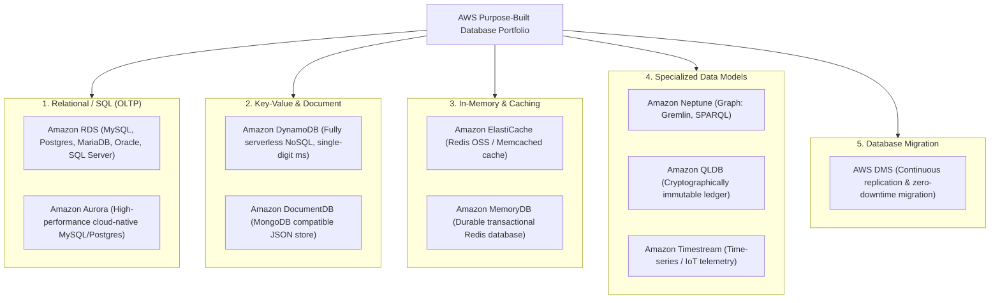

# AWS Database Services — Map of Content (MOC)

> **Domain:** 03_Services / Database  
> **Parent MOC:** [[AWS_Brain_MOC]]  
> **Certifications:** [[CLF-C02_Master_Blueprint|CLF-C02]], SAA-C03, DVA-C02

---

## 💡 The Real-World Analogy (ELI5)

> **Information Organization Systems:**
> - **Amazon RDS / Aurora (Relational):** A rigid, beautiful Excel workbook with strictly enforced columns, primary keys, and relationship lines between sheets (OLTP transactions, banking, e-commerce orders).
> - **Amazon DynamoDB (NoSQL Key-Value):** A bank of electronic luggage lockers at a train station. You punch in your locker ticket number (Partition Key), the door opens in 2 milliseconds, and you grab your bag. Scale from 10 lockers to 10 million lockers without changing your speed.
> - **Amazon ElastiCache (In-Memory Caching):** A quick whiteboard hanging right next to the cash register. Instead of walking back to the file cabinet every time a customer asks for the price of milk, the cashier reads it off the whiteboard in microseconds.
> - **Amazon Redshift (Data Warehouse):** The massive corporate historical record archives. Used by business intelligence analysts to run complex queries across 10 years of sales data (OLAP analytics).

---

## 1. Architectural Taxonomy of AWS Databases

AWS rejects the single "one-size-fits-all" database approach in favor of **purpose-built databases** engineered for specific workload access patterns and data models:

---

## 2. Decision Matrix: Selecting the Target Database

| Workload Need | Target Engine | Key Characteristics |
| :--- | :--- | :--- |
| **Traditional SQL, Foreign Keys, Joins, ACID** | **[[Amazon_RDS]]** / **[[Amazon_Aurora]]** | Automated backup, Multi-AZ failover, read replicas. |
| **Massive Scale Web/Mobile, Predictable Latency** | **[[Amazon_DynamoDB]]** | Serverless, horizontal scaling, partition keys, DAX. |
| **Sub-Millisecond Read Acceleration (Caching)** | **[[Amazon_ElastiCache]]** | In-memory key-value cache, Redis/Memcached. |
| **Primary In-Memory DB with Multi-AZ Durability**| **[[Amazon_MemoryDB]]** | Redis-compatible with transactional write-ahead transaction log. |
| **Connected Graphs (Social, Fraud Networks)** | **[[Amazon_Specialty_Databases|Amazon Neptune]]** | Graph nodes & edges, TinkerPop Gremlin. |
| **MongoDB Document Workloads** | **[[Amazon_Specialty_Databases|Amazon DocumentDB]]** | Fully managed BSON document engine. |
| **Tamper-Proof Audit & Financial Log** | **[[Amazon_Specialty_Databases|Amazon QLDB]]** | Immutable append-only cryptographic ledger. |
| **Sensor / IoT Time Sequences** | **[[Amazon_Specialty_Databases|Amazon Timestream]]** | Auto-scaling time-series with built-in analytics. |

---

## 3. Atomic Notes in this Domain

| Atomic Note | Description | Key Focus / Keywords |
| :--- | :--- | :--- |
| **[[Amazon_RDS]]** | Relational Database Service | Multi-AZ vs. Read Replicas, automated patching, engines. |
| **[[Amazon_Aurora]]** | Cloud-Native Relational Engine | 6-way storage replication across 3 AZs, Aurora Serverless. |
| **[[Amazon_DynamoDB]]** | Serverless NoSQL Database | Tables, Items, Attributes, Partition/Sort Keys, TTL, Streams. |
| **[[Amazon_ElastiCache]]** | Managed In-Memory Cache | Redis OSS vs. Memcached, read caching, session stores. |
| **[[Amazon_MemoryDB]]** | In-Memory Database for Redis | Primary transactional database, sub-millisecond reads, single-digit ms writes. |
| **[[Amazon_Specialty_Databases]]** | Purpose-Built Specialty DBs | DocumentDB, Neptune, QLDB, and Timestream details. |
| **[[AWS_Database_Migration_Service_DMS]]** | Database Migration Service | CDC (Change Data Capture), homogenous and heterogeneous migrations. |
---

## 7. Post-Topic Question Simulation & Retention Check

Test your understanding of AWS Database Services with these 5 exam-style questions:

## 🎯 Exam Traps & 'Clue-to-Answer' Trigger Words

| Exam Question Clue Keyword | Correct Database Service | Exam Trap Tip |
| :--- | :--- | :--- |
| *'Relational database with automated Multi-AZ failover and read scaling'* | **Amazon RDS** | Supports MySQL, PostgreSQL, MariaDB, Oracle, SQL Server. |
| *'Cloud-native relational database, up to 5x throughput of MySQL, 3x PostgreSQL'* | **Amazon Aurora** | Storage replicates 6 copies across 3 AZs automatically. |
| *'Fully managed serverless NoSQL key-value database, single-digit millisecond latency'* | **Amazon DynamoDB** | Uses DAX for microsecond in-memory caching. |
| *'In-memory data store for sub-millisecond caching of frequent queries'* | **Amazon ElastiCache** | Redis or Memcached engines. |
| *'Petabyte-scale columnar data warehouse for complex analytics and BI queries'* | **Amazon Redshift** | Columnar storage for OLAP queries; not for fast transactional OLTP. |
| *'Graph database for fraud detection and social network relationships'* | **Amazon Neptune** | Highly connected graph relationships. |

---

### Question 1
**Which AWS database service provides a fully managed NoSQL key-value and document database engine capable of delivering single-digit millisecond latency at any scale with automated multi-AZ replication?**
- A) Amazon RDS
- B) Amazon DynamoDB
- C) Amazon Redshift
- D) Amazon DocumentDB

<b>Click to View Answer & Explanation</b>

**Correct Answer:** **B) Amazon DynamoDB**  
- **Why it's correct:** Amazon DynamoDB is a serverless NoSQL database engineered for high-throughput, millisecond performance with automatic horizontal scaling, built-in security, and Global Tables for multi-region replication.

### Question 2
**A company is running an existing MySQL database on-premises and wants to migrate to an enterprise cloud-native relational database that provides up to 5 times the throughput of standard MySQL, self-healing storage up to 128 TiB, and up to 15 Read Replicas. Which service should they choose?**
- A) Amazon DynamoDB
- B) Amazon Aurora
- C) Amazon Redshift
- D) Amazon Neptune

<b>Click to View Answer & Explanation</b>

**Correct Answer:** **B) Amazon Aurora**  
- **Why it's correct:** Amazon Aurora is AWS's proprietary cloud-native relational database engine compatible with MySQL and PostgreSQL, delivering 3-5x the throughput of standard open-source engines with a distributed storage system replicating 6 copies across 3 AZs.

### Question 3
**An e-commerce website experiences heavy read traffic on its Amazon RDS database during flash sales. How can the architecture be modified to reduce database read latency to microseconds without re-architecting the database?**
- A) Upgrade the EC2 web instances
- B) Add an Amazon ElastiCache in-memory caching layer in front of the database
- C) Convert the database to Amazon Redshift
- D) Enable S3 Versioning

<b>Click to View Answer & Explanation</b>

**Correct Answer:** **B) Add an Amazon ElastiCache in-memory caching layer in front of the database**  
- **Why it's correct:** Amazon ElastiCache (Redis or Memcached) caches frequent query results in memory, serving responses with sub-millisecond latency and offloading read pressure from the backend database.

### Question 4
**Which database service is specifically optimized for Online Analytical Processing (OLAP), complex SQL queries across petabytes of historical structured business intelligence data, and columnar storage?**
- A) Amazon RDS for PostgreSQL
- B) Amazon Redshift
- C) Amazon DynamoDB
- D) Amazon DocumentDB

<b>Click to View Answer & Explanation</b>

**Correct Answer:** **B) Amazon Redshift**  
- **Why it's correct:** Amazon Redshift is a petabyte-scale cloud data warehouse designed for OLAP workloads, reporting, and BI analytics using columnar storage and massively parallel processing (MPP).

### Question 5
**Which purpose-built database service is designed specifically for storing and navigating highly connected relationship data, such as social graphs, fraud rings, and recommendation engines?**
- A) Amazon Neptune
- B) Amazon Timestream
- C) Amazon DocumentDB
- D) Amazon RDS

<b>Click to View Answer & Explanation</b>

**Correct Answer:** **A) Amazon Neptune**  
- **Why it's correct:** Amazon Neptune is a purpose-built graph database supporting property graph (Apache TinkerPop Gremlin) and W3C RDF (SPARQL) queries for mapping complex interconnected relationships.

