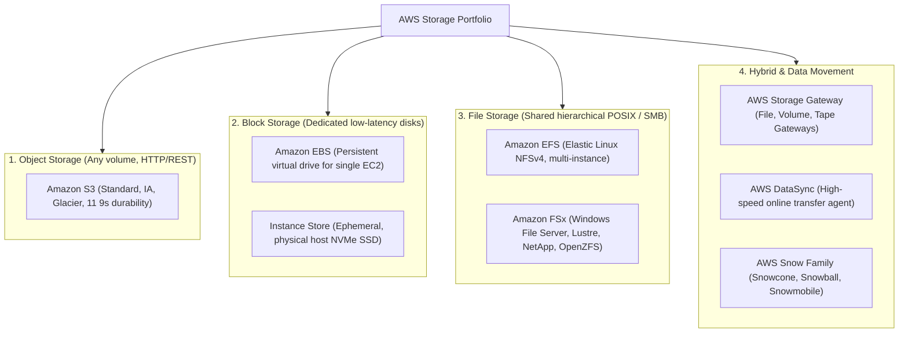
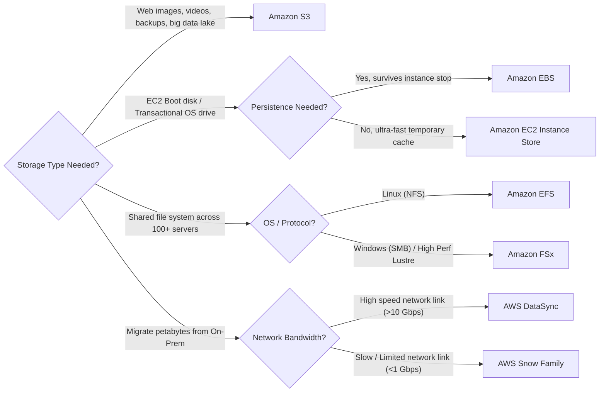

# AWS Storage Services — Map of Content (MOC)

> **Domain:** 03_Services / Storage  
> **Parent MOC:** [[AWS_Brain_MOC]]  
> **Certifications:** [[CLF-C02_Master_Blueprint|CLF-C02]], SAA-C03, SysOps

---

## 1. Architectural Taxonomy of AWS Storage

AWS divides storage services across three fundamental paradigms—**Object Storage**, **Block Storage**, and **File Storage**—alongside hybrid and data transfer appliances:

---

## 2. Decision Tree: Choosing the Right Storage Service

---

## 3. Atomic Notes in this Domain

| Atomic Note | Description | Key Focus / Keywords |
| :--- | :--- | :--- |
| **[[Amazon_S3]]** | Simple Storage Service | Buckets, Storage Classes, Lifecycle Rules, Versioning, S3 Object Lock. |
| **[[Amazon_EBS]]** | Elastic Block Store | `gp3`, `io2`, `st1`, `sc1`, Snapshots, Multi-Attach, single AZ. |
| **[[Amazon_EC2_Instance_Store]]** | Ephemeral Host Storage | Maximum IOPS/performance, data lost on instance stop/termination. |
| **[[Amazon_EFS]]** | Elastic File System | Managed Linux NFS, multi-AZ, scales automatically, concurrent mount. |
| **[[Amazon_FSx]]** | Specialized File Systems | FSx for Windows File Server (SMB), FSx for Lustre (HPC/ML). |
| **[[AWS_Storage_Gateway]]** | Hybrid Storage Bridge | S3 File Gateway, Volume Gateway (Stored/Cached), Tape Gateway. |
| **[[AWS_DataSync]]** | Automated Data Transfer | 10x faster online transfer between on-prem storage and S3/EFS/FSx. |
| **[[AWS_Snow_Family]]** | Physical Data Migration Devices | Snowcone (8 TB), Snowball Edge (80 TB), Snowmobile (up to 100 PB). |
| **[[Block_and_File_Storage_EBS_EFS]]** | Comparison Guide | Detailed architectural breakdown comparing EBS vs. EFS. |
---

## 7. Post-Topic Question Simulation & Retention Check

Test your understanding of AWS Storage Services with these 5 exam-style questions:

### Question 1
**Which Amazon S3 storage class automatically optimizes customer costs by analyzing access patterns and moving objects between frequent and infrequent access tiers without operational overhead or retrieval fees?**
- A) S3 Standard
- B) S3 Intelligent-Tiering
- C) S3 Glacier Flexible Retrieval
- D) S3 One Zone-IA

<b>Click to View Answer & Explanation</b>

**Correct Answer:** **B) S3 Intelligent-Tiering**  
- **Why it's correct:** S3 Intelligent-Tiering monitors object access frequencies and moves objects automatically between frequent, infrequent, and optional archive tiers, eliminating storage waste when data access patterns are unknown or unpredictable.

### Question 2
**An application running on multiple Amazon EC2 instances in different Availability Zones needs concurrent read and write access to a shared hierarchical file system using standard NFS protocols. Which service should be used?**
- A) Amazon Elastic Block Store (Amazon EBS)
- B) Amazon Elastic File System (Amazon EFS)
- C) Amazon S3 Glacier
- D) Amazon EC2 Instance Store

<b>Click to View Answer & Explanation</b>

**Correct Answer:** **B) Amazon Elastic File System (Amazon EFS)**  
- **Why it's correct:** Amazon EFS is a fully managed, serverless, elastic file system supporting the NFSv4 protocol that can be mounted simultaneously by hundreds of EC2 instances across multiple Availability Zones.

### Question 3
**What is the defining characteristic of Amazon EC2 Instance Store storage?**
- A) It is persistent and survives instance stopping and termination.
- B) It is ephemeral (temporary); data is completely lost if the instance stops or fails.
- C) It is hosted in an external storage area network (SAN).
- D) It automatically replicates data across multiple AWS Regions.

<b>Click to View Answer & Explanation</b>

**Correct Answer:** **B) It is ephemeral (temporary); data is completely lost if the instance stops or fails.**  
- **Why it's correct:** Instance Store volumes consist of physical disks directly attached to the host physical server. They offer ultra-high IOPS and low latency, but their lifecycle is tied directly to the instance; stopping or terminating the instance wipes all data.

### Question 4
**A company must archive 100 TB of medical compliance records for 10 years. The records are accessed at most once per year, and the organization can tolerate a retrieval time of 12 hours. Which storage solution offers the lowest cost?**
- A) S3 Standard-Infrequent Access (S3 Standard-IA)
- B) S3 Glacier Deep Archive
- C) Amazon EBS Cold HDD (sc1)
- D) Amazon EFS One Zone

<b>Click to View Answer & Explanation</b>

**Correct Answer:** **B) S3 Glacier Deep Archive**  
- **Why it's correct:** S3 Glacier Deep Archive is AWS's lowest-cost cloud storage tier ($0.00099 per GB/month), designed for long-term retention of infrequently accessed regulatory archives with standard 12-hour retrieval windows.

### Question 5
**An enterprise needs to physically migrate 150 TB of on-premises video data to Amazon S3, but its corporate internet connection is limited to 10 Mbps. Which AWS service is purpose-built for this data transfer?**
- A) AWS Storage Gateway
- B) AWS Snowball Edge
- C) AWS DataSync
- D) AWS Direct Connect

<b>Click to View Answer & Explanation</b>

**Correct Answer:** **B) AWS Snowball Edge**  
- **Why it's correct:** AWS Snowball Edge devices are ruggedized physical appliances shipped to the customer's data center to transfer up to 80 TB per device over local high-speed network cabling, bypassing slow internet bandwidth.

