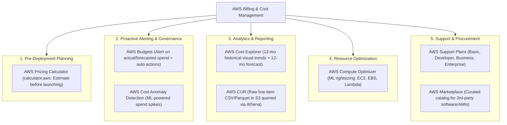
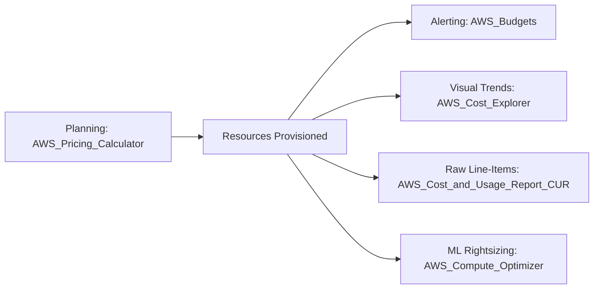

# AWS Billing & Cost Management — Map of Content (MOC)

> **Domain:** 03_Services / Billing & Cost Management  
> **Parent MOC:** [[AWS_Brain_MOC]]  
> **Certifications:** [[CLF-C02_Master_Blueprint|CLF-C02]], Cloud Operations, Solutions Architect

---

## 1. Architectural Taxonomy of AWS Billing & FinOps

AWS billing and cost management tools guide organizations through the full lifecycle of cloud financial governance—from initial architectural estimation through proactive alerting, visual analysis, machine learning optimization, and executive reporting:

---

## 2. High-Yield Tool Comparison (CLF-C02 Cheat Sheet)

| Tool | When to Use | Key Differentiator |
| :--- | :--- | :--- |
| **[[AWS_Pricing_Calculator]]** | **Before** launching resources. | Estimate expected monthly bill; no AWS account required (`calculator.aws`). |
| **[[AWS_Budgets]]** | **During** the billing cycle. | Set hard thresholds; alert via email/SNS; execute automated shutdown actions. |
| **[[AWS_Cost_Explorer]]** | **Monthly/Weekly** reviews. | Interactive visual charts; group by tag/service; 12-month historical + 12-month forecast. |
| **[[AWS_Cost_and_Usage_Report_CUR]]** | **Enterprise FinOps**. | Most granular raw line-item dataset; delivered to S3; queried using SQL via Athena. |
| **[[AWS_Compute_Optimizer]]** | **Optimization** sprints. | ML analysis of CloudWatch metrics to recommend downsizing or upsizing instances. |
| **[[AWS_Support_Plans]]** | **Operational planning**. | SLA response times (< 15 min for Enterprise); TAM assignment; 24/7 phone access. |
| **[[AWS_Marketplace]]** | **Software procurement**. | Buy 3rd-party software and AMIs; consolidated billing onto regular AWS invoice. |

---

## 3. Atomic Notes in this Domain

| Atomic Note | Description | Key Focus / Keywords |
| :--- | :--- | :--- |
| **[[AWS_Budgets]]** | Cost & Usage Budgets | Actual vs. Forecasted thresholds, auto-stop EC2 actions, SNS alerts. |
| **[[AWS_Cost_Explorer]]** | Historical Analytics & Forecasting | Visual graphs, breakdown by tag/service, Savings Plans recommendations. |
| **[[AWS_Cost_and_Usage_Report_CUR]]** | Raw Line-Item Data | Ultimate billing granularity, S3 delivery, Amazon Athena SQL integration. |
| **[[AWS_Pricing_Calculator]]** | Pre-Deployment Estimator | Estimate architectures before building, shareable links, CSV export. |
| **[[AWS_Compute_Optimizer]]** | ML Resource Rightsizing | Identify over-provisioned and under-provisioned EC2, EBS, Lambda, Fargate. |
| **[[AWS_Support_Plans]]** | Support Tier Comparison | Basic, Developer, Business, Enterprise; TAM, Concierge, response SLAs. |
| **[[AWS_Marketplace]]** | Digital Software Catalog | 3rd-party AMIs and SaaS, consolidated monthly billing, Private Marketplace. |
---

## 7. Post-Topic Question Simulation & Retention Check

Test your understanding of Pricing Models & Billing Tools with these 5 exam-style questions:

### Question 1
**Which AWS tool provides an interactive graphical interface allowing customers to visualize, understand, and forecast their AWS spending patterns over the past 12 months and project costs for the next 12 months?**
- A) AWS Budgets
- B) AWS Cost Explorer
- C) AWS Pricing Calculator
- D) AWS Billing Conductor

<b>Click to View Answer & Explanation</b>

**Correct Answer:** **B) AWS Cost Explorer**  
- **Why it's correct:** AWS Cost Explorer has an easy-to-use interface that lets you visualize, understand, and manage your AWS costs and usage over time, including customizable charts, filtering by tags, and 12-month future forecasting.

### Question 2
**A financial manager wants to configure custom notifications that trigger an automated alert when monthly spending on Amazon EC2 exceeds $1,000 or when forecasted spending is predicted to exceed that limit. Which service should they configure?**
- A) AWS Budgets
- B) AWS Cost Explorer
- C) AWS Trusted Advisor
- D) Amazon CloudWatch

<b>Click to View Answer & Explanation</b>

**Correct Answer:** **A) AWS Budgets**  
- **Why it's correct:** AWS Budgets allows you to set custom budgets that track your cost or usage and alert you via email or SNS when you exceed (or are forecasted to exceed) your budgeted threshold.

### Question 3
**Which pricing model offers the highest discount (up to 72%) on compute resources in exchange for a commitment to a consistent amount of usage (measured in $/hour) for a 1-year or 3-year period across EC2, Lambda, and Fargate?**
- A) Standard Reserved Instances
- B) Compute Savings Plans
- C) Spot Instances
- D) On-Demand Instances

<b>Click to View Answer & Explanation</b>

**Correct Answer:** **B) Compute Savings Plans**  
- **Why it's correct:** Compute Savings Plans provide the greatest flexibility, automatically applying discounts of up to 72% across EC2 (regardless of family, OS, or Region), AWS Fargate, and AWS Lambda based on a committed $/hour spend.

### Question 4
**What is the purpose of Cost Allocation Tags in AWS Billing?**
- A) To automatically terminate resources that exceed a budget
- B) To label and categorize AWS resources (e.g. by Department, Environment, or Project) to track and allocate costs on detailed billing reports
- C) To encrypt data stored on S3
- D) To restrict IAM users from launching expensive instances

<b>Click to View Answer & Explanation</b>

**Correct Answer:** **B) To label and categorize AWS resources (e.g. by Department, Environment, or Project) to track and allocate costs on detailed billing reports**  
- **Why it's correct:** Cost Allocation Tags are key-value labels assigned to AWS resources that appear in Cost Explorer and detailed billing reports, allowing finance teams to allocate expenses accurately to cost centers.

### Question 5
**Which tool allows architects to estimate the cost of an architecture proposal before building or provisioning any resources on AWS?**
- A) AWS Pricing Calculator
- B) AWS Cost and Usage Report (CUR)
- C) AWS Budgets
- D) AWS License Manager

<b>Click to View Answer & Explanation</b>

**Correct Answer:** **A) AWS Pricing Calculator**  
- **Why it's correct:** The AWS Pricing Calculator is a web-based planning tool that allows you to model proposed cloud architectures and generate comprehensive monthly cost estimates without needing an AWS account.

