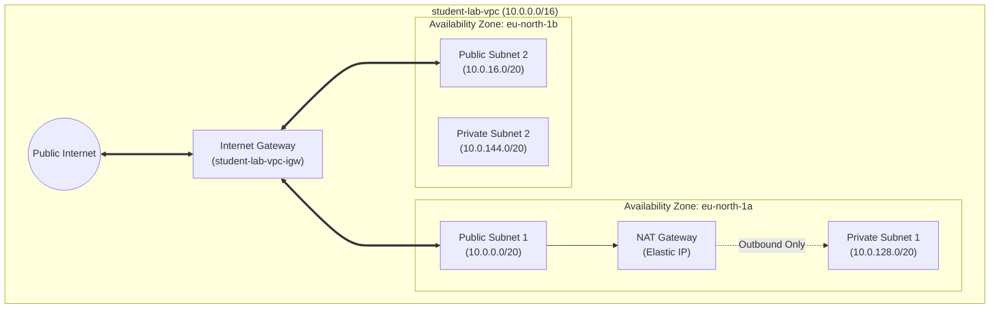
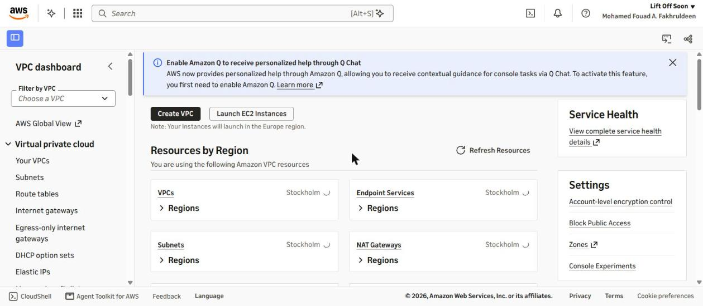
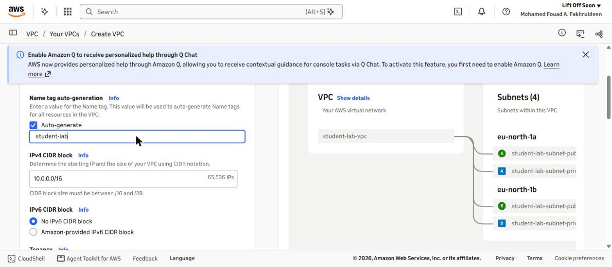
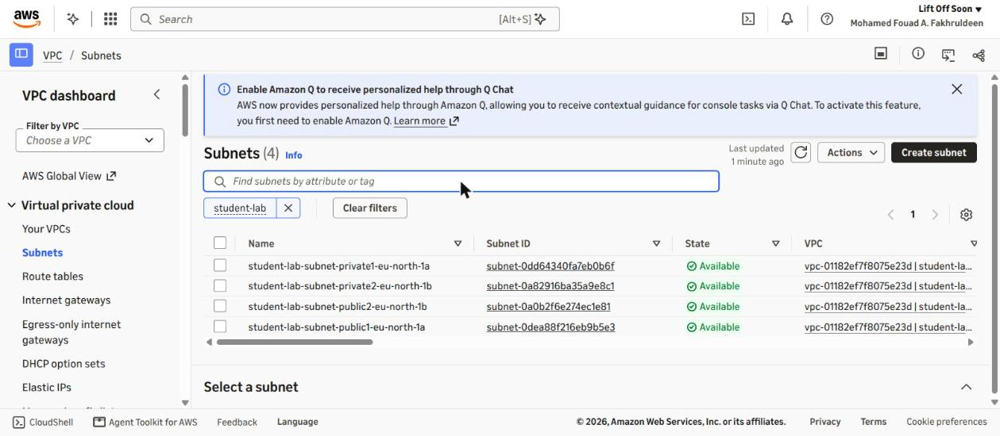
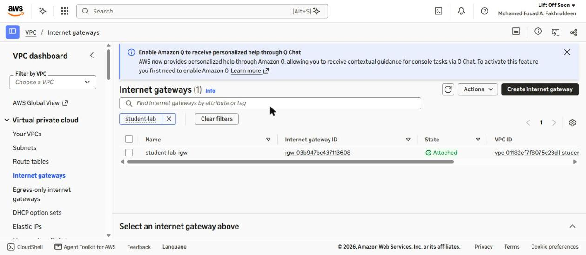
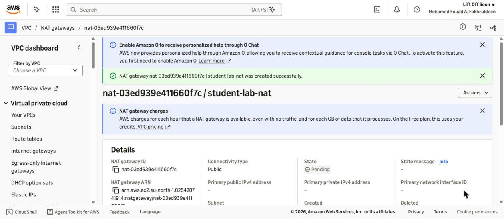
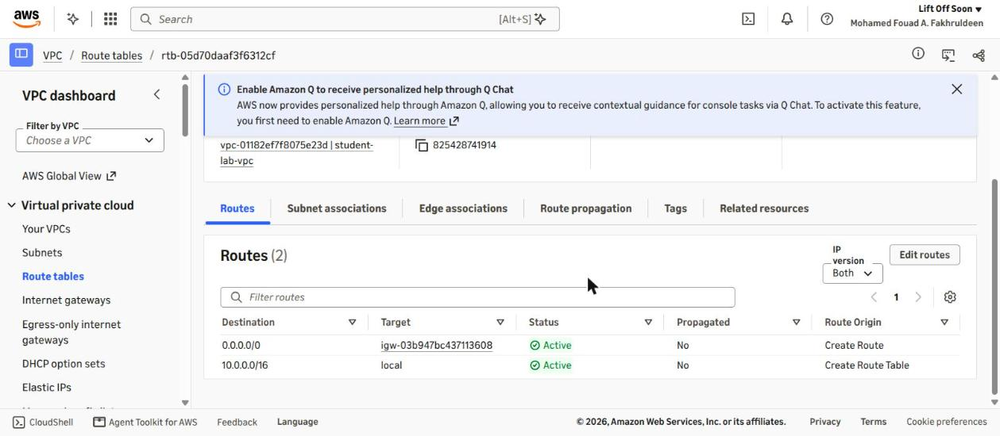
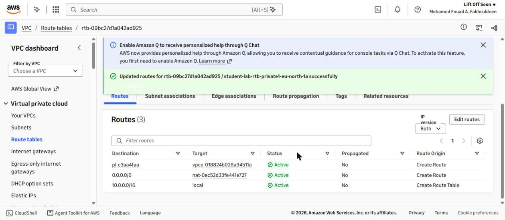

# Lab 01: Multi-Tier VPC & Networking Foundations

> **Focus:** Amazon VPC, Public & Private Subnets, Internet Gateways (IGW), Route Tables, and NAT Gateways  
> **Region:** `eu-north-1` (Stockholm)  
> **Course Domain:** Domain 3: Cloud Technology & Services  
> **Associated Vault Note:** [[Amazon_VPC]]  

---

## 🧭 Prerequisite Concept Refresher: Networking 101

Before creating cloud networks, students must master three fundamental concepts:

### 1. The OSI Model (Layers 3 & 4)
- **Layer 3 (Network Layer):** Operates on **IP Addresses** (e.g., IPv4 `10.0.0.0/16`). Amazon VPC, Subnets, Internet Gateways, and Route Tables operate at Layer 3 to route packets across subnets and to the internet.
- **Layer 4 (Transport Layer):** Operates on **Ports and Protocols** (e.g., TCP port 80 for HTTP, TCP port 443 for HTTPS, TCP port 22 for SSH). Security Groups and Network ACLs filter traffic at Layer 4.

### 2. IPv4 CIDR Blocks & Subnetting Math
A **CIDR (Classless Inter-Domain Routing)** block defines the range of IP addresses assigned to your network:
- `10.0.0.0/16`: The `/16` prefix leaves 16 bits for hosts ($2^{16} = 65,536$ total IP addresses). This is standard for a VPC.
- `10.0.1.0/24`: The `/24` prefix leaves 8 bits for hosts ($2^8 = 256$ total IP addresses). This is standard for a subnet.

### 3. The 5 AWS-Reserved IP Addresses per Subnet
In every AWS subnet, **5 IP addresses are reserved** by AWS and cannot be assigned to instances:
- `.0`: Network address.
- `.1`: Reserved for the VPC router.
- `.2`: Reserved for internal DNS resolution (AmazonProvidedDNS).
- `.3`: Reserved for future AWS internal use.
- `.255`: Network broadcast address (AWS does not support broadcast, but reserves it).
*Formula:* Available usable IPs in a subnet = $2^{(32 - \text{prefix})} - 5$. For a `/24` subnet: $256 - 5 = 251$ usable IPs.

---

## 🏗️ Lab Architecture



---

## 🛠️ Step-by-Step Console Walkthrough

### Step 1: Open the Amazon VPC Dashboard
1. Sign in to the AWS Management Console.
2. Ensure your region selector in the top-right corner is set to **`eu-north-1` (Stockholm)**.
3. In the search bar, type `VPC` and select **VPC**.


*Figure 1.1: Amazon VPC console dashboard in Stockholm (`eu-north-1`).*

---

### Step 2: Launch the "VPC and more" Creation Wizard
1. Click the orange **Create VPC** button.
2. Select **VPC and more** (this creates subnets, gateways, and route tables in a single cohesive blueprint).
3. Configure the following parameters:
   - **Name tag auto-generation:** `student-lab-vpc`
   - **IPv4 CIDR block:** `10.0.0.0/16`
   - **Number of Availability Zones (AZs):** `2`
   - **Number of public subnets:** `2`
   - **Number of private subnets:** `2`
   - **NAT gateways:** `In 1 AZ` (cost-optimized for learning labs)
   - **VPC Endpoints:** `None`


*Figure 1.2: Visual workflow of the VPC and More creation wizard.*

4. Click **Create VPC** at the bottom of the page and wait for the resources to provision.

---

### Step 3: Inspect the Generated Subnets
1. In the left navigation pane, click **Subnets**.
2. Filter the table by entering `student-lab-vpc` in the search bar.
3. Verify that 4 subnets are created: 2 public subnets and 2 private subnets distributed across `eu-north-1a` and `eu-north-1b`.


*Figure 1.3: Subnets table showing IPv4 CIDR blocks and AZ mapping.*

---

### Step 4: Verify the Internet Gateway (IGW) Attachment
1. In the left navigation pane, select **Internet Gateways**.
2. Select `student-lab-vpc-igw`.
3. Confirm that the state displays as **Attached** to `student-lab-vpc`.


*Figure 1.4: Internet Gateway attached at the VPC level.*

---

### Step 5: Verify the NAT Gateway & Elastic IP
1. In the left navigation pane, click **NAT Gateways**.
2. Select `student-lab-vpc-nat-public1-eu-north-1a`.
3. Verify that:
   - **Subnet:** Resides in a **Public Subnet** (`student-lab-vpc-subnet-public1-eu-north-1a`).
   - **Elastic IP address:** An Elastic IP is allocated and bound to the NAT Gateway.
   - **Status:** **Available**.


*Figure 1.5: NAT Gateway provisioned in the public subnet with an Elastic IP.*

---

### Step 6: Inspect the Public Subnet Route Table
1. In the left navigation pane, select **Route Tables**.
2. Select `student-lab-vpc-rtb-public` and click on the **Routes** tab.
3. Observe the default route:
   - **Destination:** `0.0.0.0/0` (all non-VPC internet traffic).
   - **Target:** `igw-xxxxxxxx` (the Internet Gateway).


*Figure 1.6: Public route table directing non-local traffic to the Internet Gateway.*

---

### Step 7: Inspect the Private Subnet Route Table
1. Select `student-lab-vpc-rtb-private1-eu-north-1a` and click on the **Routes** tab.
2. Observe the egress-only route:
   - **Destination:** `0.0.0.0/0`.
   - **Target:** `nat-xxxxxxxx` (the NAT Gateway).


*Figure 1.7: Private route table routing outbound internet traffic through the NAT Gateway.*

---

## 💻 AWS CLI Verification Commands

Verify each resource using the AWS CLI configured for Sweden (`eu-north-1`):

```bash
# 1. Describe the VPC
aws ec2 describe-vpcs \
  --filters "Name=tag:Name,Values=student-lab-vpc*" \
  --region eu-north-1 \
  --profile aws-notes

# 2. List all subnets and their available IP counts
aws ec2 describe-subnets \
  --filters "Name=vpc-id,Values=$(aws ec2 describe-vpcs --filters 'Name=tag:Name,Values=student-lab-vpc*' --query 'Vpcs[0].VpcId' --output text --region eu-north-1 --profile aws-notes)" \
  --query "Subnets[*].{SubnetId:SubnetId,CIDR:CidrBlock,AZ:AvailabilityZone,AvailableIPs:AvailableIpAddressCount}" \
  --output table \
  --region eu-north-1 \
  --profile aws-notes

# 3. Confirm NAT Gateway status
aws ec2 describe-nat-gateways \
  --filter "Name=state,Values=available" \
  --region eu-north-1 \
  --profile aws-notes
```

---

## 🎯 Exam Practice: Scenarios & Traps

| Exam Scenario | Correct Recommendation | Why Distractors Fail |
|---|---|---|
| *"A company has backend database instances running in a private subnet that need to download OS security patches from the internet without allowing external users to initiate inbound connections."* | **Deploy a NAT Gateway in a public subnet and route private outbound traffic to it** | An Internet Gateway (IGW) attached directly to a private subnet allows bi-directional inbound traffic, exposing databases. A NAT Instance is unmanaged and lacks built-in HA. |
| *"A network engineer creates a new subnet with CIDR block `10.0.1.0/24`. How many usable IP addresses are available for EC2 instances?"* | **251 Usable IP Addresses** | AWS always reserves **5 IP addresses** in every subnet (.0 network, .1 router, .2 Amazon DNS, .3 future use, .255 broadcast). $256 - 5 = 251$. |
| *"What makes a subnet in Amazon VPC officially 'public' versus 'private'?"* | **Its associated route table has a default route (`0.0.0.0/0`) targeting an Internet Gateway (IGW)** | Simply attaching an Elastic IP does not make a subnet public without the route table entry pointing to an IGW. |
| *"Which VPC component is redundant, highly available by default, and incurs zero additional hourly cost?"* | **Internet Gateway (IGW)** | NAT Gateways incur hourly charges per gateway plus data processing fees. IGWs are horizontally scaled and free. |

---

## 🧹 Free Tier Cleanup & Cost Safeguard

> [!WARNING]
> **NAT Gateways incur hourly charges!** While VPCs, Subnets, and IGWs are free, an active NAT Gateway costs approximately \$0.045 per hour plus data processing. Delete the NAT Gateway immediately after completing the lab.

1. Navigate to **NAT Gateways** -> Select your NAT Gateway -> Click **Actions** -> **Delete NAT Gateway**.
2. Navigate to **Elastic IPs** -> Select the allocated IP -> Click **Actions** -> **Release Elastic IP addresses**.
3. Navigate to **Your VPCs** -> Select `student-lab-vpc` -> Click **Actions** -> **Delete VPC**. Check the confirmation box to delete all associated subnets, route tables, and internet gateways automatically.
