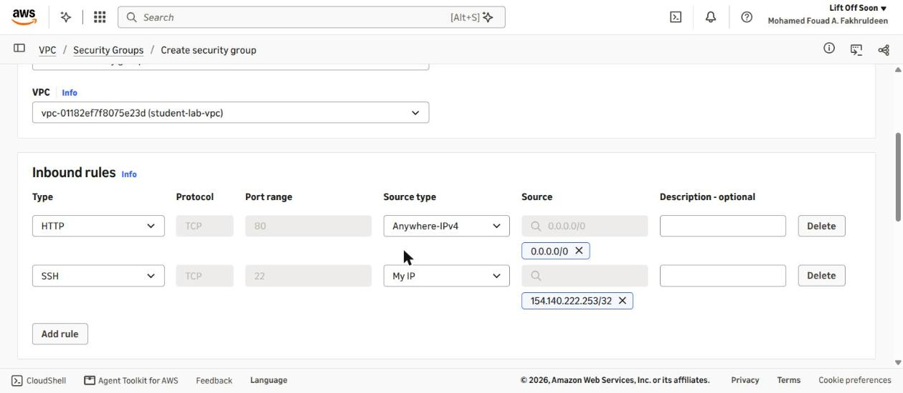
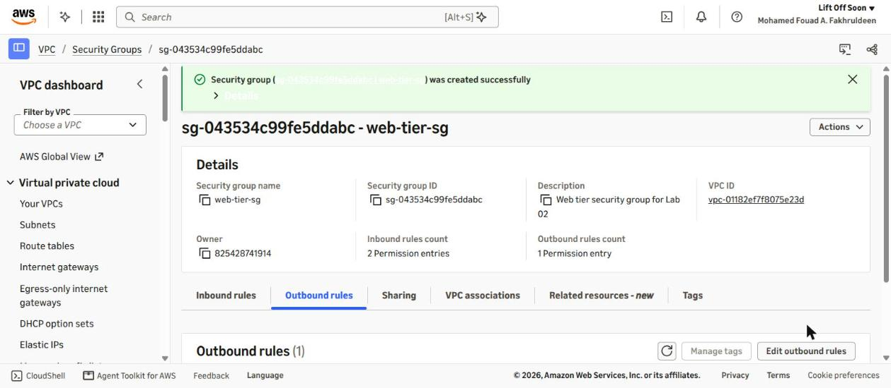
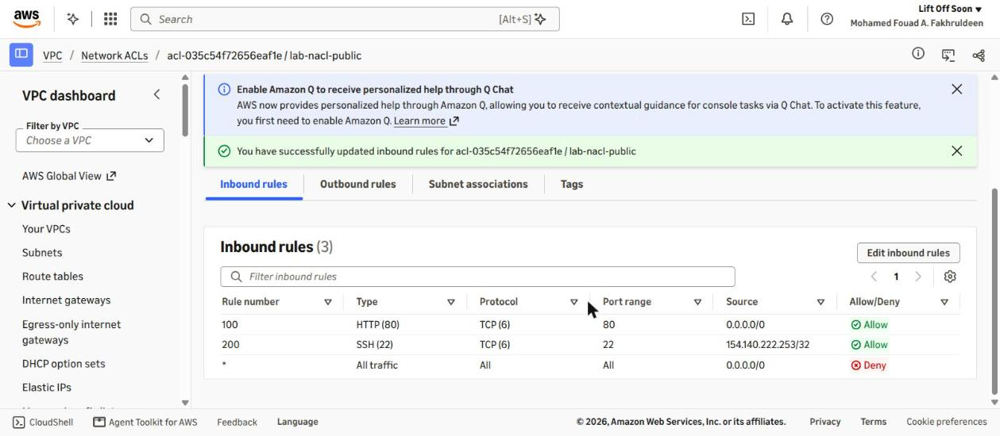
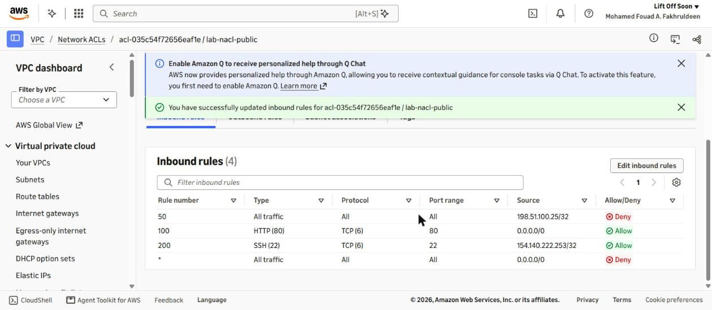
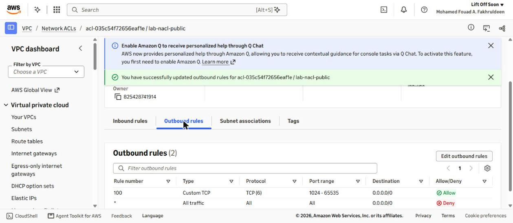
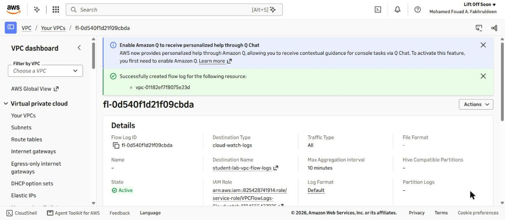

# Lab 02: VPC Security Controls (Security Groups vs. NACLs)

> **Focus:** Stateful Security Groups, Stateless Network ACLs (NACLs), Explicit IP Deny Rules, and VPC Flow Logs  
> **Region:** `eu-north-1` (Stockholm)  
> **Course Domain:** Domain 2: Security & Compliance, Domain 3: Cloud Technology & Services  
> **Associated Vault Note:** [[Security_Groups_vs_NACLs]]  

---

## 🧭 Prerequisite Concept Refresher: Firewall Defense in Depth

In Amazon VPC, network security is implemented in two concentric security boundaries:

```
[ Internet ]
      │
      ▼
┌──────────────────────────────────────────────┐
│  Subnet Boundary: Network ACL (Stateless)    │  <-- First Line of Defense (Subnet Level)
│  (Allows & Denies specific IPs/CIDRs)       │
└──────────────────────┬───────────────────────┘
                       │
                       ▼
         ┌───────────────────────────────┐
         │ Instance Boundary: SG         │  <-- Second Line of Defense (Instance/ENI Level)
         │ (Stateful, Allow-rules only)  │
         └─────────────┬─────────────────┘
                       │
                       ▼
              [ EC2 Virtual Server ]
```

### 1. Stateful vs. Stateless Filtering
- **Stateful (Security Groups):** The firewall remembers active connections. If an inbound packet is allowed in (e.g., HTTP on port 80), return traffic is **automatically allowed back out**, regardless of outbound rules.
- **Stateless (Network ACLs):** Inbound and outbound traffic are treated as completely independent connections. If you allow inbound HTTP on port 80, you **must explicitly configure an outbound rule** to allow response packets back to the client.

### 2. Ephemeral Ports (1024–65535)
When a client (e.g., your laptop) connects to a web server on port 80, the client's operating system chooses a random high port (an **ephemeral port**, typically 1024 to 65535) to receive the return data. Because NACLs are stateless, the NACL outbound rule table **must allow outbound traffic on ports 1024–65535**; otherwise, the connection will time out.

### 3. Allow-Only vs. Explicit Deny Rules
- **Security Groups:** Support **ALLOW rules only**. You cannot write an explicit DENY rule. All traffic is blocked by default unless permitted.
- **Network ACLs:** Support both **ALLOW and DENY rules**. Rules are evaluated in strict numerical order (lowest numbered rule first). As soon as a packet matches a rule, evaluation halts.

---

## 🛠️ Step-by-Step Console Walkthrough

### Step 1: Create a Stateful Security Group
1. In the VPC Console, select **Security Groups** from the left navigation pane.
2. Click **Create security group**.
3. Configure the security group:
   - **Security group name:** `web-tier-sg`
   - **Description:** `Allow inbound HTTP and management SSH`
   - **VPC:** Select `student-lab-vpc`.
4. In the **Inbound rules** section, add two rules:
   - Rule 1: Type: `HTTP`, Protocol: `TCP`, Port range: `80`, Source: `Anywhere-IPv4` (`0.0.0.0/0`).
   - Rule 2: Type: `SSH`, Protocol: `TCP`, Port range: `22`, Source: `My IP`.


*Figure 2.1: Defining inbound allow rules for web and administrative traffic.*

---

### Step 2: Verify Stateful Outbound Behavior
1. In the **Outbound rules** section of `web-tier-sg`, observe the default rule:
   - **Type:** `All traffic`, **Destination:** `0.0.0.0/0`.
2. Because Security Groups are **stateful**, even if you restricted outbound traffic, return responses to permitted inbound connections would still be allowed.
3. Click **Create security group**.


*Figure 2.2: Default stateful outbound rule.*

---

### Step 3: Inspect Network ACL Inbound Rules
1. In the left navigation pane, select **Network ACLs**.
2. Select the default Network ACL associated with your public subnets (`student-lab-vpc-nacl-public`).
3. Click on the **Inbound rules** tab. Observe the default numbered rules:
   - Rule `100`: Allow all traffic (`*`).
   - Rule `*`: Deny all traffic (the catch-all rule).


*Figure 2.3: Numbered rule evaluation list in the Network ACL.*

---

### Step 4: Add an Explicit DENY Rule to Block a Malicious IP
1. Click **Edit inbound rules**.
2. Click **Add new rule** and set:
   - **Rule number:** `50` (processed *before* Rule 100).
   - **Type:** `All traffic`.
   - **Source:** `198.51.100.25/32` (simulated attacker IP).
   - **Allow/Deny:** Select **DENY**.
3. Click **Save changes**. All packets from `198.51.100.25` are now dropped immediately at the subnet perimeter.


*Figure 2.4: Low-numbered explicit DENY rule inserted before broad ALLOW rules.*

---

### Step 5: Verify Stateless Outbound Rules & Ephemeral Ports
1. Click on the **Outbound rules** tab.
2. In custom NACLs that do not allow all traffic, verify that an outbound rule permits ephemeral traffic:
   - **Rule number:** `100`
   - **Type:** `Custom TCP`
   - **Port range:** `1024-65535`
   - **Destination:** `0.0.0.0/0`
   - **Allow/Deny:** `ALLOW`


*Figure 2.5: Permitting outbound ephemeral return traffic on ports 1024–65535.*

---

### Step 6: Enable VPC Flow Logs for Network Auditing
1. In the VPC Console, click **Your VPCs**.
2. Select `student-lab-vpc` and click on the **Flow logs** tab.
3. Click **Create flow log**:
   - **Filter:** `ALL` (records both accepted and rejected connections).
   - **Maximum aggregation interval:** `1 minute`.
   - **Destination:** `Send to CloudWatch Logs`.
   - **Destination log group:** `/aws/vpc/student-lab-flow-logs`.
   - **IAM role:** Select or create `VPCFlowLogsRole`.
4. Click **Create flow log**. Network traffic metadata is now captured for compliance auditing.


*Figure 2.6: VPC Flow Logs configuration sending Layer 3/4 packet metadata to CloudWatch.*

---

## 💻 AWS CLI Verification Commands

```bash
# 1. Inspect the Security Group rules
aws ec2 describe-security-groups \
  --group-names "web-tier-sg" \
  --region eu-north-1 \
  --profile aws-notes

# 2. Inspect the Network ACL rules and verify Rule 50 DENY
aws ec2 describe-network-acls \
  --filters "Name=vpc-id,Values=$(aws ec2 describe-vpcs --filters 'Name=tag:Name,Values=student-lab-vpc*' --query 'Vpcs[0].VpcId' --output text --region eu-north-1 --profile aws-notes)" \
  --query "NetworkAcls[*].Entries[?RuleNumber==\`50\`]" \
  --region eu-north-1 \
  --profile aws-notes
```

---

## 🎯 Exam Practice: Scenarios & Traps

| Exam Scenario | Correct Recommendation | Why Distractors Fail |
|---|---|---|
| *"A security administrator needs to block a specific malicious IP address (`198.51.100.25`) from connecting to all web servers in a subnet."* | **Add a DENY rule for `198.51.100.25` in the subnet's Network ACL (NACL)** | Security Groups do NOT support DENY rules (they only support ALLOW rules). Explicit IP blocking requires a Network ACL. |
| *"You allow inbound HTTP traffic on port 80 in a Security Group. Why do you NOT need to configure an outbound rule for the web server to send responses back?"* | **Security Groups are stateful; return traffic is automatically allowed regardless of outbound rules** | Network ACLs are stateless and would require explicit outbound rules, but Security Groups automatically track connection state. |
| *"In a Network ACL, Rule 100 allows all HTTP traffic, and Rule 200 denies all traffic. An incoming HTTP packet arrives. What action is taken?"* | **The packet is ALLOWED** | Network ACLs process rules in strict numerical order starting with the lowest number. Rule 100 matches first and allows the packet; Rule 200 is never evaluated. |
| *"A compliance team needs to audit accepted and rejected network connection attempts across their VPC. What feature should they enable?"* | **VPC Flow Logs (publishing to CloudWatch Logs or S3)** | CloudTrail logs management API calls (who created a subnet), not packet connection flows. AWS Config tracks resource configuration changes. |

---

## 🧹 Free Tier Cleanup & Cost Safeguard
1. Navigate to **Security Groups** -> Select `web-tier-sg` -> Click **Actions** -> **Delete security group**.
2. If VPC Flow Logs were created, select your VPC -> **Flow logs** tab -> Select flow log -> **Delete flow log**.
3. Open **CloudWatch Logs** -> Delete the log group `/aws/vpc/student-lab-flow-logs`.
