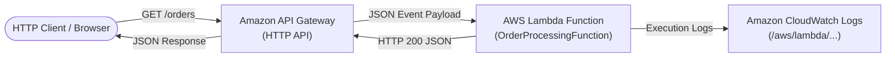
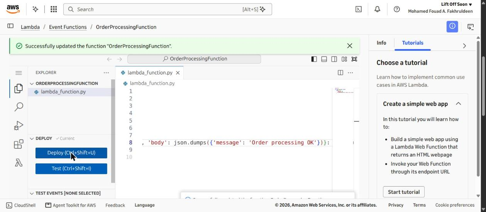
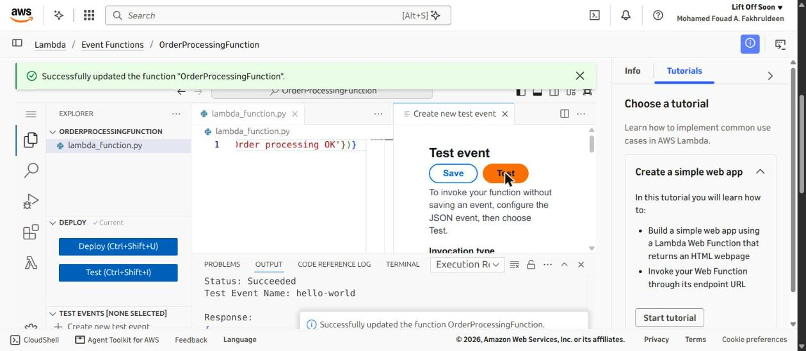
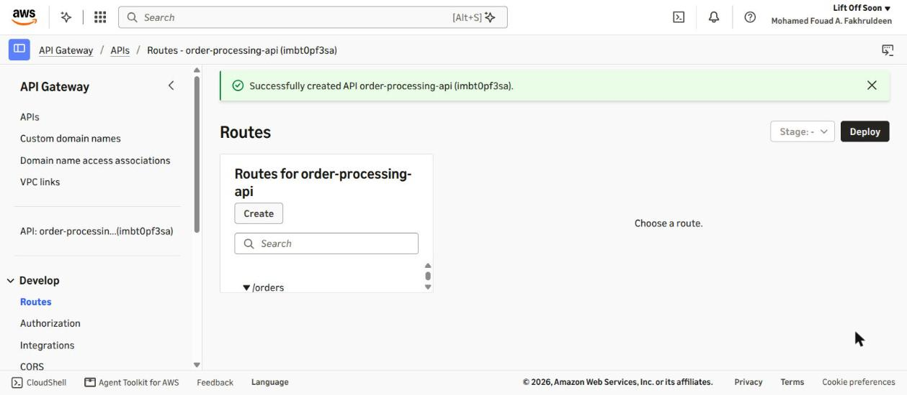

# Lab 05: Serverless Compute (AWS Lambda & API Gateway)

> **Focus:** Serverless Function-as-a-Service (FaaS), AWS Lambda, Amazon API Gateway, CloudWatch Execution Logs, and Sub-second Billing  
> **Region:** `eu-north-1` (Stockholm)  
> **Course Domain:** Domain 3: Cloud Technology & Services  
> **Associated Vault Note:** [[AWS_Lambda]]  

---

## 🧭 Prerequisite Concept Refresher: The Serverless Paradigm

### 1. What Does "Serverless" Really Mean?
Serverless does not mean servers do not exist; it means **servers are completely abstracted away from the customer**. Under the serverless model:
- **Zero OS or Hardware Management:** No provisioning instances, patching Linux/Windows, or sizing disks.
- **Scale from Zero to Millions:** Automatically executes in response to incoming events; if zero traffic arrives, zero compute runs.
- **Pay-Per-Execution Billing:** You pay exclusively for the exact milliseconds your code executes and memory consumed. There is **zero cost when your code is idle**.

### 2. AWS Lambda Operational Rules
- **Maximum Execution Timeout:** **15 minutes** (900 seconds). Lambda is designed for short, event-driven tasks, not long-running continuous batch computations (use ECS/Batch for long workloads).
- **Memory Scaling:** Configurable from **128 MB up to 10,240 MB (10 GB)**. CPU power and network bandwidth scale proportionally to the memory allocated.
- **Cold Starts:** When a function hasn't been invoked recently, AWS spins up a new isolated container environment, introducing a slight initialization delay (under a second) known as a "cold start".

### 3. Amazon API Gateway
Acts as the **front door** for applications. Converts incoming public HTTP/REST/WebSocket client requests from browsers or mobile apps into standardized JSON payloads, authorizes callers, and routes the requests directly into backend Lambda functions.

---

## 🏗️ Lab Architecture



---

## 🛠️ Step-by-Step Console Walkthrough

### Step 1: Create an AWS Lambda Function
1. In the AWS Management Console, navigate to **AWS Lambda** in `eu-north-1`.
2. Click **Create function**.
3. Choose **Author from scratch**:
   - **Function name:** `OrderProcessingFunction`
   - **Runtime:** `Python 3.12`
   - **Architecture:** `x86_64` (or `arm64`)
   - **Execution role:** Select *Create a new role with basic Lambda permissions* (grants permission to write logs to CloudWatch).
4. Click **Create function**.

---

### Step 2: Write Code in the Built-in Code Editor
1. In the **Code source** section, double-click `lambda_function.py`.
2. Replace the default placeholder code with this order processing simulation:

```python
import json
from datetime import datetime

def lambda_handler(event, context):
    order_id = "ORD-2026-98124"
    status = "CONFIRMED"
    
    response_body = {
        "message": "Order processed successfully by AWS Lambda!",
        "orderId": order_id,
        "status": status,
        "timestamp": datetime.utcnow().isoformat(),
        "region": "eu-north-1"
    }
    
    return {
        "statusCode": 200,
        "headers": {
            "Content-Type": "application/json"
        },
        "body": json.dumps(response_body)
    }
```

3. Click the **Deploy** button above the editor to compile and publish the function code.


*Figure 5.1: Editing, deploying, and configuring Python 3.12 code in the Lambda console.*

---

### Step 3: Configure a Test Event and Execute the Function
1. Click the **Test** tab (or the dropdown next to the Test button) and select **Configure test event**.
2. Set **Event name:** `SampleWebOrderTest`.
3. Leave the default sample JSON payload and click **Save**.
4. Click the orange **Test** button.
5. In the **Execution result: succeeded** banner, click to expand details:
   - Notice the **Duration** (typically ~1–5 ms).
   - Notice the **Billed Duration** rounded up to the nearest millisecond.
   - Notice the **Max Memory Used** (typically ~35–45 MB).


*Figure 5.2: Verification of function execution showing sub-millisecond execution metrics.*

---

### Step 4: Create an Amazon API Gateway Front Door
1. Navigate to **API Gateway** in the console.
2. Under **HTTP API**, click **Build**.
3. Click **Add integration**:
   - Select **Lambda**.
   - **Lambda function:** Select `OrderProcessingFunction`.
   - **API name:** `orders-api`.
4. Under **Configure routes**:
   - **Method:** `GET`
   - **Resource path:** `/orders`
   - **Integration target:** `OrderProcessingFunction`.
5. Click **Next** through stages (default `$default` auto-deploy stage) and click **Create**.


*Figure 5.3: HTTP API Gateway successfully created and integrated with the Lambda function.*

---

### Step 5: Test the Live HTTP API Endpoint
1. On the API Gateway details page, copy the **Invoke URL** (e.g., `https://xxxxxxxx.execute-api.eu-north-1.amazonaws.com`).
2. Open a terminal or browser and query the `/orders` endpoint:

```bash
curl -i https://xxxxxxxx.execute-api.eu-north-1.amazonaws.com/orders
```

3. Verify the live JSON output:

```json
HTTP/2 200 
content-type: application/json

{
  "message": "Order processed successfully by AWS Lambda!",
  "orderId": "ORD-2026-98124",
  "status": "CONFIRMED",
  "timestamp": "2026-11-15T14:15:30.123456",
  "region": "eu-north-1"
}
```

---

## 💻 AWS CLI Verification Commands

```bash
# 1. Invoke the Lambda function directly via AWS CLI
aws lambda invoke \
  --function-name "OrderProcessingFunction" \
  --payload '{"test": "cli-trigger"}' \
  --cli-binary-format raw-in-base64-out \
  --region eu-north-1 \
  --profile aws-notes \
  response.json

cat response.json

# 2. Inspect API Gateway routes
aws apigatewayv2 get-apis \
  --region eu-north-1 \
  --profile aws-notes
```

---

## 🎯 Exam Practice: Scenarios & Traps

| Exam Scenario | Correct Recommendation | Why Distractors Fail |
|---|---|---|
| *"A startup is building a microservice that runs occasionally when a file is uploaded. It must scale to zero and cost \$0.00 when idle without managing OS patches."* | **AWS Lambda** | EC2 instances bill per hour 24/7 as long as they run, and require OS security patch management. ECS Fargate still incurs container management. |
| *"What is the maximum execution time limit for an AWS Lambda function before it automatically times out?"* | **15 Minutes (900 Seconds)** | Long-running tasks exceeding 15 minutes should be run on AWS Fargate, Amazon ECS/EKS, or Amazon EC2. |
| *"An API receives 10,000 requests per minute and needs to protect backend services by enforcing rate limiting (throttling) and validating API keys."* | **Amazon API Gateway** | Application Load Balancers lack built-in token-bucket rate limiting per client or API key management. CloudFront caches assets but does not manage API keys. |
| *"How does AWS bill for AWS Lambda executions?"* | **Based on the number of requests and the execution duration (measured in milliseconds) multiplied by allocated memory** | Lambda never charges for idle server time; billing strictly reflects actual compute duration and invocations. |

---

## 🧹 Free Tier Cleanup & Cost Safeguard
> [!NOTE]
> AWS Lambda includes **1 million free requests per month** and 3.2 million seconds of compute time in the Always Free tier. However, deleting unused endpoints is good practice.

1. In the **API Gateway Console**, select `orders-api` -> Click **Actions** -> **Delete**.
2. In the **Lambda Console**, select `OrderProcessingFunction` -> Click **Actions** -> **Delete**.
3. Open **CloudWatch Logs** -> Delete the log group `/aws/lambda/OrderProcessingFunction`.
