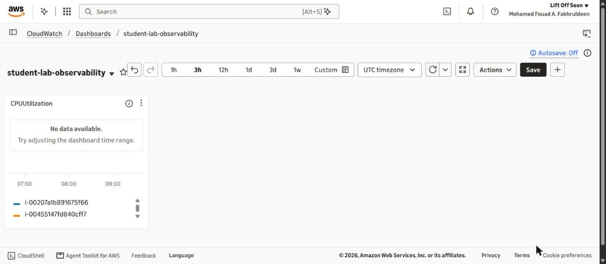
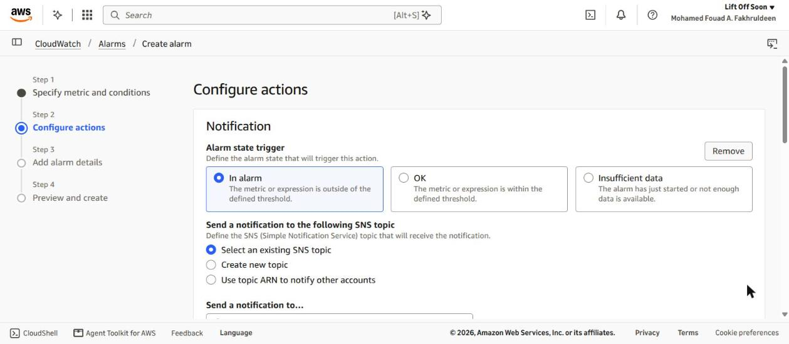
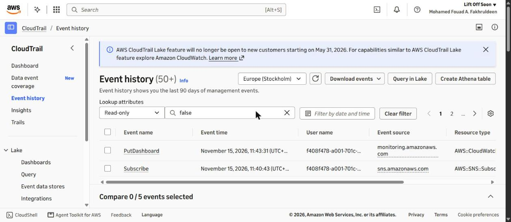
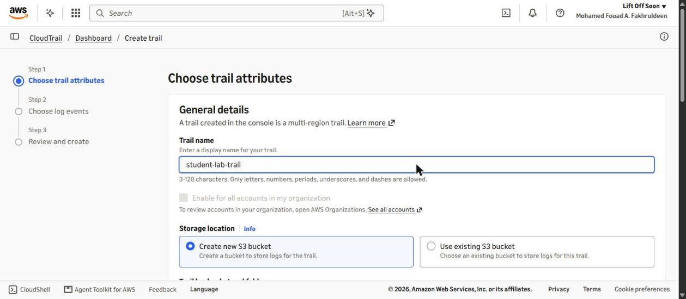
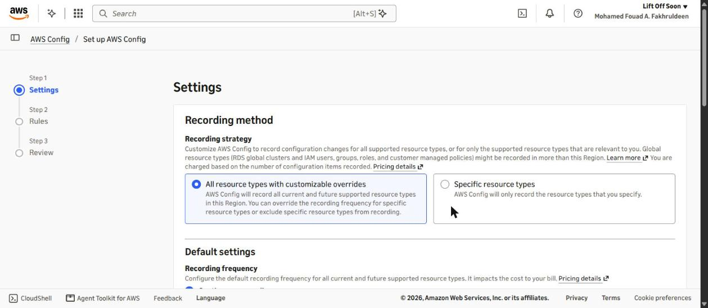
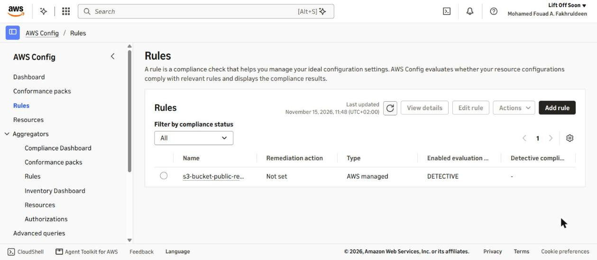
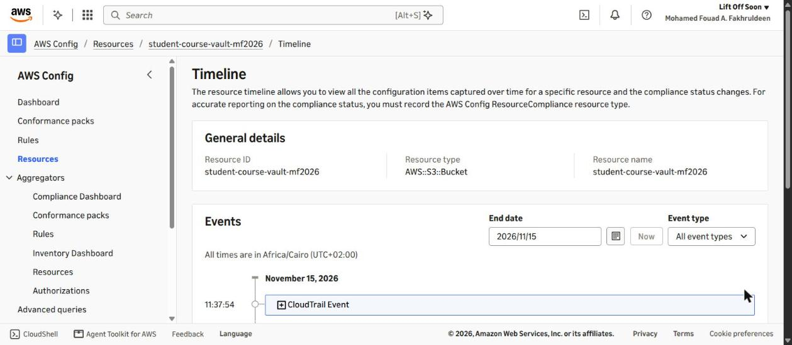

# Lab 13: Observability Triad (CloudWatch, CloudTrail & AWS Config)

> **Focus:** The AWS Observability Triad: Amazon CloudWatch (Performance), AWS CloudTrail (Auditing), and AWS Config (Compliance & Governance)  
> **Region:** `eu-north-1` (Stockholm)  
> **Course Domain:** Domain 2: Security & Compliance, Domain 3: Cloud Technology & Services  
> **Associated Vault Notes:** [[Amazon_CloudWatch]], [[AWS_CloudTrail]], [[AWS_Config]]  

---

## 🧭 Prerequisite Concept Refresher: The Observability Triad

To effectively operate enterprise infrastructure, AWS provides three complementary observability services that answer distinct operational questions:

```
┌────────────────────────────────────────────────────────────────────────┐
│                        THE OBSERVABILITY TRIAD                         │
├──────────────────────────┬─────────────────────────┬───────────────────┤
│    Amazon CloudWatch     │     AWS CloudTrail      │    AWS Config     │
├──────────────────────────┼─────────────────────────┼───────────────────┤
│ "How is it performing?"  │   "Who did what & when?"│ "Is it compliant?"│
│ Metrics, Logs & Alarms   │ Management & API Audits │ State & History   │
│ CPU, RAM, Disk, Network  │ Identity, IP, Timestamp │ Drift, Baseline   │
└──────────────────────────┴─────────────────────────┴───────────────────┘
```

### 1. Amazon CloudWatch (Performance & Health)
- **Metrics:** Numerical time-series data emitted by AWS services (e.g., `CPUUtilization`, `NetworkIn`, `DiskReadBytes`). Basic monitoring is collected at 5-minute intervals for free; detailed monitoring is 1-minute intervals.
- **Alarms:** Evaluates metrics against predefined thresholds and triggers actions (e.g., sending an alert via SNS or triggering an Auto Scaling policy).

### 2. AWS CloudTrail (Governance & Auditing)
- Records every API call, console login, and CLI command made across your AWS account.
- Answers: *Which IAM identity made the call, at what timestamp, from what source IP address, and what was the API response?*
- **Event History:** Stores the last **90 days** of management events for free.
- **Trails:** Delivers continuous, tamper-evident audit logs to an Amazon S3 bucket for long-term archiving and compliance.

### 3. AWS Config (Resource State & Compliance)
- Records a point-in-time inventory of resource configurations and continuously evaluates them against desired security baselines (e.g., *Is EBS encryption enabled? Are any S3 buckets public?*).
- Provides a visual **compliance timeline** showing exact configuration diffs across history.

---

## 🛠️ Step-by-Step Console Walkthrough

### Step 1: Build a Custom CloudWatch Dashboard
1. In the AWS Management Console, navigate to **CloudWatch** in `eu-north-1`.
2. In the left navigation pane, click **Dashboards** -> Click **Create dashboard**.
3. Name your dashboard: `Operations-Executive-Dashboard`.
4. Click **Add widget** -> Select **Line**:
   - Select **Metrics** -> `AWS/EC2` -> `Per-Instance Metrics`.
   - Select `CPUUtilization` and `NetworkIn` for your instances.
5. Click **Create widget** and click **Save dashboard**.


*Figure 13.1: Live CloudWatch operations dashboard monitoring EC2 performance metrics.*

---

### Step 2: Create a CloudWatch Alarm with SNS Notification
1. In the left navigation pane, click **Alarms** -> Click **Create alarm**.
2. Click **Select metric** -> `AWS/EC2` -> Select `CPUUtilization`.
3. Configure the metric condition:
   - **Statistic:** `Average`
   - **Period:** `5 minutes`
   - **Threshold type:** `Static`
   - **Whenever CPUUtilization is:** `Greater than > 80%`.
4. Under **Actions**:
   - **Alarm state trigger:** `In alarm`.
   - **Send a notification to:** Select `orders-notification-topic` (from Lab 12).
5. Name the alarm: `HighCPUUtilizationAlarm` -> Click **Create alarm**.


*Figure 13.2: CloudWatch Alarm threshold triggering automated SNS notification.*

---

### Step 3: Inspect AWS CloudTrail Event History
1. Navigate to the **CloudTrail Console**.
2. In the left navigation pane, click **Event history**.
3. Review recent events:
   - Notice records for `RunInstances`, `CreateBucket`, `CreateSecurityGroup`.
   - Click on an event row to inspect the full JSON record: observe `userIdentity`, `sourceIPAddress`, `userAgent`, and `requestParameters`.


*Figure 13.3: CloudTrail immutable audit log capturing user and API activities.*

---

### Step 4: Create a Multi-Region CloudTrail Trail
To archive audit events past 90 days:
1. In the left navigation pane, click **Trails** -> Click **Create trail**:
   - **Trail name:** `organization-audit-trail`.
   - **Storage location:** Create a new S3 bucket (e.g., `audit-trail-logs-vault-2026`).
   - **Log file SSE-KMS encryption:** Enabled.
   - **Multi-region trail:** **Yes** (captures activity across all AWS Regions).
2. Click through to **Create trail**.


*Figure 13.4: Creating a multi-region trail continuously streaming audit logs to Amazon S3.*

---

### Step 5: Initialize AWS Config & Recorder
1. Navigate to the **AWS Config Console**.
2. Click **Get started** (or **Set up AWS Config**):
   - **Recording strategy:** Record all current and future resource types supported in this region.
   - **Data storage:** Select an S3 bucket to store configuration snapshots.
   - **IAM role:** Select *Create AWS Config service-linked role*.
3. Click **Next**.


*Figure 13.5: AWS Config recorder initialization capturing infrastructure state changes.*

---

### Step 6: Deploy Managed Compliance Rules
1. In the AWS Config rule setup screen, search for the managed rule:
   - **`s3-bucket-public-read-prohibited`**: Automatically flags any S3 bucket that permits public read access.
2. Add the rule and click **Save**.
3. Config immediately evaluates your environment and assigns a compliance status (**COMPLIANT** or **NON_COMPLIANT**).


*Figure 13.6: AWS Config managed rule continuously evaluating resource configurations.*

---

### Step 7: Inspect Resource Configuration Timeline
1. In AWS Config, navigate to **Resources**.
2. Select any evaluated resource (e.g., an S3 bucket or EC2 instance).
3. Click **Resource timeline**.
4. Observe the interactive visual timeline showing every configuration change, tagging event, and compliance transition over time!


*Figure 13.7: Visual timeline showing point-in-time configuration diffs and compliance drift.*

---

## 💻 AWS CLI Verification Commands

```bash
# 1. Check CloudWatch alarms
aws cloudwatch describe-alarms \
  --alarm-names "HighCPUUtilizationAlarm" \
  --region eu-north-1 \
  --profile aws-notes

# 2. Query CloudTrail lookup events via CLI
aws cloudtrail lookup-events \
  --max-items 3 \
  --region eu-north-1 \
  --profile aws-notes

# 3. Check AWS Config rule compliance summary
aws configservice get-compliance-summary-by-config-rule \
  --region eu-north-1 \
  --profile aws-notes
```

---

## 🎯 Exam Practice: Scenarios & Traps

| Exam Scenario | Correct Recommendation | Why Distractors Fail |
|---|---|---|
| *"A security analyst needs to find out which IAM user terminated a production EC2 instance at 2:00 AM last night, including their source IP address."* | **AWS CloudTrail Event History (`StopInstances` / `TerminateInstances` API calls)** | CloudWatch monitors performance metrics (CPU/Disk), not identity or API call provenance. AWS Config tracks configuration changes, not API credentials. |
| *"An administrator needs to receive an automated SMS alert when the CPU utilization of an EC2 instance exceeds 85% for 5 consecutive minutes."* | **Amazon CloudWatch Alarm sending a notification to an Amazon SNS Topic** | CloudTrail records API calls, not real-time resource utilization percentages. Config audits rule compliance. |
| *"A compliance officer requires a timeline of changes made to a security group over the last 90 days to verify whether port 22 was ever opened to the public internet."* | **AWS Config Configuration Timeline** | CloudTrail tells you who called `AuthorizeSecurityGroupIngress`, but AWS Config tracks the exact state and timeline of the resource over time. |
| *"How can an organization collect memory utilization and disk space metrics from an EC2 instance into Amazon CloudWatch?"* | **Install and configure the unified CloudWatch Agent on the EC2 instance OS** | Standard CloudWatch hypervisor metrics only track CPU, Network, and Disk I/O. Memory and disk space are guest OS metrics requiring the CloudWatch Agent. |

---

## 🧹 Free Tier Cleanup & Cost Safeguard
> [!WARNING]
> AWS Config charges per configuration item recorded ($0.003 per item) and per rule evaluation.

1. In **AWS Config**, navigate to **Settings** -> Click **Edit** -> Turn **Recording: OFF**, then delete active custom rules.
2. In **CloudTrail**, select `organization-audit-trail` -> Click **Delete**.
3. In **CloudWatch**, delete the alarm `HighCPUUtilizationAlarm` and delete the dashboard `Operations-Executive-Dashboard`.
