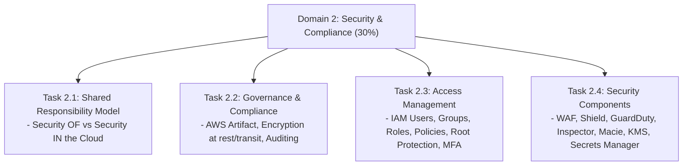

# Domain 2: Security and Compliance (30% Exam Weighting)

> **Certification:** [[CLF-C02_Master_Blueprint|AWS Certified Cloud Practitioner (CLF-C02)]]  
> **Exam Weighting:** **30%** (~20 questions - **Second Highest Weighted Domain!**)  
> **Tags:** `#aws/certification` `#clf-c02` `#domain2`

---

## 🎯 Domain Overview & Official Task Statements

Domain 2 evaluates your ability to implement security best practices, understand the Shared Responsibility Model, configure Identity and Access Management (IAM), secure network perimeters, detect vulnerabilities, and maintain regulatory compliance.

---

## 📚 Linked Knowledge Base Study Notes (Single Source of Truth)

1. **Shared Responsibility Model:**
   - Review [[Shared_Responsibility_Model]]: The shifting line of responsibility across IaaS (EC2), Managed/PaaS (RDS), and Serverless (Lambda/S3).
   - *Remember:* Customer data and IAM permissions are **ALWAYS** 100% the customer's responsibility.
2. **Access Management & Identities:**
   - Review [[AWS_IAM_and_Identity]]: Root user security, IAM Users, User Groups, IAM Roles, IAM Policies, Least Privilege, IAM Identity Center (Multi-account workforce SSO), Amazon Cognito (External app users), and Secrets Manager vs Systems Manager Parameter Store.
3. **Security, Encryption & Threat Detection:**
   - Review [[AWS_Security_Services]]:
     - Perimeter Defense: AWS WAF (Layer 7 web exploits) vs AWS Shield (Layer 3/4 DDoS).
     - ML Threat Detection: Amazon GuardDuty (Account/log anomalies) vs Amazon Inspector (EC2/ECR/Lambda vulnerabilities) vs Amazon Macie (S3 PII data discovery).
     - Cryptography: AWS KMS (KMS keys) vs AWS CloudHSM (Dedicated hardware).
4. **Compliance & Auditing:**
   - Review [[AWS_Organizations_and_Governance]]: AWS CloudTrail (API activity auditing), AWS Config (Configuration compliance), and [[AWS_Security_Services]] -> **AWS Artifact** (SOC/PCI audit reports and HIPAA BAA agreements).

---

## ⚠️ Domain 2 High-Yield Trap Checklist

* [ ] **Root User Security:**
  * Root user should only be used to create the first admin user, change account settings, or close the account.
  * Must have **Multi-Factor Authentication (MFA)** enabled immediately.
* [ ] **Roles vs Users:**
  * Never hardcode AWS access keys inside EC2 instances or application code. Always attach an **IAM Role (Instance Profile)** to the EC2 instance or Lambda function.
* [ ] **Explicit Deny Rule:**
  * An explicit `Deny` in any policy always overrides an explicit `Allow`.
* [ ] **WAF vs Shield:**
  * *AWS WAF:* Protects against SQL injection, Cross-Site Scripting (XSS), and HTTP flood attacks at Layer 7.
  * *AWS Shield Standard:* Free automatic protection against Layer 3/4 network DDoS attacks (SYN floods, UDP reflection).
* [ ] **GuardDuty vs Inspector vs Macie:**
  * *GuardDuty:* Detects compromised accounts and unauthorized activity from logs.
  * *Inspector:* Scans running EC2 servers and container images for software CVE vulnerabilities.
  * *Macie:* Scans S3 buckets for sensitive personal data (credit card numbers, PII).

---

## 📚 Canonical Literature & Framework Citations

- **Daswani & Kankaria (Packt, 2026), Chapter 3 ("Security, Identity, and Governance"):**
  - Modern IAM evaluation logic (SCP -> Permission Boundary -> Identity Policy -> Resource Policy).
  - IAM Identity Center centralized workforce federation architecture.
- **Tom Taulli (O'Reilly, 2026), Chapter 6 ("Security and Compliance"):**
  - Defense-in-depth perimeter design: Shield Standard vs Shield Advanced (DDoS cost protection), WAF web ACL rulesets, and KMS envelope encryption.

---

## 🎯 Master Unique Practice Questions

- **Practice Set:** [[Domain_2_Security_and_Compliance_Unique_Questions|Domain 2 Unique Revision Bank]] (552 unique, deduplicated questions across 18 source providers with interactive checkboxes and explanations).

