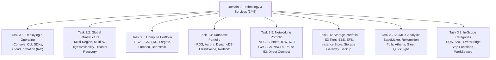

# Domain 3: Cloud Technology and Services (34% Exam Weighting)

> **Certification:** [[CLF-C02_Master_Blueprint|AWS Certified Cloud Practitioner (CLF-C02)]]  
> **Exam Weighting:** **34%** (~22 questions - **HIGHEST WEIGHTED DOMAIN!**)  
> **Tags:** `#aws/certification` `#clf-c02` `#domain3`

---

## 🎯 Domain Overview & Official Task Statements

Domain 3 covers the core services portfolio across compute, storage, databases, networking, integration, and developer tools. It accounts for more than one-third of your total exam score.

---

## 📚 Linked Knowledge Base Study Notes (Single Source of Truth)

1. **Deployment & Automation:**
   - AWS Management Console (GUI) vs AWS CLI vs Software Development Kits (SDKs) vs **AWS CloudFormation** (Declarative Infrastructure as Code - JSON/YAML templates).
2. **Compute & Containers:**
   - Review [[Amazon_EC2]]: Instance types (General, Compute, Memory, Storage), purchasing options (On-Demand, Reserved, Spot, Savings Plans, Dedicated Hosts), ELB (ALB vs NLB), and Auto Scaling.
   - Review [[Containers_ECS_EKS_Fargate]]: Amazon ECS (AWS native), Amazon EKS (Kubernetes), and **AWS Fargate** (Serverless container execution).
   - Review [[Serverless_AWS_Lambda]]: Event-driven computing, 15-minute execution limit, microservices with API Gateway.
3. **Storage & Hybrid Systems:**
   - Review [[Amazon_S3]]: Object storage, 11 9's durability, 8 storage tiers (Standard, Express One Zone, Intelligent-Tiering, Standard-IA, One Zone-IA, Glacier tiers), Lifecycle policies, and S3 Versioning.
   - Review [[Block_and_File_Storage_EBS_EFS]]: EBS (AZ-locked virtual hard drives, snapshots in S3), EC2 Instance Store (Ephemeral/temporary), Amazon EFS (Multi-AZ shared NFS), Amazon FSx (Windows SMB / Lustre HPC), and AWS Storage Gateway (File, Volume, Tape).
4. **Networking & Acceleration:**
   - Review [[Amazon_VPC_and_Networking]]: Subnets (Public vs Private), Internet Gateway, NAT Gateway, Security Groups (Stateful) vs Network ACLs (Stateless), Transit Gateway, Direct Connect, and Site-to-Site VPN.
   - Review [[Amazon_CloudFront_and_Global_Accelerator]]: CloudFront (HTTP/HTTPS content caching at Edge) vs Global Accelerator (Static Anycast IPs routing over private fiber backbone).
5. **Databases:**
   - Review [[AWS_Databases_Overview]]: Amazon RDS (6 engines, Multi-AZ HA vs Read Replicas), Amazon Aurora (Cloud-native, 6 copies across 3 AZs), Amazon DynamoDB (Serverless NoSQL, single-digit ms latency, DAX), Amazon ElastiCache (In-memory Redis/Memcached), and Amazon Redshift (Petabyte OLAP data warehouse).
6. **Application Integration & Messaging:**
   - Review [[Application_Integration_Services]]: Amazon SQS (Pull-based queue, Standard vs FIFO), Amazon SNS (Push-based Pub/Sub fanout), Amazon EventBridge (Serverless event bus), and AWS Step Functions (State machines).
7. **AI & Analytics:**
   - Review [[AI_and_Analytics_Services]]: Amazon Athena (Serverless SQL on S3), AWS Glue (Serverless ETL & Data Catalog), Amazon QuickSight (BI dashboards), and pre-trained AI APIs (Rekognition, Polly, Transcribe, Lex, Textract, Bedrock).
8. **Disaster Recovery & Architecture:**
   - Review [[Disaster_Recovery_and_High_Availability]]: RTO vs RPO, and the 4 DR strategies (Backup & Restore, Pilot Light, Warm Standby, Multi-Site Active-Active).

---

## ⚠️ Domain 3 High-Yield Trap Checklist

* [ ] **EBS vs EFS vs S3:**
  * *EBS:* Single-AZ virtual drive attached to 1 EC2 instance.
  * *EFS:* Multi-AZ shared file system mounted by thousands of EC2 instances.
  * *S3:* Global object storage accessed over HTTP REST APIs.
* [ ] **Multi-AZ vs Read Replicas (RDS):**
  * *Multi-AZ:* Synchronous standby replica in another AZ for **High Availability & Disaster Recovery** (cannot be read from).
  * *Read Replicas:* Asynchronous replicas for **Read Performance & Scaling** (can be read from).
* [ ] **SQS vs SNS:**
  * *SQS:* Pull-based message queue for decoupling individual components (1-to-1).
  * *SNS:* Push-based pub/sub topic for fanning out notifications to multiple subscribers (1-to-many).
* [ ] **CloudFront vs Global Accelerator:**
  * *CloudFront:* Caches web assets (HTTP/HTTPS) at Edge Locations.
  * *Global Accelerator:* Provides 2 static Anycast IPs and routes traffic (including TCP/UDP) over AWS private fiber without caching.

---

## 📚 Canonical Literature & Framework Citations

- **Daswani & Kankaria (Packt, 2026), Chapters 4 & 5:**
  - Modern compute selection decision tree (EC2, ECS, EKS, Fargate, Lambda).
  - S3 Express One Zone and modern S3 default encryption behaviors.
- **Tom Taulli (O'Reilly, 2026), Chapters 3, 4 & 5:**
  - Database selection guide: OLTP (RDS, Aurora, DynamoDB) vs OLAP (Redshift) vs In-Memory (ElastiCache).
  - Multi-tier decoupling architectures using Amazon SQS and Amazon EventBridge.

---

## 🎯 Master Unique Practice Questions

- **Practice Set:** [[Domain_3_Cloud_Technology_and_Services_Unique_Questions|Domain 3 Unique Revision Bank]] (909 unique, deduplicated questions across 18 source providers with interactive checkboxes and explanations).

