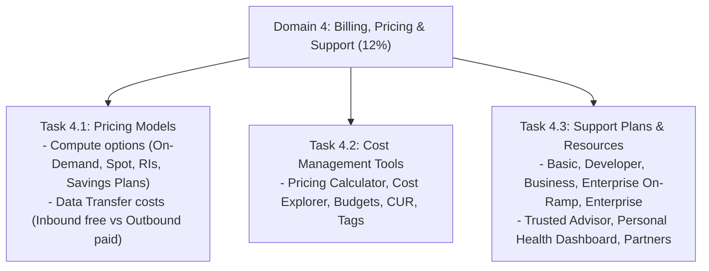

# Domain 4: Billing, Pricing, and Support (12% Exam Weighting)

> **Certification:** [[CLF-C02_Master_Blueprint|AWS Certified Cloud Practitioner (CLF-C02)]]  
> **Exam Weighting:** **12%** (~7–8 questions)  
> **Tags:** `#aws/certification` `#clf-c02` `#domain4`

---

## 🎯 Domain Overview & Official Task Statements

Domain 4 tests your knowledge of how AWS bills for resources, how to estimate costs for future deployments, how to track and alert on spending in real time, and the features and response-time SLAs across the different AWS Support plans.

---

## 📚 Linked Knowledge Base Study Notes (Single Source of Truth)

1. **Billing Tools & Support Plans:**
   - Review [[AWS_Billing_and_Pricing_Tools]]:
     - Timeline: **AWS Pricing Calculator** (*Before deployment - "what-if" modeling*) vs **AWS Budgets** (*During deployment - proactive alerts*) vs **AWS Cost Explorer** (*After deployment - historical graphs and 12-month forecasts*) vs **Cost & Usage Report (CUR)** (*Most detailed raw data in S3*).
     - Support Plans: Basic (Free) vs Developer (\$29) vs Business (\$100, 24/7 phone/chat, <1h response) vs Enterprise On-Ramp (\$5,500, pool of TAMs, <30m) vs Enterprise (\$15,000, designated 1-on-1 TAM, Concierge, <15m).
     - **AWS Compute Optimizer:** Machine learning recommendations to identify over-provisioned or under-provisioned resources.
2. **Consolidated Billing & Organization Governance:**
   - Review [[AWS_Organizations_and_Governance]]: Consolidated billing under a single payer account, volume discount pooling, and sharing of Reserved Instances and Savings Plans across accounts.
3. **Cloud Economics & Data Transfer Pricing:**
   - Review [[Cloud_Economics_and_Billing_Models]]: CapEx to OpEx, Economies of scale, and data transfer costs (Inbound is FREE, Outbound to internet is charged, Cross-AZ has fee, Same AZ is free).
4. **Best-Practice Audits:**
   - Review [[AWS_Organizations_and_Governance]] -> **AWS Trusted Advisor**: 6 categories (Cost Optimization, Performance, Security, Fault Tolerance, Service Limits, Operational Excellence).

---

## ⚠️ Domain 4 High-Yield Trap Checklist

* [ ] **Pricing Calculator vs Cost Explorer:**
  * *Pricing Calculator:* Forward-looking cost estimation **before** you launch any resource (no AWS account required).
  * *Cost Explorer:* Backward-looking historical analysis **after** resources have generated usage bills.
* [ ] **AWS Budgets Alerts:**
  * Can alert on **actual spend** OR **forecasted spend** (e.g., notify before you breach your monthly budget!).
* [ ] **Support Plan SLAs:**
  * *Production system down (< 1 hour):* Requires **Business Support Plan** (or higher).
  * *Business-critical system down (< 15 minutes) + Designated 1-on-1 TAM:* Requires **Enterprise Support Plan**.
* [ ] **Cost Allocation Tags:**
  * Must be **activated** in the Billing console before they appear in Cost Explorer or CUR.
* [ ] **Inbound Data Transfer:**
  * Data transferred **INTO** AWS from the internet is **always \$0.00**.

---

## 📚 Canonical Literature & Framework Citations

- **Daswani & Kankaria (Packt, 2026), Chapter 6 ("Billing, Pricing, and Support"):**
  - Consolidated Billing mechanics and volume discount tier aggregation rules across AWS Organizations.
  - Compute Optimizer ML rightsizing heuristics and AWS Budgets automated action triggers.
- **Tom Taulli (O'Reilly, 2026), Chapter 7 ("Billing, Governance, and Support"):**
  - Support plan SLA comparison matrices and TAM pooling tiers.
  - AWS Trusted Advisor 6 pillar checks and cost anomaly detection.

---

## 🎯 Master Unique Practice Questions

- **Practice Set:** [[Domain_4_Billing_Pricing_and_Support_Unique_Questions|Domain 4 Unique Revision Bank]] (536 unique, deduplicated questions across 18 source providers with interactive checkboxes and explanations).

