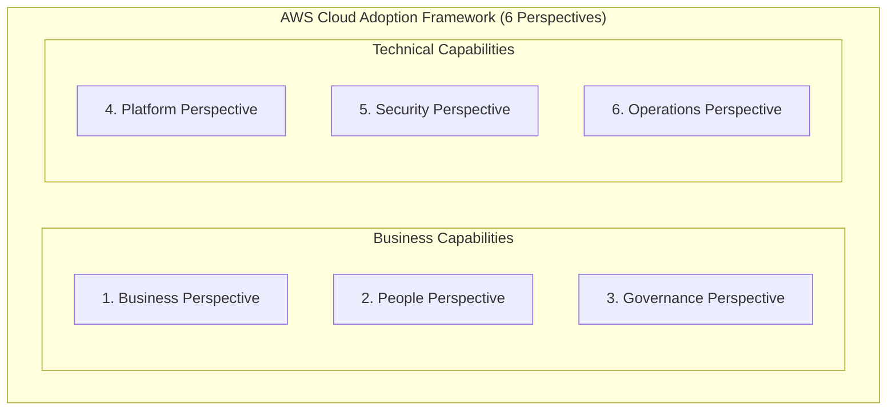
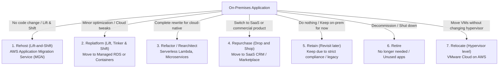
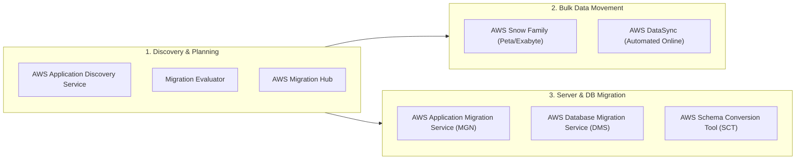

# AWS Cloud Adoption Framework (AWS CAF) & Migration Strategies

> **Knowledge Area:** Cloud Concepts (Domain 1.3) & Migration (Domain 3.8)  
> **Relevant Certifications:** [CLF-C02](../../phase0_step01_syllabus/CLF-C02_Master_Blueprint.md), SAA-C03  
> **Tags:** `#aws/concepts` `#aws/migration` `#clf-c02`

---

## 💡 The Real-World Analogy (ELI5)

> Imagine your organization is building a **brand-new modern city**:
> - **Business Perspective:** The mayor and city council deciding *why* we are building the city, what economic growth it will create, and ensuring taxpayer ROI.
> - **People Perspective:** The schools, HR recruiters, and community organizers training citizens with modern skills and building an agile culture.
> - **Governance Perspective:** The city planning office managing development budgets, project portfolios, and FinOps financial guardrails.
> - **Platform Perspective:** The civil engineers and architects designing the foundational infrastructure: roads, bridges, and zoning laws (landing zones and cloud architecture).
> - **Security Perspective:** The police department, fire marshal, and building inspectors enforcing safety codes, access gates, and data protection laws.
> - **Operations Perspective:** The daily utility departments (power, water, sanitation) ensuring streetlights stay on and water flows smoothly 24/7/365 to meet citizen SLAs.

---

## 1. Overview of AWS CAF 3.0

The **AWS Cloud Adoption Framework (AWS CAF)** provides actionable guidance that helps organizations digitally transform and accelerate their cloud adoption journey.

The framework organizes guidance into **6 Perspectives**, split equally between **Business Capabilities** and **Technical Capabilities**:

---

## 2. The 6 Perspectives Breakdown

### Business Capabilities (Focus on Business Strategy & Alignment):

1. **Business Perspective:**
   * *Target Stakeholders:* Business managers, finance managers, strategy leaders.
   * *Core Focus:* Ensures that cloud investments align with business outcomes, return on investment (ROI), revenue generation, and business model innovation.
2. **People Perspective:**
   * *Target Stakeholders:* Human resources, training leaders, organizational change managers.
   * *Core Focus:* Prepares the workforce for cloud adoption, bridging skills gaps through training, organizational change management, and building high-performing cross-functional teams.
3. **Governance Perspective:**
   * *Target Stakeholders:* CIO, program managers, project managers, enterprise architects.
   * *Core Focus:* Orchestrates cloud initiatives, manages cloud portfolio priorities, measures cloud value, and ensures program alignment with organizational goals.

---

### Technical Capabilities (Focus on Implementation & Architecture):

4. **Platform Perspective:**
   * *Target Stakeholders:* CTO, technology leaders, solutions architects, developers.
   * *Core Focus:* Designing, implementing, and optimizing cloud architecture, landing zones, migration strategies, and modern cloud application development.
5. **Security Perspective:**
   * *Target Stakeholders:* CISO, security officers, compliance and risk managers.
   * *Core Focus:* Ensures the organization meets security, identity, data privacy, and compliance requirements in the cloud without slowing down innovation.
6. **Operations Perspective:**
   * *Target Stakeholders:* Operations managers, Site Reliability Engineers (SREs), IT support leads.
   * *Core Focus:* Operating, monitoring, automating, and maintaining cloud workloads according to agreed service-level agreements (SLAs).

---

## 3. The 7 Rs of Cloud Migration

When migrating existing on-premises workloads to AWS, organizations classify each application into one of the **7 Migration Strategies ("7 Rs")**:

| Strategy | Alias | Description | Effort | Speed | Typical Tools |
|---|---|---|---|---|---|
| **Rehost** | Lift-and-Shift | Move applications without changing any code or architecture. | Low | Fastest | **AWS Application Migration Service (MGN)** |
| **Replatform** | Lift, Tinker & Shift | Make minor optimizations without altering core code (e.g., migrating an on-prem DB to Amazon RDS). | Medium | Fast | AWS DMS, AWS Elastic Beanstalk |
| **Refactor** | Rearchitect | Re-imagine application architecture from scratch to be cloud-native (serverless, microservices). | High | Slowest | AWS Lambda, Amazon ECS/EKS, DynamoDB |
| **Repurchase** | Drop and Shop | Discard custom application and switch to a SaaS solution or commercial package. | Low-Med | Fast | AWS Marketplace |
| **Retain** | Keep as-is | Leave legacy application on-premises because migration is not yet feasible or cost-effective. | None | N/A | Hybrid VPN / Direct Connect |
| **Retire** | Decommission | Identify and shut down applications that are no longer actively used by the business. | Low | Fast | AWS Application Discovery Service |
| **Relocate** | Hypervisor Shift | Move existing VMware or containerized workloads directly to AWS without converting VM formats. | Low | Fast | VMware Cloud on AWS |

---

## 4. Key AWS Migration Services Portfolio

1. **AWS Migration Hub:** A single unified dashboard to track the progress of migrations across multiple AWS and partner solutions (MGN, DMS).
2. **AWS Application Discovery Service:** Plans migration projects by automatically discovering on-premises server specifications, CPU/RAM utilization, and network dependency mappings. (Offers *Agentless Collector* for VMware and *Discovery Agent* for physical servers).
3. **AWS Application Migration Service (AWS MGN):** The primary AWS service for **Rehosting (lift-and-shift)** servers to AWS with minimal downtime and continuous block-level data replication.
4. **AWS Database Migration Service (AWS DMS):** Migrates relational databases, data warehouses, and NoSQL databases to AWS. Keeps source database **fully operational and online** during migration. Supports homogeneous (MySQL -> MySQL) and heterogeneous (Oracle -> PostgreSQL) migrations.
5. **AWS Schema Conversion Tool (AWS SCT):** Automatically converts source database schemas, stored procedures, and triggers from commercial engines (Oracle, SQL Server) to open-source targets (Aurora, PostgreSQL, MySQL).
6. **AWS Snow Family:** Physical, ruggedized hardware appliances to transport massive data volumes offline:
   - *AWS Snowcone:* Portable, lightweight (8 TB).
   - *AWS Snowball Edge:* Storage & compute-optimized (80 TB to 210 TB).
   - *AWS Snowmobile:* 45-foot ruggedized shipping container truck for exabyte-scale migrations (up to 100 PB per truck).

---

## 5. Exam Tip Matrix

| Exam Scenario | Correct Service / Strategy |
|---|---|
| *"Wants to move 200 on-premises Windows and Linux servers to AWS with minimal configuration change"* | **Rehost** using **AWS Application Migration Service (MGN)** |
| *"Migrating Oracle to Amazon Aurora while keeping the production database running without downtime"* | **AWS Database Migration Service (DMS)** + **AWS Schema Conversion Tool (SCT)** |
| *"Company needs to transfer 500 TB of data to S3 from a remote location with limited 10 Mbps internet bandwidth"* | **AWS Snowball Edge** (physical offline transfer) |
| *"Which CAF perspective focuses on bridging staff cloud skill gaps and change management?"* | **People Perspective** |
| *"Which CAF perspective focuses on ROI, business model innovation, and financial justification?"* | **Business Perspective** |
| *"Single pane of glass to monitor migration progress across servers and databases"* | **AWS Migration Hub** |
---

## 7. Post-Topic Question Simulation & Retention Check

Test your understanding of the AWS Cloud Adoption Framework (CAF) with these 5 exam-style questions:

## 🎯 Exam Traps & 'Clue-to-Answer' Trigger Words

| Exam Question Clue Keyword | Correct CAF Perspective | Common Distractor Traps |
| :--- | :--- | :--- |
| *'Workforce transformation', 'skill gaps', 'cloud fluency', 'culture change'* | **People Perspective** | Business Perspective (focuses on ROI/finances, not HR/talent). |
| *'Return on investment (ROI)', 'revenue generation', 'business model innovation'* | **Business Perspective** | Governance Perspective (focuses on project control, not revenue). |
| *'Cloud Financial Management (FinOps)', 'portfolio priorities', 'KPI tracking'* | **Governance Perspective** | Business Perspective or Platform Perspective. |
| *'Landing zones', 'hybrid architecture', 'modernizing legacy code', 'IaC templates'* | **Platform Perspective** | Operations Perspective (operates existing infra; doesn't design architecture). |
| *'Regulatory compliance (HIPAA, GDPR)', 'IAM boundaries', 'threat modeling'* | **Security Perspective** | Governance Perspective (governs projects, not security controls). |
| *'Service level agreements (SLAs)', 'daily monitoring', 'observability', 'incident recovery'* | **Operations Perspective** | Platform Perspective (builds the platform; Operations runs it). |

---

### Question 1
**Which perspective of the AWS Cloud Adoption Framework (AWS CAF) focuses on building modern, scalable, and secure cloud architectures and migrating infrastructure workloads?**
- A) People Perspective
- B) Platform Perspective
- C) Business Perspective
- D) Governance Perspective

<b>Click to View Answer & Explanation</b>

**Correct Answer:** **B) Platform Perspective**  
- **Why it's correct:** The Platform Perspective focuses on architectural blueprints, landing zones, data engineering, and modernizing cloud infrastructure.
- **Distractor Analysis:**
  - *A is incorrect:* People Perspective focuses on organizational culture, training, and change management.
  - *C is incorrect:* Business Perspective focuses on business models, finance, and strategy.

### Question 2
**An organization is bridging the skills gap of its IT engineering workforce by implementing comprehensive cloud certification programs and upskilling initiatives. Which AWS CAF perspective encompasses this effort?**
- A) Security Perspective
- B) Operations Perspective
- C) People Perspective
- D) Governance Perspective

<b>Click to View Answer & Explanation</b>

**Correct Answer:** **C) People Perspective**  
- **Why it's correct:** The People Perspective centers on organizational readiness, culture change, skill development, cloud literacy, and career transition roadmaps.

### Question 3
**Managing program portfolios, measuring business outcomes, and aligning cloud financial management (FinOps) belongs to which AWS CAF perspective?**
- A) Governance Perspective
- B) Platform Perspective
- C) Operations Perspective
- D) Security Perspective

<b>Click to View Answer & Explanation</b>

**Correct Answer:** **A) Governance Perspective**  
- **Why it's correct:** The Governance Perspective focuses on orchestrating cloud initiatives, enterprise architecture governance, portfolio prioritization, and financial governance (FinOps).

### Question 4
**Which AWS CAF perspective ensures that cloud workloads comply with regulatory standards (e.g., GDPR, HIPAA, PCI-DSS) and enforces access control and data protection policies?**
- A) Operations Perspective
- B) Security Perspective
- C) People Perspective
- D) Business Perspective

<b>Click to View Answer & Explanation</b>

**Correct Answer:** **B) Security Perspective**  
- **Why it's correct:** The Security Perspective defines IAM access boundaries, data privacy, threat detection, compliance auditing, and incident response procedures.

### Question 5
**What is the primary objective of the Operations Perspective within the AWS Cloud Adoption Framework?**
- A) Negotiating enterprise software licensing agreements
- B) Delivering and maintaining cloud services at agreed-upon business SLA levels, health monitoring, and incident management
- C) Designing multi-region database replication schemas
- D) Conducting human resource talent acquisition interviews

<b>Click to View Answer & Explanation</b>

**Correct Answer:** **B) Delivering and maintaining cloud services at agreed-upon business SLA levels, health monitoring, and incident management**  
- **Why it's correct:** The Operations Perspective focuses on day-to-day service delivery, observability, event management, release management, and business continuity.

