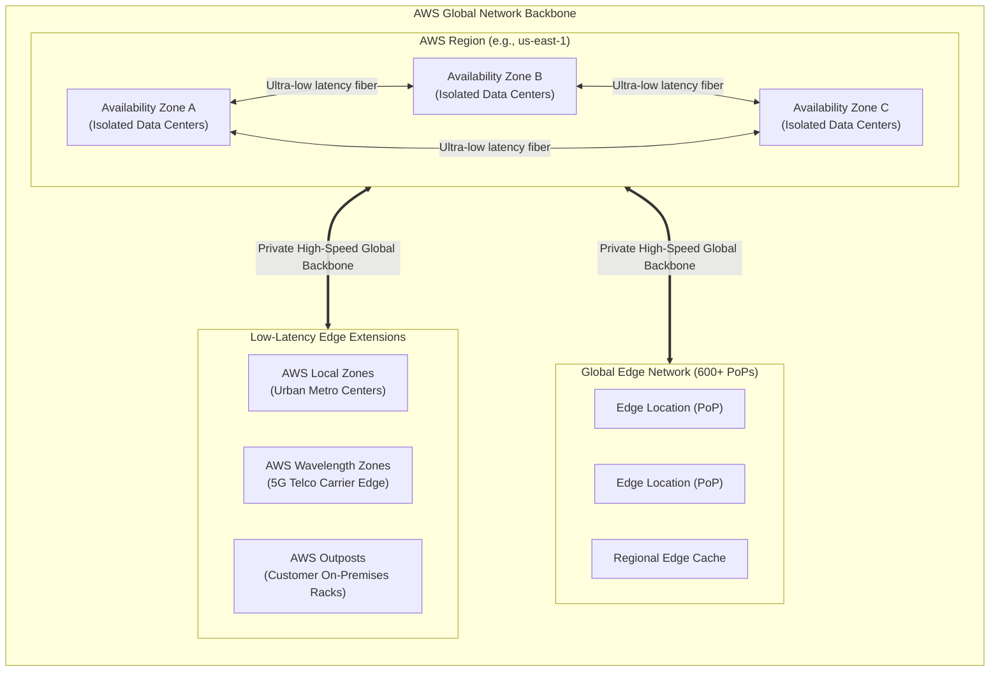
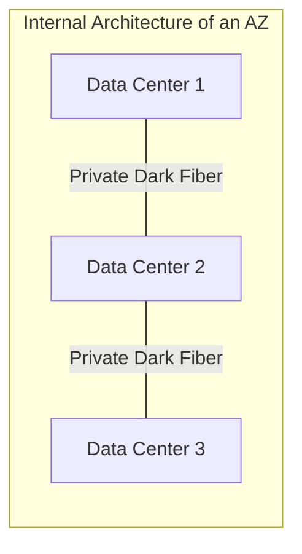
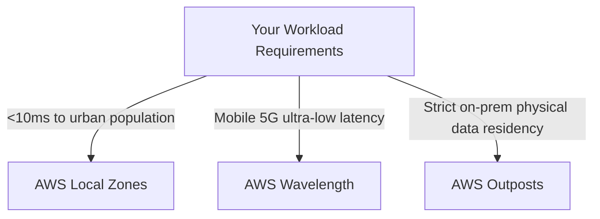

# AWS Global Infrastructure

> **Knowledge Area:** Cloud Concepts (Domain 1) & Cloud Technology (Domain 3)  
> **Relevant Certifications:** [CLF-C02](../../phase0_step01_syllabus/CLF-C02_Master_Blueprint.md), SAA-C03, AIF-C01  
> **Tags:** `#aws/concepts` `#aws/infrastructure` `#clf-c02`

---

## 💡 The Real-World Analogy (ELI5)

> **The Global Airport System:**
> - **AWS Region:** A major world metropolitan area (e.g., London, Tokyo, Stockholm). It is an independent geographic territory with multiple physical facilities.
> - **Availability Zone (AZ):** An individual, fully functional airport terminal within that city (Terminal A, Terminal B, Terminal C). Each terminal has its own independent backup power generators, air filtration, and flood protections, but they are connected to each other by a high-speed underground monorail (< 1 ms latency). If Terminal A has a power failure, flights instantly divert to Terminal B.
> - **Edge Location (Point of Presence - PoP):** City-center satellite ticket kiosks and package lockers located in hundreds of cities worldwide. Travelers can print boarding passes or pick up deliveries locally without driving all the way to the airport.

---

## 1. Overview of AWS Global Infrastructure

AWS operates a purpose-built, high-availability global cloud infrastructure consisting of geographically dispersed **Regions**, isolated **Availability Zones (AZs)**, an ultra-fast private global network backbone, and a distributed footprint of **Edge Locations**, **Local Zones**, and **Wavelength Zones**.

---

## 2. AWS Regions

An **AWS Region** is a physical geographical area in the world where AWS clusters multiple, physically separated Availability Zones.

### Key Characteristics:
* **Independence:** Every AWS Region is completely independent and isolated from other regions. A failure in one region does not affect another.
* **Minimum 3 AZs:** Every modern AWS Region contains at least **three** discrete Availability Zones (some have 6, like `us-east-1`).
* **Data Sovereignty:** Data stored in a specific Region **never leaves that Region** unless the customer explicitly configures cross-region replication.

### 4 Pillars of Region Selection (High-Yield Exam Focus):
When deciding which AWS Region to deploy workloads in, organizations evaluate 4 factors:

| Factor | Description | Example Scenario |
|---|---|---|
| **1. Compliance & Data Sovereignty** | Legal and regulatory requirements governing where data can physically reside. | GDPR in Europe requires customer data to reside within the EU; government regulations in Australia require data to stay in Sydney. |
| **2. Proximity & Latency** | Minimizing network round-trip time for the primary user base. | Deploy in `eu-west-1` (Ireland) for Western European users; deploy in `ap-southeast-1` (Singapore) for Southeast Asia. |
| **3. Service Availability** | Not all AWS services or new features are available in every region on launch day. | Amazon Bedrock or specialized GPU instance families might only be available in select tier-1 regions initially. |
| **4. Cost & Pricing** | Prices for compute, storage, and data transfer vary between regions due to local power, real estate, and tax costs. | `us-east-1` (N. Virginia) is generally cheaper than `sa-east-1` (São Paulo, Brazil). |

> [!TIP]
> **Exam Tip:** If a question asks for the **most critical** factor in region selection for a healthcare or financial firm, **Compliance and Legal Regulations (Data Sovereignty)** always trumps cost or latency!

---

## 3. Availability Zones (AZs)

An **Availability Zone (AZ)** consists of one or more discrete physical data centers, each with redundant power, networking, and connectivity, housed in separate facilities.

### Key Characteristics:
* **Distance & Separation:** AZs in the same Region are separated by a meaningful physical distance (typically tens of miles) to ensure they are on different flood plains, electrical grids, and seismic fault lines.
* **Low-Latency Interconnect:** Despite physical separation, all AZs in a Region are connected via redundant, private dark-fiber networks with single-digit millisecond latency (<1–2 ms).
* **Fault Isolation:** AZs are engineered as independent failure zones. If a catastrophic event strikes one AZ (e.g., substation power failure), other AZs in that region continue operating unaffected.
* **High Availability (HA) Best Practice:** Deploying an application across at least **two Availability Zones (Multi-AZ)** within a Region protects against local infrastructure failures and delivers high availability.

---

## 4. Edge Locations & Point of Presence (PoP)

An **Edge Location** is a physical site where AWS caches content closer to end-users to reduce latency.

### Services Operating at Edge Locations:
1. **Amazon CloudFront:** Content Delivery Network (CDN) that caches static and dynamic web content, videos, APIs, and software downloads.
2. **Amazon Route 53:** Highly available and scalable cloud DNS web service.
3. **AWS Shield Standard & AWS WAF:** Distributed Denial of Service (DDoS) protection and Web Application Firewall rules executed at the network edge before traffic ever hits customer servers.
4. **AWS Global Accelerator:** Routes traffic through edge entry points onto AWS's congestion-free private global network.

### Difference Between AZs and Edge Locations:
* **Availability Zones:** Where you **run your application workloads** (EC2 instances, RDS databases, VPC subnets).
* **Edge Locations:** Where AWS **caches content and handles DNS/routing/edge security** to speed up global delivery. You cannot launch an EC2 instance in an Edge Location!

---

## 5. Low-Latency Hybrid & Edge Extensions

For workloads that cannot tolerate the latency of a regional data center, AWS provides three specialized extensions:

### 1. AWS Local Zones
* **What it is:** Brings AWS compute, storage, database, and select services closer to large population, industry, and IT centers where no AWS Region currently exists (e.g., Los Angeles, Chicago, Hamburg, Taipei).
* **Ideal for:** Video editing/rendering, real-time gaming, CAD design, local healthcare applications requiring single-digit millisecond latency to local end users.

### 2. AWS Wavelength
* **What it is:** Embeds AWS compute and storage services inside telecommunication carriers' 5G networks (e.g., Verizon, Vodafone, KDDI).
* **Ideal for:** Mobile edge computing, connected vehicles (V2X), smart factories, real-time interactive game streaming on 5G mobile devices.
* **Mechanism:** Traffic from 5G devices reaches Wavelength servers directly without leaving the telecom network, eliminating internet hop latency.

### 3. AWS Outposts
* **What it is:** Physical AWS hardware racks and servers installed directly inside the customer’s on-premises data center or co-location facility.
* **Ideal for:** Workloads requiring local data processing for manufacturing plant floor execution systems (MES), ultra-low latency to existing on-premises mainframes, or strict regulatory local data storage mandates.
* **Unified Control:** Outposts hardware is managed, monitored, and patched by AWS using the exact same AWS APIs, tools, and console used in the cloud.

---

## 6. Exam Review Summary Table

| Infrastructure Component | Scope | Primary Purpose | Resilient Architecture Rule |
|---|---|---|---|
| **Region** | Geographic area (country/state) | Global compliance, local latency, full service catalog. | Replicate across multiple Regions for **Disaster Recovery (DR)**. |
| **Availability Zone (AZ)** | Cluster of data centers within a Region | Fault-isolated compute and data persistence. | Deploy across **Multi-AZ** for **High Availability (HA)**. |
| **Edge Location** | Worldwide Points of Presence (PoPs) | Caching, DNS, DDoS protection at perimeter. | Use CloudFront & Route 53 to protect origin servers. |
| **Local Zone** | Urban metro area extension | Single-digit ms latency to urban centers. | Extend VPC subnets into designated Local Zones. |
| **Wavelength Zone** | 5G telecom carrier network | Ultra-low latency for 5G mobile devices. | Deploy mobile app backends into carrier Wavelength subnets. |
| **Outposts** | Customer on-prem data center | On-premises AWS hardware & data residency. | Managed by AWS; connected back to parent AWS Region. |
---

## 7. Post-Topic Question Simulation & Retention Check

Test your understanding of AWS Global Infrastructure with these 5 exam-style questions:

## 🎯 Exam Traps & 'Clue-to-Answer' Trigger Words

| Exam Question Clue Keyword | Correct Infrastructure Component | Exam Trap Tip |
| :--- | :--- | :--- |
| *'One or more discrete data centers with redundant power and networking'* | **Availability Zone (AZ)** | Never confuse an AZ with a single data center (an AZ has $\ge 1$ data centers). |
| *'Physical location in the world with multiple isolated AZs'* | **AWS Region** | Minimum of 3 AZs per Region for resilience. |
| *'Cache content closer to worldwide end users with low latency'* | **Edge Location / CloudFront PoP** | Used for CloudFront CDN caching and Route 53 DNS. |
| *'Ultra-low single-digit millisecond latency for 5G mobile devices'* | **AWS Wavelength** | Embedded in telecom carrier 5G networks. |
| *'Single-digit millisecond latency in cities with no AWS Region'* | **AWS Local Zones** | Edge compute in major metro areas (e.g., Dallas, Boston). |
| *'Deploy physical AWS infrastructure racks on-premises in own data center'* | **AWS Outposts** | True hybrid cloud infrastructure managed by AWS. |

---

### Question 1
**An architecture requires high availability and automatic failover if a natural disaster floods a single physical facility. How should the application be deployed within an AWS Region?**
- A) Across multiple Edge Locations
- B) Across multiple Availability Zones (Multi-AZ)
- C) Inside a single Local Zone
- D) In an AWS Outposts rack

<b>Click to View Answer & Explanation</b>

**Correct Answer:** **B) Across multiple Availability Zones (Multi-AZ)**  
- **Why it's correct:** Each Availability Zone consists of one or more physically isolated data centers separated by a meaningful distance (tens of kilometers) on distinct floodplains and power grids. Deploying across Multi-AZ provides fault isolation against localized disasters.
- **Distractor Analysis:**
  - *A is incorrect:* Edge Locations cache static content (CloudFront); you cannot deploy compute instances in Edge Locations.
  - *C is incorrect:* A Local Zone is an extension for single-digit ms latency to urban centers, not multi-AZ redundancy.
  - *D is incorrect:* Outposts runs on-premises and does not provide multi-AZ cloud redundancy.

### Question 2
**What is the fundamental architectural difference between an Availability Zone and an Edge Location?**
- A) Edge Locations host EC2 instances, while Availability Zones host S3 buckets.
- B) Availability Zones run compute and database workloads, while Edge Locations cache content closer to end users.
- C) Edge Locations are connected only via the public internet.
- D) Availability Zones are only located outside the United States.

<b>Click to View Answer & Explanation</b>

**Correct Answer:** **B) Availability Zones run compute and database workloads, while Edge Locations cache content closer to end users.**  
- **Why it's correct:** AZs are regional clusters of data centers for primary compute and storage execution. Edge Locations (Points of Presence) cache data via Amazon CloudFront and Route 53 to reduce delivery latency globally.
- **Distractor Analysis:**
  - *A is incorrect:* EC2 instances cannot run in Edge Locations.
  - *C is incorrect:* Edge Locations connect directly to AWS Regions over AWS's private high-speed global fiber backbone.

### Question 3
**A hospital requires ultra-low latency (< 5ms) processing on a manufacturing plant floor and must store patient records on-site due to strict national data sovereignty laws. Which AWS solution fits this requirement?**
- A) Amazon CloudFront
- B) AWS Outposts
- C) AWS Local Zones
- D) AWS Wavelength

<b>Click to View Answer & Explanation</b>

**Correct Answer:** **B) AWS Outposts**  
- **Why it's correct:** AWS Outposts brings physical AWS hardware racks directly into the customer's on-premises facility, allowing local data processing and compliance with strict data residency mandates while being managed centrally by AWS.
- **Distractor Analysis:**
  - *A is incorrect:* CloudFront is a global CDN for caching web assets.
  - *C is incorrect:* Local Zones are located in metropolitan centers managed by AWS, not on customer premises.
  - *D is incorrect:* Wavelength is embedded inside 5G telecommunication networks.

### Question 4
**Which AWS extension embeds AWS compute and storage directly within telecommunication providers' 5G networks to deliver single-digit millisecond latency to mobile devices?**
- A) AWS Outposts
- B) AWS Wavelength
- C) AWS Direct Connect
- D) AWS Transit Gateway

<b>Click to View Answer & Explanation</b>

**Correct Answer:** **B) AWS Wavelength**  
- **Why it's correct:** AWS Wavelength allows developers to build applications for 5G connected devices (autonomous vehicles, smart robotics, mobile gaming) by hosting compute inside carrier 5G networks, bypassing internet hops.
- **Distractor Analysis:**
  - *A is incorrect:* Outposts is customer on-premises.
  - *C is incorrect:* Direct Connect is a dedicated private fiber link to AWS.
  - *D is incorrect:* Transit Gateway connects VPCs and on-premises networks in a hub-and-spoke model.

### Question 5
**What is the minimum number of Availability Zones contained within every AWS Region?**
- A) Exactly 1
- B) Minimum of 2 (typically 3 or more)
- C) Exactly 5
- D) 10 or more

<b>Click to View Answer & Explanation</b>

**Correct Answer:** **B) Minimum of 2 (typically 3 or more)**  
- **Why it's correct:** Every AWS Region is composed of a minimum of two physically isolated Availability Zones (most have 3 or more) to ensure high-availability architectures can be designed within any region.
- **Distractor Analysis:**
  - *A is incorrect:* A single data center or single AZ cannot constitute an AWS Region.

