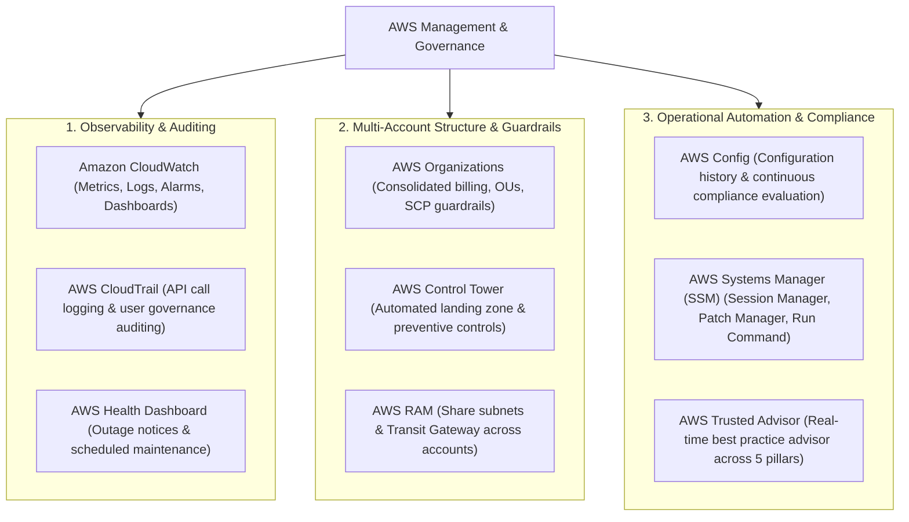
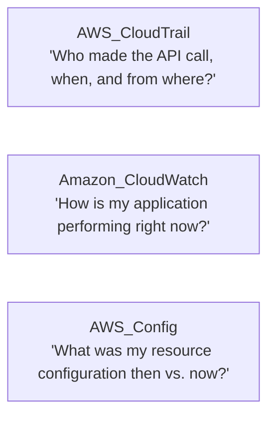

# AWS Management & Governance — Map of Content (MOC)

> **Domain:** 03_Services / Management & Governance  
> **Parent MOC:** [AWS_Brain_MOC](../../../../../README.md)  
> **Certifications:** [CLF-C02](../../phase0_step01_syllabus/CLF-C02_Master_Blueprint.md), SysOps Administrator, Solutions Architect

---

## 💡 The Real-World Analogy (ELI5)

> **Home Security & Compliance System:**
> - **Amazon CloudWatch:** The smart home dashboard and smoke detector. It monitors temperature (CPU utilization), water pressure (network I/O), and sounds a loud alarm (CloudWatch Alarm) if smoke is detected, while recording daily thermostat readings (CloudWatch Logs & Metrics).
> - **AWS CloudTrail:** The building's 24/7 security CCTV camera recording the front entrance. Every time someone enters or exits, the camera records: *Who walked in (IAM identity), What key they used (API action), Which door they touched (AWS resource), When it happened (Timestamp), and Where they came from (IP address).*
> - **AWS Config:** The municipal building inspector. It constantly checks that every room has an up-to-code fire extinguisher and unblocked fire exits. If an employee removes a smoke detector (turns off S3 bucket encryption), Config flags the room as non-compliant and can trigger an automated repair.
> - **AWS Systems Manager:** The master maintenance iPad. It lets IT administrators remotely update software, run scripts, and patch 500 servers simultaneously without needing SSH keys or open firewall ports.

---

## 1. Architectural Taxonomy of AWS Management & Governance

AWS management and governance services provide continuous visibility, centralized multi-account guardrails, operational automation, and compliance auditing:

---

## 2. High-Yield "The Big Three" Observability Comparison

| Service | Primary Question Answered | Data Artifacts | Target Audience |
| :--- | :--- | :--- | :--- |
| **[AWS_CloudTrail](../../phase3_step09_notes/distinctions/Monitoring_Governance_Trio_CloudWatch_vs_CloudTrail_vs_Config.md)** | *"Who made the API call, when, and from where?"* | Event logs, user identities, source IPs, AWS KMS encryption. | Security, Auditing, Compliance |
| **[Amazon_CloudWatch](../../phase3_step09_notes/distinctions/Monitoring_Governance_Trio_CloudWatch_vs_CloudTrail_vs_Config.md)** | *"How is my application performing right now?"* | Metrics, CloudWatch Logs, Alarms, Container Insights. | DevOps, SysAdmins, SREs |
| **[AWS_Config](../../phase3_step09_notes/distinctions/Monitoring_Governance_Trio_CloudWatch_vs_CloudTrail_vs_Config.md)** | *"What was my resource configuration then vs. now?"* | Configuration Items (CIs), timeline history, rule evaluations. | Governance, Compliance, SecOps |

---

## 3. Atomic Notes in this Domain

| Atomic Note | Description | Key Focus / Keywords |
| :--- | :--- | :--- |
| **[Amazon_CloudWatch](../../phase3_step09_notes/distinctions/Monitoring_Governance_Trio_CloudWatch_vs_CloudTrail_vs_Config.md)** | Monitoring & Observability | Metrics (15 months retention), Alarms (EC2 action, SNS), Logs Insights. |
| **[AWS_CloudTrail](../../phase3_step09_notes/distinctions/Monitoring_Governance_Trio_CloudWatch_vs_CloudTrail_vs_Config.md)** | API Governance & Auditing | Multi-region trail, Management vs. Data events, immutable S3 log storage. |
| **[AWS_Organizations](../../phase3_step09_notes/services/Management_Governance/AWS_Organizations_and_Governance.md)** | Centralized Multi-Account Governance | Consolidated Billing, Organizational Units (OUs), Service Control Policies (SCPs). |
| **[AWS_Control_Tower](../../phase3_step09_notes/services/Management_Governance/AWS_Organizations_and_Governance.md)** | Automated Multi-Account Landing Zone | Well-Architected multi-account baseline, Account Factory, Guardrails. |
| **[AWS_Config](../../phase3_step09_notes/distinctions/Monitoring_Governance_Trio_CloudWatch_vs_CloudTrail_vs_Config.md)** | Configuration Management & Rules | Track configuration drift, point-in-time state, automatic remediation. |
| **[AWS_Systems_Manager](../../phase3_step09_notes/distinctions/Monitoring_Governance_Trio_CloudWatch_vs_CloudTrail_vs_Config.md)** | Operations Hub & Node Management | Session Manager (no port 22/bastion), Patch Manager, Parameter Store. |
| **[AWS_Trusted_Advisor](../../phase3_step09_notes/distinctions/Monitoring_Governance_Trio_CloudWatch_vs_CloudTrail_vs_Config.md)** | Cloud Best Practice Advisor | 5 pillars (Cost, Security, Fault Tolerance, Performance, Quotas). |
| **[AWS_Health_Dashboard](../../phase3_step09_notes/distinctions/AWS_Health_Dashboard_Global_vs_Account.md)** | Service Availability & Account Impact | Global service events vs. personal impact alerts on your specific resources. |
| **[AWS_Resource_Access_Manager_RAM](../../phase3_step09_notes/services/Management_Governance/AWS_Organizations_and_Governance.md)** | Cross-Account Resource Sharing | Share VPC subnets, Transit Gateways, Route 53 rules without duplication. |
---

## 7. Post-Topic Question Simulation & Retention Check

Test your understanding of Management & Observability with these 5 exam-style questions:

## 🎯 Exam Traps & 'Clue-to-Answer' Trigger Words

| Observability / Governance Service | Primary Focus & Function | Exam Trap Tip |
| :--- | :--- | :--- |
| **Amazon CloudWatch** | **Performance metrics, logs, and alarms** (CPU, disk, latency, billing alarms). | Monitors *system performance and operational health*. |
| **AWS CloudTrail** | **Auditing API activity, user governance, and security forensics**. | Records *who did what, when, and from where* via API calls. |
| **AWS Config** | **Resource configuration tracking, compliance auditing, and change history**. | Evaluates *whether resource configurations comply with organizational rules*. |
| **AWS Systems Manager (SSM)** | **Operational hub for remote management, automated patching, and parameter storage**. | Session Manager replaces SSH/RDP; Patch Manager automates OS updates. |
| **AWS Trusted Advisor** | **Real-time automated guidance** across Cost, Performance, Security, Fault Tolerance, Quotas. | Basic has 7 core checks; Business & Enterprise have full 115+ checks. |

---

### Question 1
**Which AWS service records API activity, user logins, and administrative actions across an AWS account, providing an immutable audit trail for security investigations and compliance?**
- A) Amazon CloudWatch
- B) AWS CloudTrail
- C) AWS Config
- D) AWS Trusted Advisor

<b>Click to View Answer & Explanation</b>

**Correct Answer:** **B) AWS CloudTrail**  
- **Why it's correct:** AWS CloudTrail captures and records every API call made via the Console, CLI, SDKs, or AWS services, answering: *"Who made the call, when was it made, from what IP address, and on what resource?"*

### Question 2
**A system administrator needs to monitor EC2 CPU utilization, trigger automated scaling actions when metrics exceed 80%, and send SMS alerts to engineers. Which service should be used?**
- A) AWS CloudTrail
- B) Amazon CloudWatch
- C) AWS Config
- D) AWS Systems Manager

<b>Click to View Answer & Explanation</b>

**Correct Answer:** **B) Amazon CloudWatch**  
- **Why it's correct:** Amazon CloudWatch monitors application and operational performance metrics, aggregates logs, and triggers CloudWatch Alarms that can execute EC2 Auto Scaling or send SNS notifications.

### Question 3
**Which service tracks configuration changes over time, evaluates resource configurations against compliance rules (e.g. ensuring all S3 buckets are encrypted), and provides automated remediation?**
- A) AWS CloudTrail
- B) AWS Config
- C) Amazon Inspector
- D) AWS Trusted Advisor

<b>Click to View Answer & Explanation</b>

**Correct Answer:** **B) AWS Config**  
- **Why it's correct:** AWS Config records the timeline of configuration changes to AWS resources and compares active configurations against predefined or custom rules to detect compliance drift.

### Question 4
**An enterprise has 200 member accounts in AWS Organizations. Which feature allows administrators to set central guardrails that restrict which AWS services and API actions can be executed within member accounts?**
- A) AWS IAM Identity Center
- B) Service Control Policies (SCPs)
- C) AWS Trusted Advisor
- D) Amazon CloudWatch Synthetics

<b>Click to View Answer & Explanation</b>

**Correct Answer:** **B) Service Control Policies (SCPs)**  
- **Why it's correct:** Service Control Policies (SCPs) in AWS Organizations define maximum allowed permissions for member accounts or Organizational Units (OUs), acting as boundaries that even account root users cannot bypass.

### Question 5
**Which online tool provides continuous automated guidance across 5 categories: Cost Optimization, Security, Fault Tolerance, Performance, and Service Quotas?**
- A) AWS Trusted Advisor
- B) AWS Health Dashboard
- C) AWS CloudTrail
- D) AWS Compute Optimizer

<b>Click to View Answer & Explanation</b>

**Correct Answer:** **A) AWS Trusted Advisor**  
- **Why it's correct:** AWS Trusted Advisor inspects your environment and compares configurations against AWS best practices across all 5 key categories, providing real-time recommendations and cost savings estimates.

