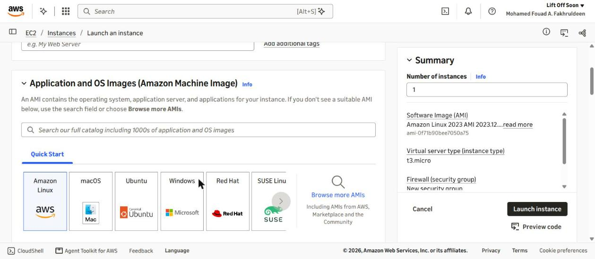
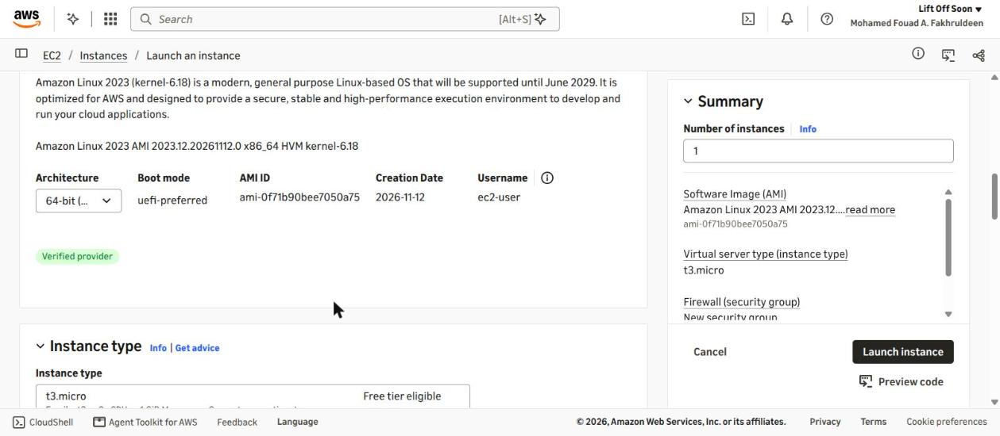
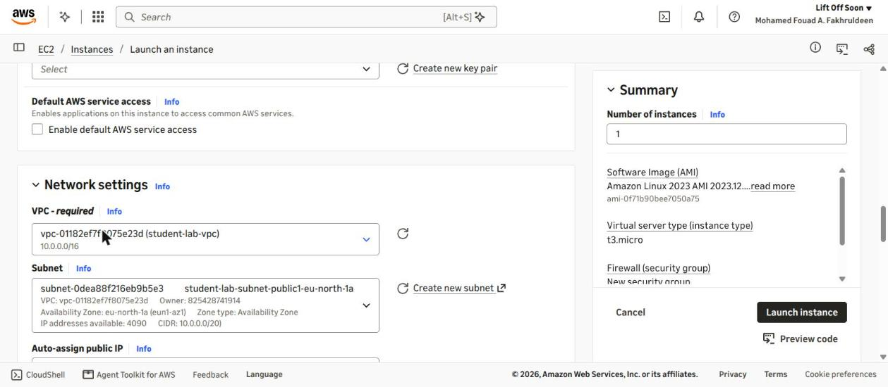
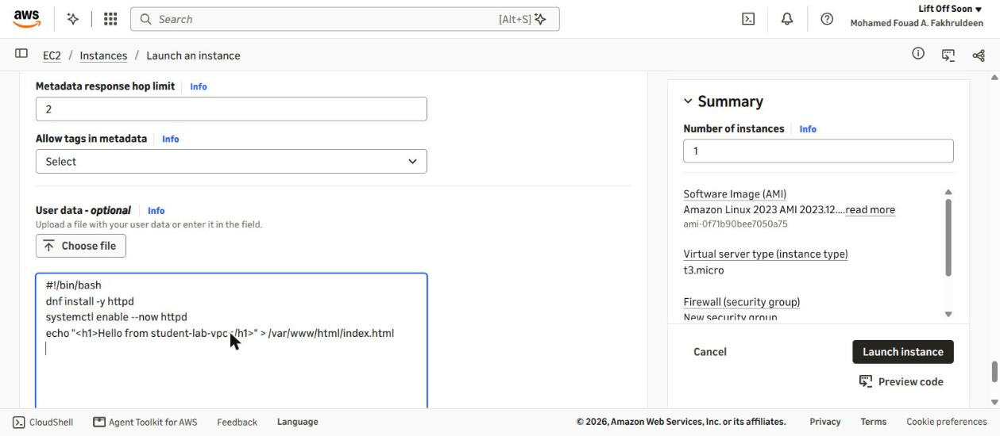
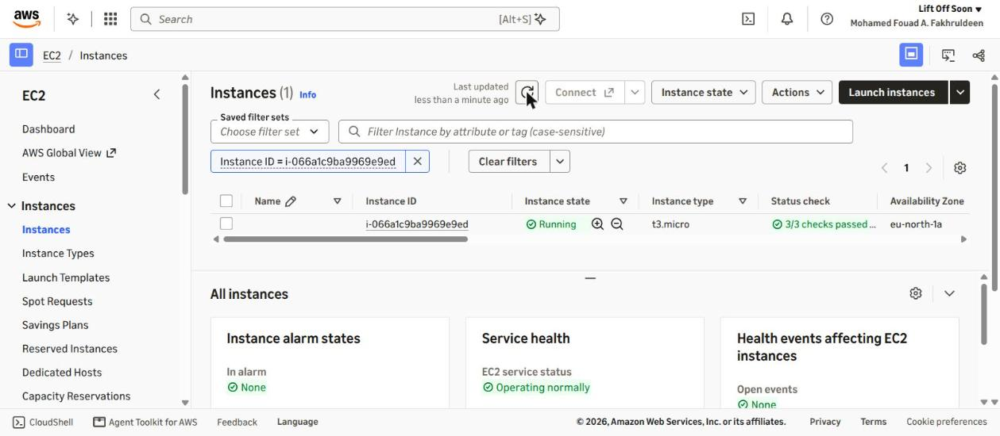
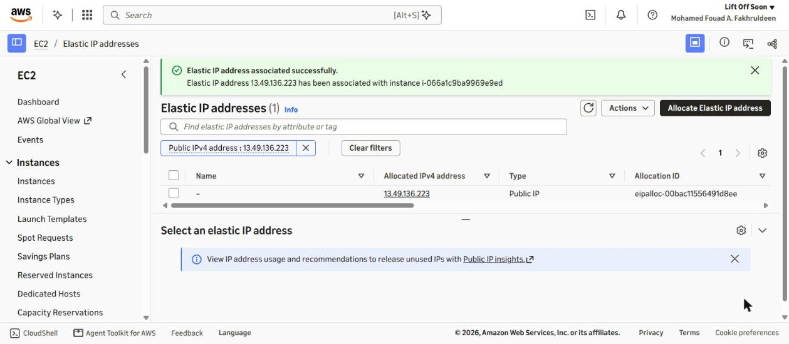

# Lab 03: Compute Tier (EC2, User Data & Elastic IPs)

> **Focus:** Amazon EC2, AMI Selection, Instance Types, User Data Bootstrapping, Status Checks, and Elastic IPs  
> **Region:** `eu-north-1` (Stockholm)  
> **Course Domain:** Domain 3: Cloud Technology & Services  
> **Associated Vault Note:** [Amazon_EC2](../phase3_step09_notes/services/Compute/Amazon_EC2.md)  

---

## 🧭 Prerequisite Concept Refresher: Elastic Compute Architecture

### 1. What is an Amazon Machine Image (AMI)?
An **AMI** is a pre-configured template containing the operating system, architecture (x86_64 vs. ARM64 Graviton), software packages, and volume permissions needed to launch an instance. AMIs can be AWS-provided (e.g., Amazon Linux 2023), AWS Marketplace commercial appliances, or custom private AMIs created from your own instances.

### 2. Decoding EC2 Instance Family Naming Conventions
AWS instance names follow a standardized formula:
$$\underbrace{\mathbf{t}}_{\text{Family}} \overbrace{\mathbf{4g}}^{\text{Generation + Tech}} . \underbrace{\mathbf{micro}}_{\text{Size}}$$
- **Family:** `t` = Burstable general purpose, `c` = Compute optimized, `m` = General purpose balanced, `r` = Memory optimized, `i` = Storage optimized.
- **Generation:** Higher numbers represent newer, more cost-effective hardware (e.g., generation 4 vs. 3).
- **Additional Capabilities:** `g` = AWS Graviton processor (ARM-based, high performance per dollar), `i` = Intel processor, `a` = AMD processor, `n` = Network enhanced.
- **Size:** Scales vCPU, RAM, and network bandwidth proportionally (`nano`, `micro`, `small`, `medium`, `large`, `xlarge`, etc.).

### 3. User Data Bootstrapping vs. Manual Administration
**User Data** is a bootstrap script (typically Bash or PowerShell) executed automatically as the root user **once during initial instance launch**. It allows you to provision software, update packages, clone repositories, and configure servers without needing manual SSH access.

---

## 🛠️ Step-by-Step Console Walkthrough

### Step 1: Open EC2 Launch Wizard & Select AMI
1. In the AWS Management Console, navigate to the **EC2 Console** in `eu-north-1`.
2. Click **Launch instance**.
3. Name your instance: `web-server-01`.
4. Under **Application and OS Images (Amazon Machine Image)**, select **Amazon Linux 2023 AMI** (verify the **Free tier eligible** badge).
5. Choose architecture: **64-bit (x86)** or **64-bit (Arm)** depending on your target instance type.


*Figure 3.1: Selecting Amazon Linux 2023 from the AMI Quick Start catalog.*

---

### Step 2: Choose Instance Type & Key Pair
1. Under **Instance type**, select **`t3.micro`** (or **`t4g.micro`** if using Graviton). Both qualify for Free Tier allocations.
2. Under **Key pair (login)**, choose an existing key pair or select **Proceed without a key pair** (since this web server will be bootstrapped automatically via User Data and managed via SSM Session Manager).


*Figure 3.2: Selecting a Free Tier eligible burstable instance type.*

---

### Step 3: Configure Network Settings & Security Group
1. Click **Edit** next to **Network settings**.
2. Set the following parameters:
   - **VPC:** `student-lab-vpc`
   - **Subnet:** Select a public subnet (`student-lab-vpc-subnet-public1-eu-north-1a`).
   - **Auto-assign public IP:** **Enable** (enables the instance to receive a temporary public IP).
   - **Firewall (security groups):** Select **Select existing security group** and choose **`web-tier-sg`** (created in Lab 02, allowing HTTP:80).


*Figure 3.3: Attaching the instance to the public subnet with web security group.*

---

### Step 4: Add User Data Bootstrap Script
1. Scroll down to the bottom and expand **Advanced details**.
2. Scroll to the **User data** box at the very end of the page.
3. Paste the following automated bootstrap script:

```bash
#!/bin/bash
# Update OS packages
dnf update -y
# Install Apache Web Server
dnf install -y httpd
# Enable and start the Apache service
systemctl enable httpd
systemctl start httpd
# Generate custom HTML greeting with metadata
INSTANCE_ID=$(curl -s http://169.254.169.254/latest/meta-data/instance-id)
AZ=$(curl -s http://169.254.169.254/latest/meta-data/placement/availability-zone)
echo "<h1>Hello from AWS Cloud Practitioner Lab!</h1><p>Instance ID: $INSTANCE_ID</p><p>Availability Zone: $AZ</p>" > /var/www/html/index.html
```


*Figure 3.4: Automated bash bootstrap script inserted into the User data field.*

4. Click the orange **Launch instance** button.

---

### Step 5: Verify Instance Status Checks
1. In the left navigation pane, click **Instances**.
2. Select `web-server-01`.
3. Wait approximately 2–3 minutes until the **Status check** column displays **2/2 checks passed** (System status check and Instance status check).


*Figure 3.5: Instance running with 2/2 hardware and hypervisor status checks passed.*

4. Copy the **Public IPv4 address** from the instance details pane.
5. Open a new browser tab and navigate to `http://<Public-IPv4-Address>`. You should see the personalized greeting with your Instance ID and AZ!

---

### Step 6: Allocate and Associate a Static Elastic IP
Standard public IPs are released when an instance is stopped. To maintain a permanent fixed public IP:
1. In the left navigation pane under **Network & Security**, click **Elastic IPs**.
2. Click **Allocate Elastic IP address** and click **Allocate**.
3. Select the allocated IP, click **Actions** -> **Associate Elastic IP address**.
4. Set **Resource type:** `Instance`, select `web-server-01`, and click **Associate**.


*Figure 3.6: Binding a permanent Elastic IP to the running web server instance.*

---

## 💻 AWS CLI Verification Commands

```bash
# 1. Describe running instances and inspect public IP
aws ec2 describe-instances \
  --filters "Name=tag:Name,Values=web-server-01" "Name=instance-state-name,Values=running" \
  --query "Reservations[*].Instances[*].{InstanceId:InstanceId,Type:InstanceType,State:State.Name,PublicIP:PublicIpAddress,PrivateIP:PrivateIpAddress}" \
  --output table \
  --region eu-north-1 \
  --profile aws-notes

# 2. Check 2/2 status checks programmatically
aws ec2 describe-instance-status \
  --instance-ids $(aws ec2 describe-instances --filters "Name=tag:Name,Values=web-server-01" "Name=instance-state-name,Values=running" --query "Reservations[0].Instances[0].InstanceId" --output text --region eu-north-1 --profile aws-notes) \
  --region eu-north-1 \
  --profile aws-notes
```

---

## 🎯 Exam Practice: Scenarios & Traps

| Exam Scenario | Correct Recommendation | Why Distractors Fail |
|---|---|---|
| *"An EC2 instance fails its System Status Check due to an underlying physical host hardware degradation. What is the immediate recommended action?"* | **Stop and then Start the instance** | Simply rebooting the OS keeps the instance on the same damaged physical host. Stopping and starting moves the instance to a healthy physical host. |
| *"A cloud administrator needs to automatically install Apache web server and clone a Git repo every time an EC2 instance launches from a standard base AMI."* | **Provide a shell script in the EC2 User Data field** | Instance Metadata is read-only information about the instance. CloudWatch monitors metrics; it does not bootstrap software. |
| *"From inside an EC2 instance, an application needs to query its own public IP address and Availability Zone. What URL endpoint should it query?"* | **The Instance Metadata service at `http://169.254.169.254/latest/meta-data/`** | `user-data` returns the bootstrap script, not live operational metadata. Localhost `127.0.0.1` has no AWS metadata knowledge. |
| *"When does AWS charge for an Elastic IP (EIP) address?"* | **When the Elastic IP is allocated in your account but NOT associated with a running EC2 instance (or when attached to a stopped instance)** | AWS provides one free Elastic IP while it is actively associated with a running instance to encourage efficient IPv4 utilization. |

---

## 🧹 Free Tier Cleanup & Cost Safeguard

> [!WARNING]
> **Unassociated Elastic IPs cost money!** AWS charges for Elastic IPs that are allocated but NOT attached to a running instance.

1. Navigate to **Elastic IPs** -> Select your Elastic IP -> Click **Actions** -> **Disassociate Elastic IP address**.
2. Click **Actions** -> **Release Elastic IP address** (permanently delete it).
3. Navigate to **Instances** -> Select `web-server-01` -> Click **Instance state** -> **Terminate instance**.
