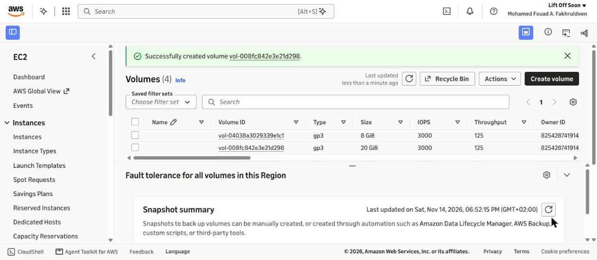
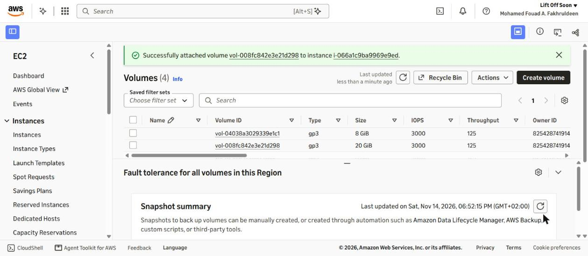
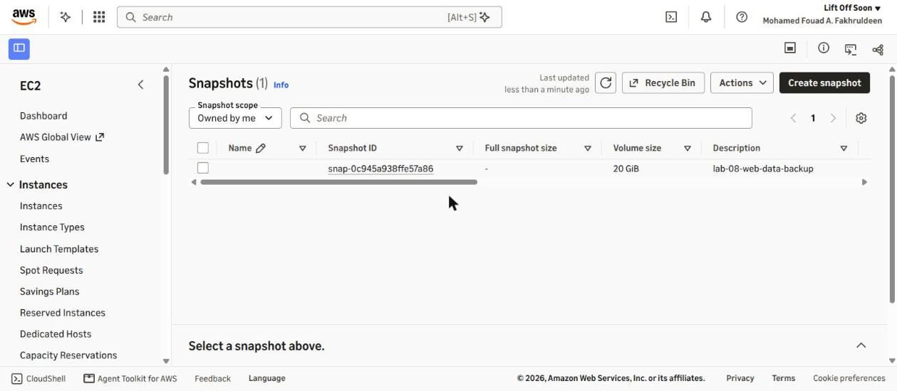
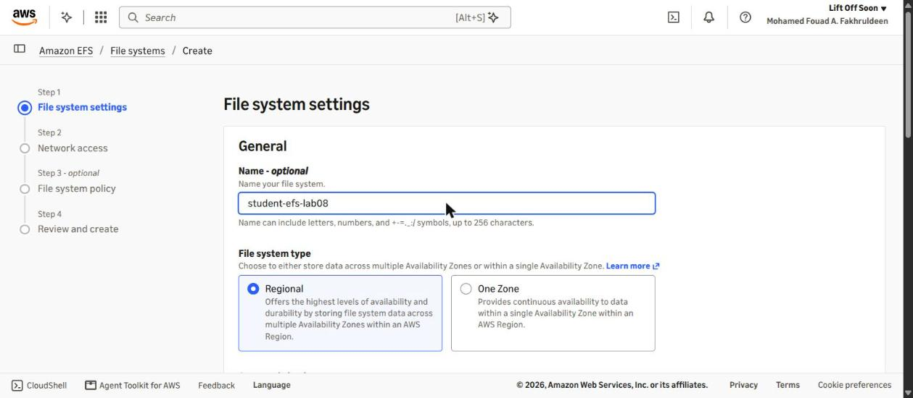
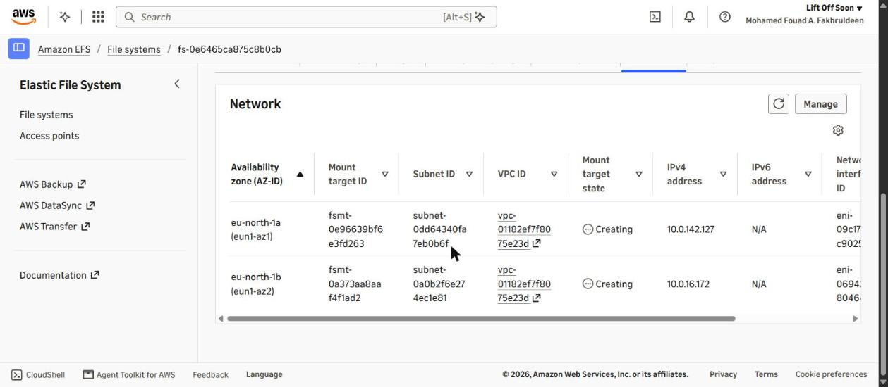

# Lab 08: Block & File Storage (EBS Volumes vs. Amazon EFS)

> **Focus:** Amazon Elastic Block Store (EBS), `gp3` Volume Tuning, EBS Snapshots, and Amazon Elastic File System (EFS) Multi-AZ Sharing  
> **Region:** `eu-north-1` (Stockholm)  
> **Course Domain:** Domain 3: Cloud Technology & Services  
> **Associated Vault Notes:** [Block_and_File_Storage_EBS_EFS](../phase3_step09_notes/services/Storage/Block_and_File_Storage_EBS_EFS.md)  

---

## 🧭 Prerequisite Concept Refresher: Block vs. File Storage

### 1. Amazon EBS (Block Storage - RWO)
- Operates like a physical hard drive (SSD/HDD) plugged directly into your virtual server.
- **Single-AZ Limitation:** An EBS volume is physically located in a specific data center rack inside a **single Availability Zone** (e.g., `eu-north-1a`). It **cannot** be directly attached to an EC2 instance in `eu-north-1b`.
- **Access Mode:** Primarily **Read-Write-Once (RWO)**—attached to one instance at a time (with the exception of specialized EBS Multi-Attach on `io2` volumes).
- **Persistence:** Persists data independently of the instance lifecycle. If the EC2 instance is stopped or terminated, the EBS volume remains intact (unless *Delete on Termination* is checked).

### 2. Amazon EFS (File Storage - RWX)
- A fully managed, elastic **Network File System (NFSv4)**.
- **Multi-AZ by Design:** Automatically replicates across multiple Availability Zones in the Region.
- **Concurrent Sharing (RWX - Read-Write-Many):** Hundreds or thousands of EC2 instances, ECS container tasks, and on-premises servers across multiple AZs can **simultaneously mount and write to the same shared directory**.
- **Elastic Capacity:** Automatically expands and shrinks as files are added or deleted; you never provision storage size in advance.

### 3. EBS Volume Types Quick Reference
- **`gp3` (General Purpose SSD):** Default baseline. Decouples IOPS (3,000 baseline) and throughput (125 MB/s baseline) from storage size. Up to 20% cheaper than legacy `gp2`.
- **`io2` Block Express (Provisioned IOPS SSD):** Extreme performance for mission-critical relational databases (up to 256,000 IOPS and 99.999% durability).
- **`st1` (Throughput Optimized HDD):** Big data, data warehouses, sequential logs.
- **`sc1` (Cold HDD):** Lowest-cost magnetic storage for infrequently accessed sequential files.

---

## 🛠️ Step-by-Step Console Walkthrough

### Step 1: Create an Amazon EBS `gp3` Volume
1. In the AWS Management Console, navigate to the **EC2 Console** in `eu-north-1`.
2. In the left navigation pane under **Elastic Block Store**, click **Volumes**.
3. Click **Create volume**.
4. Configure the volume parameters:
   - **Volume type:** `General Purpose SSD (gp3)`
   - **Size:** `20 GiB`
   - **IOPS:** `3000` (free baseline included)
   - **Throughput:** `125 MB/s` (free baseline included)
   - **Availability Zone:** Select **`eu-north-1a`** (must match the AZ of your target EC2 instance).
   - **Encryption:** Check **Encrypt this volume** (using default `aws/ebs` KMS key).
5. Click **Create volume**.


*Figure 8.1: Creating an encrypted gp3 EBS volume in Availability Zone eu-north-1a.*

---

### Step 2: Attach the EBS Volume to an EC2 Instance
1. In the **Volumes** list, select your newly created volume (`Available` state).
2. Click **Actions** -> **Attach volume**.
3. In the **Instance** field, select your running instance (`web-server-01`).
4. Set **Device name:** `/dev/sdf` (or `/dev/xvdf`).
5. Click **Attach volume**. The volume state will transition to **In-use**.


*Figure 8.2: Attaching the block volume to a running EC2 instance.*

---

### Step 3: Create an Incremental EBS Snapshot
1. Select the attached EBS volume.
2. Click **Actions** -> **Create snapshot**.
3. Add a description: `Point-in-time backup before maintenance`.
4. Click **Create snapshot**.
5. In the left navigation pane under **Elastic Block Store**, click **Snapshots** to view the progress of the point-in-time incremental backup stored durably in Amazon S3.


*Figure 8.3: Creating an incremental snapshot stored across multiple AZs in Amazon S3.*

---

### Step 4: Create an Amazon EFS Shared File System
1. In the AWS Console, navigate to **EFS** (Elastic File System).
2. Click **Create file system**.
3. Click **Customize** to view detailed architecture options:
   - **Name:** `shared-team-storage`
   - **File system type:** `Regional` (replicated across multiple AZs).
   - **Automatic backups:** Enabled.
   - **Lifecycle management:** Transition to Infrequently Accessed (IA) after `30 days`.


*Figure 8.4: Creating a multi-AZ elastic NFS file system.*

---

### Step 5: Verify Multi-AZ Mount Targets
1. Click **Next** to reach the **Network access** configuration.
2. Select your VPC (`student-lab-vpc`).
3. Notice that AWS automatically provisions a **Mount Target** with a dedicated private IP address in each enabled Availability Zone (`eu-north-1a` and `eu-north-1b`).
4. Select a security group that allows inbound NFS traffic on **TCP port 2049**.
5. Click **Next** -> **Create**.


*Figure 8.5: Multi-AZ mount targets enabling instances in any AZ to access the shared file system.*

---

### Step 6: Concurrent Multi-Instance Mounting
To mount the shared EFS file system on multiple instances simultaneously:

```bash
# On Instance 1 (eu-north-1a):
sudo mkdir -p /mnt/shared-data
sudo mount -t nfs4 -o nfsvers=4.1 fs-xxxxxxxx.efs.eu-north-1.amazonaws.com:/ /mnt/shared-data
echo "Created by Instance 1 at $(date)" > /mnt/shared-data/test.txt

# On Instance 2 (eu-north-1b):
sudo mkdir -p /mnt/shared-data
sudo mount -t nfs4 -o nfsvers=4.1 fs-xxxxxxxx.efs.eu-north-1.amazonaws.com:/ /mnt/shared-data
cat /mnt/shared-data/test.txt
# Output: Created by Instance 1 at ...
```

---

## 💻 AWS CLI Verification Commands

```bash
# 1. Describe EBS volumes in eu-north-1
aws ec2 describe-volumes \
  --filters "Name=status,Values=in-use" \
  --query "Volumes[*].{VolumeId:VolumeId,Size:Size,Type:VolumeType,AZ:AvailabilityZone,State:State}" \
  --output table \
  --region eu-north-1 \
  --profile aws-notes

# 2. Describe EFS file systems and lifecycle policies
aws efs describe-file-systems \
  --query "FileSystems[*].{Id:FileSystemId,Name:Name,State:LifeCycleState,Size:SizeInBytes.Value}" \
  --output table \
  --region eu-north-1 \
  --profile aws-notes
```

---

## 🎯 Exam Practice: Scenarios & Traps

| Exam Scenario | Correct Recommendation | Why Distractors Fail |
|---|---|---|
| *"A fleet of 50 EC2 instances running across multiple Availability Zones in a region need concurrent read and write access to a shared POSIX file system."* | **Amazon Elastic File System (Amazon EFS)** | Amazon EBS is locked to a single Availability Zone and cannot be mounted simultaneously across multiple AZs. S3 is object storage, not a POSIX file system. |
| *"An application requires high-performance temporary cache storage with maximum disk I/O speed. The data is non-critical and can be regenerated if lost upon stopping the server."* | **Amazon EC2 Instance Store (Ephemeral Storage)** | EBS volumes incur network latency as network-attached block devices. Instance Store provides physically attached NVMe speed, but is ephemeral. |
| *"How are Amazon EBS Snapshots backed up and billed?"* | **They are stored in Amazon S3 and are incremental (billing only for changed blocks since the last snapshot)** | Snapshots do not duplicate unchanged data; they store only the delta blocks in Amazon S3. |
| *"Can an Amazon EBS volume be attached to an EC2 instance in a different Availability Zone?"* | **No. EBS volumes are single-AZ resources and must reside in the exact same Availability Zone as the EC2 instance** | To move an EBS volume across AZs, you must take an EBS Snapshot and restore it as a new volume in the target AZ. |

---

## 🧹 Free Tier Cleanup & Cost Safeguard
1. In the **EC2 Console**, go to **Volumes** -> Select the 20 GiB volume -> Click **Actions** -> **Detach volume** (wait for `Available`), then **Delete volume**.
2. Go to **Snapshots** -> Select your snapshot -> Click **Actions** -> **Delete snapshot**.
3. In the **EFS Console**, select `shared-team-storage` -> Click **Delete** -> Type the file system ID to confirm permanent deletion.
