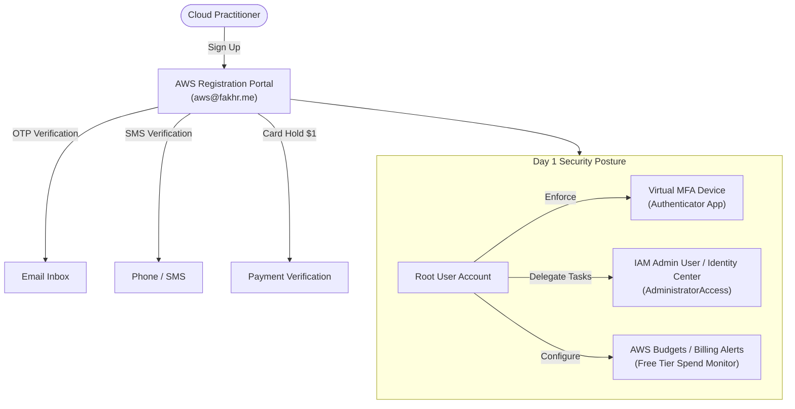

# Tutorial 00: AWS Account Creation & Security Baseline

This tutorial walks through the foundational process of creating a new AWS Free Tier account, securing the root user with Multi-Factor Authentication (MFA), and creating an administrative identity for day-to-day operations.

---

## 📌 Associated Notes & Blueprints
- [Shared_Responsibility_Model](../phase3_step09_notes/concepts/Shared_Responsibility_Model.md)
- [AWS_IAM](../phase3_step09_notes/services/Security_Identity_Compliance/AWS_IAM_and_Identity.md)
- [Cloud_Economics_and_Billing_Models](../phase3_step09_notes/concepts/Cloud_Economics_and_Billing_Models.md)
- [CLF-C02_Master_Blueprint](../phase0_step01_syllabus/CLF-C02_Master_Blueprint.md)

---

## 🏗️ Architecture Overview



---

## 🚀 Execution Steps

### Step 1: Account Creation Walkthrough
Follow the complete registration walkthrough documented in the work repository:
👉 `work/phase2_step07_labs/00_Account_Creation_Walkthrough.md`

### Step 2: Essential Day-1 Security Configurations

#### 1. Enable Root Multi-Factor Authentication (MFA)
Under the AWS Shared Responsibility Model, customer security starts with locking down the root credentials:
1. Navigate to the **IAM Console**.
2. Click **Security Credentials** on the top right account dropdown.
3. In the **Multi-factor authentication (MFA)** section, click **Assign MFA**.
4. Select **Authenticator app** and scan the QR code using Google Authenticator or 1Password.
5. Enter two consecutive 6-digit MFA codes and click **Add MFA**.

#### 2. Configure AWS Free Tier Spend Alerts
1. Open the **Billing and Cost Management Console**.
2. Under **Preferences**, select **Billing Preferences**.
3. Enable:
   - **Receive Free Tier Usage Alerts**
   - **Receive Billing Alerts**
4. Set email to receive alerts: `aws@fakhr.me`.

---

## 💻 CLI Verification Commands

Once your credentials are authenticated with your profile (`aws-notes`):

```bash
# Verify caller identity and account number
aws sts get-caller-identity --profile aws-notes

# Verify default region assignment
aws configure get region --profile aws-notes

# Confirm CloudWatch alarms or billing metric accessibility
aws cloudwatch list-metrics --namespace "AWS/Billing" --region us-east-1 --profile aws-notes
```


---

## 4. 🎯 Authentic Architecture Exam Practice
> Practice real-world scenarios tested on official AWS examinations that directly apply the architectural patterns built in this tutorial.

### Scenario Practice 1: CLF-C02-ET-Q053
**Question:**  
A company is using AWS Identity and Access Management (IAM).

Who can manage the access keys of the AWS account root user?

**Options:**
- A) IAM users in the same account that have been granted permission
- B) IAM roles in any account that have been granted permission
- C) IAM users and roles that have been granted permission
- D) The AWS account owner

<details>
<summary><b>View Verified Answer & Solution Analysis</b></summary>

**Correct Answer:** `D`  
**Peer Consensus:** `100%` agreement.  

**Architectural Breakdown & Distractor Analysis:**  
Community Most Voted: D (100%). Contributor Answer: D.

Community Rationale & Discussion:
Selected Answer: D
D. The AWS account owner
---
D. The AWS account owner

</details>

### Scenario Practice 2: CLF-C02-ET-Q229
**Question:**  
Which actions are best practices for an AWS account root user? (Choose two.)

**Options:**
- A) Share root user credentials with team members.
- B) Create multiple root users for the account, separated by environment.
- C) Enable multi-factor authentication (MFA) on the root user.
- D) Create an IAM user with administrator privileges for daily administrative tasks, instead of using the root user.
- E) Use programmatic access instead of the root user and password.

<details>
<summary><b>View Verified Answer & Solution Analysis</b></summary>

**Correct Answer:** `CD`  
**Peer Consensus:** `100%` agreement.  

**Architectural Breakdown & Distractor Analysis:**  
Community Most Voted: CD (100%). Contributor Answer: CD.

Community Rationale & Discussion:
Selected Answer: CD
C. Enable multi-factor authentication (MFA) on the root user:
Enabling MFA adds an extra layer of security to the root user account. Even if someone gains access to the root user credentials, they would also need the second factor (such as a phone or hardware token) to access the account.

D. Create an IAM user with administrator privileges for daily administrative tasks, instead of using the root user:
It is a best practice to avoid using the root user for day-to-day tasks because the root user has unrestricted access to all resources and can make significant changes to your account. Instead, you should create an IAM user with administrator privileges and use that for routine management tasks.
---
Selected Answer: CD
The best practices for an AWS account root user are:

C. Enable multi-factor authentication (MFA) on the root user.
Enabling MFA adds an extra layer of security to protect the root user account from unauthorized access.

D. Create an IAM user with administrator privileges for daily administrative tasks, instead of using the root user.
It's recommended to create an IAM user with the necessary permissions for daily administrative tasks rather than using the root user. This practice helps in maintaining better security and accountability by reducing the reliance on the highly privileged root user account.

So, the correct options are C and D
---
Selected Answer: CD
CD are correct

</details>
