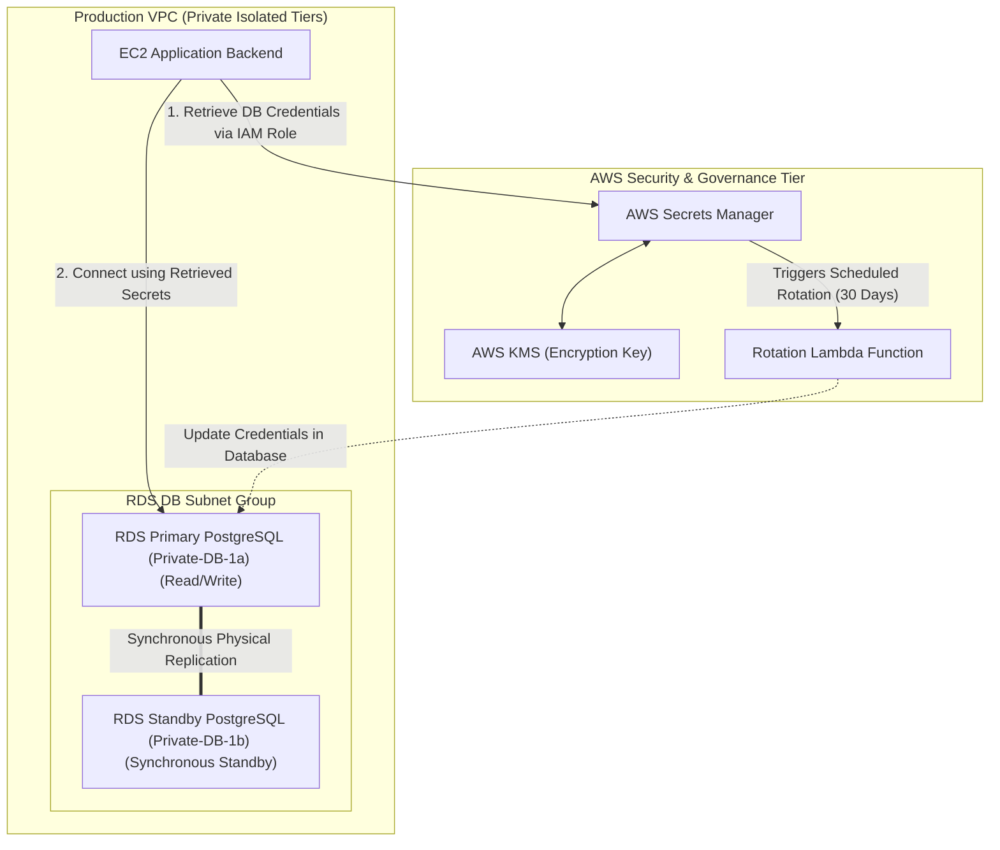

# Tutorial 03: Secure Multi-AZ RDS Deployment with AWS Secrets Manager

> **Vault Section:** `04_Tutorials/`  
> **Topic:** Relational Databases & Secret Management  
> **Source Reference:** Rajesh Daswani (*Packt, 2026*), Project Tasks 9.1–9.3 & 10.3; Tom Taulli (*O'Reilly, 2026*), Ch 7 & 11.  
> **Associated Certifications:** [CLF-C02](../phase0_step01_syllabus/CLF-C02_Master_Blueprint.md), SAA-C03

---

## 1. Architectural Blueprint & Scenario

In this tutorial, you deploy a highly available Amazon RDS PostgreSQL database across two Availability Zones, configure an isolated database subnet group, and store and automatically rotate database credentials using **AWS Secrets Manager** to eliminate hardcoded credentials in application code.



---

## 2. Step-by-Step Implementation Guide

### Step 1: Create an RDS DB Subnet Group
Amazon RDS requires a dedicated DB Subnet Group spanning at least two Availability Zones before a Multi-AZ database can be deployed:
1. Open the Amazon RDS Console -> **Subnet groups** -> **Create DB subnet group**.
2. **Name:** `production-db-subnet-group`.
3. **VPC:** `Production-VPC`.
4. **Add subnets:** Select Availability Zones `us-east-1a` and `us-east-1b`, and choose subnets `Private-DB-1a` (`10.0.20.0/24`) and `Private-DB-1b` (`10.0.21.0/24`).
5. Choose **Create**.

### Step 2: Store Master Credentials in AWS Secrets Manager
1. Open the **AWS Secrets Manager** Console -> **Store a new secret**.
2. Secret type: **Credentials for Amazon RDS database**.
3. Credentials:
   - **User name:** `dbadmin`
   - **Password:** Generate a strong random password (or allow Secrets Manager to generate it).
   - **Encryption key:** `aws/secretsmanager` (default AWS managed KMS key) or customer managed KMS key.
4. Secret name: `prod/app/postgresql`.
5. Choose **Next** and leave automatic rotation disabled initially (we enable it once the database exists).
6. Store the secret.

### Step 3: Launch Multi-AZ RDS Database Instance
1. In the RDS Console, choose **Databases** -> **Create database**.
2. Choose **Standard create**.
3. Engine: **PostgreSQL** (version 16 or 15).
4. Templates: **Production** (enables Multi-AZ by default).
5. Settings:
   - DB instance identifier: `prod-postgres-db`
   - Master username: `dbadmin`
   - Master password: Enter the password stored in Secrets Manager in Step 2.
6. Instance configuration: `db.t3.micro` or `db.m5.large`.
7. Storage: General Purpose SSD (gp3), 20 GiB. Enable storage auto-scaling.
8. Availability & durability: Select **Multi-AZ DB instance deployment** (Creates a standby instance in a different AZ to provide data redundancy and eliminate I/O freezes during automated backups).
9. Connectivity:
   - VPC: `Production-VPC`
   - DB Subnet Group: `production-db-subnet-group`
   - Public access: **No** (crucial for zero-trust security).
   - VPC security group: Select `Database-SG` (allows inbound port 5432 only from `App-SG`).
10. Database authentication: Password authentication (or Password and IAM database authentication).
11. Choose **Create database**.

### Step 4: Configure Automatic Secret Rotation
1. Once the RDS database status transitions to **Available**, navigate back to **AWS Secrets Manager**.
2. Select `prod/app/postgresql` -> **Rotation configuration** -> **Edit rotation**.
3. Enable **Automatic rotation**.
4. Set rotation interval: `30 days`.
5. Secrets Manager automatically provisions an AWS Lambda rotation function that:
   - Connects to the RDS database using superuser credentials.
   - Generates a new secret password.
   - Updates the password in the database.
   - Tests and verifies the new credentials.
   - Updates the secret value stored in Secrets Manager.

### Step 5: Application IAM Access without Passwords
To allow your backend EC2 application instances or Lambda functions to retrieve the secret without hardcoding API keys:
1. Attach an IAM Role to your EC2 instance with the following policy:
   ```json
   {
     "Version": "2012-10-17",
     "Statement": [
       {
         "Effect": "Allow",
         "Action": "secretsmanager:GetSecretValue",
         "Resource": "arn:aws:secretsmanager:us-east-1:123456789012:secret:prod/app/postgresql-*"
       }
     ]
   }
   ```
2. Application code connects via the AWS SDK:
   ```python
   import boto3
   import json

   client = boto3.client('secretsmanager', region_name='us-east-1')
   response = client.get_secret_value(SecretId='prod/app/postgresql')
   secret = json.loads(response['SecretString'])
   
   db_user = secret['username']
   db_pass = secret['password']
   # Connect to PostgreSQL using db_user and db_pass
   ```

---

## 3. Key Takeaways & Exam Distinctions
- **RDS Multi-AZ Failover:** Failover is entirely handled by AWS via automatic DNS endpoint repointing. The application connection endpoint URL (`prod-postgres-db.xxx.rds.amazonaws.com`) remains identical before and after failover.
- **Secrets Manager vs. SSM Parameter Store:**
  - If a scenario requires **automatic scheduled credential rotation** for RDS, DocumentDB, or Redshift, the answer is ALWAYS **AWS Secrets Manager**.
  - SSM Parameter Store supports storing encrypted `SecureString` parameters but requires custom Lambda authoring to rotate credentials.
