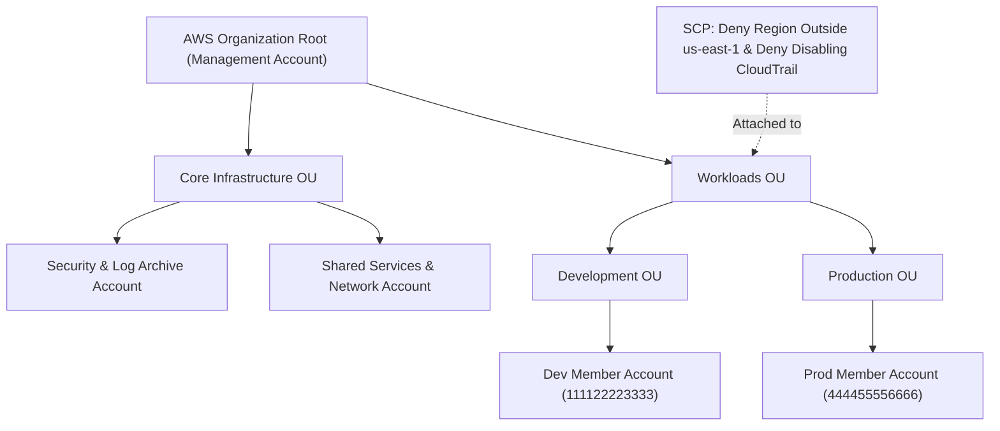

# Tutorial 06: Enterprise Multi-Account Governance with AWS Organizations & Service Control Policies (SCPs)

> **Vault Section:** `04_Tutorials/`  
> **Topic:** Security, Multi-Account Governance & Cost Management  
> **Source Reference:** Rajesh Daswani (*Packt, 2026*), Project Tasks 4.1–4.4; Tom Taulli (*O'Reilly, 2026*), Ch 5 & 15.  
> **Associated Certifications:** [CLF-C02](../phase0_step01_syllabus/CLF-C02_Master_Blueprint.md), SAA-C03

---

## 1. Architectural Blueprint & Scenario

In this tutorial, you implement an enterprise multi-account hierarchy using **AWS Organizations**. You will establish Organizational Units (OUs), configure consolidated billing, and enforce non-negotiable security guardrails using **Service Control Policies (SCPs)** to prevent administrators in child accounts from disabling security tools or deploying unauthorized high-cost resources.



---

## 2. Step-by-Step Implementation Guide

### Step 1: Create an AWS Organization
1. Sign in to the AWS Management Console using the **Management Account** (the designated root billing account).
2. Open the **AWS Organizations** Console -> **Create an organization**.
3. Confirm that **All features** are enabled (required for Service Control Policies; consolidated billing alone does not support SCPs).
4. Verify the organization root email address.

### Step 2: Establish the Organizational Unit (OU) Hierarchy
Organize your cloud environment into logical business and environment boundaries:
1. Under **Root**, choose **Actions** -> **Create new OU**:
   - Name: `Core` (for security tooling, log archives, transit gateways).
   - Name: `Workloads` (for application workloads).
2. Under `Workloads`, create nested child OUs:
   - `Development`
   - `Production`
3. Create or invite member accounts and move them into their respective OUs.

### Step 3: Enable Service Control Policies (SCPs)
1. In the left navigation pane, choose **Policies** -> **Service control policies**.
2. Choose **Enable service control policies**.
3. Note that by default, every OU and account has the AWS-managed policy `FullAWSAccess` attached, which allows all actions.

### Step 4: Author and Attach Enterprise SCP Guardrails

#### Policy 1: Geographic Region Restriction SCP
Prevent developers and workloads from spinning up expensive resources in unauthorized AWS regions (e.g., restrict everything outside `us-east-1` and `us-west-2` while exempting global services like IAM, Route 53, CloudFront, and Support):

```json
{
  "Version": "2012-10-17",
  "Statement": [
    {
      "Sid": "DenyAllOutsideApprovedRegions",
      "Effect": "Deny",
      "NotAction": [
        "iam:*",
        "route53:*",
        "cloudfront:*",
        "support:*",
        "health:*",
        "budgets:*",
        "organizations:*"
      ],
      "Resource": "*",
      "Condition": {
        "StringNotEquals": {
          "aws:RequestedRegion": [
            "us-east-1",
            "us-west-2"
          ]
        }
      }
    }
  ]
}
```

#### Policy 2: Prevent Disabling AWS CloudTrail & GuardDuty
Ensure local root or administrator accounts cannot disable audit trails or threat detection:

```json
{
  "Version": "2012-10-17",
  "Statement": [
    {
      "Sid": "PreventDisablingSecurityServices",
      "Effect": "Deny",
      "Action": [
        "cloudtrail:DeleteTrail",
        "cloudtrail:StopLogging",
        "cloudtrail:UpdateTrail",
        "guardduty:DeleteDetector",
        "guardduty:DisassociateFromMasterAccount",
        "guardduty:StopMonitoringMembers"
      ],
      "Resource": "*"
    }
  ]
}
```

### Step 5: Attach and Test the Policies
1. In the Policies console, choose **Create policy** and paste the JSON statements above. Name it `EnforceApprovedRegionsAndAudit`.
2. Navigate back to **AWS accounts**, select the `Development` OU, and switch to the **Policies** tab.
3. Choose **Attach policy** and select `EnforceApprovedRegionsAndAudit`.
4. **Testing in Member Account:**
   - Log into the development member account with full `AdministratorAccess`.
   - Switch the AWS Console region to `eu-central-1` (Frankfurt) or `ap-southeast-1` (Singapore).
   - Attempt to launch an Amazon EC2 instance or create an S3 bucket.
   - Observe that the operation is **immediately blocked with an explicit AccessDenied error**:
     `"You are not authorized to perform this operation because of a Service Control Policy."`
   - Attempt to stop logging on AWS CloudTrail. Observe that even the root user of the member account is blocked!

---

## 3. Key Takeaways & Exam Distinctions
- **SCPs NEVER Grant Permissions; They Only Set Guardrails:** An SCP defines the maximum permissions boundary. A user in a member account still requires an IAM policy explicitly granting access. If an action is denied by an SCP, no IAM policy in the member account can override it.
- **Root User of Member Accounts is Constrained:** Unlike standard IAM policies that cannot restrict the root user of an account, **SCPs DO constrain the root user of a member account**.
- **Management Account Immunity:** SCPs do **NOT** apply to the management account of the organization itself.
- **Consolidated Billing Benefits:**
  - One monthly invoice for all member accounts.
  - Automatic **volume tiering discounts** across all aggregated S3 and EC2 usage.
  - Automatic sharing of **Reserved Instances and Savings Plans discounts** across accounts in the organization.


---

## 4. 🎯 Authentic Architecture Exam Practice
> Practice real-world scenarios tested on official AWS examinations that directly apply the architectural patterns built in this tutorial.

### Scenario Practice 1: CLF-C02-ET-Q297
**Question:**  
A company needs to centrally configure and manage Amazon VPC security groups across multiple AWS accounts within an organization in AWS Organizations.

Which AWS service should the company use to meet these requirements?

**Options:**
- A) AWS Firewall Manager
- B) Amazon GuardDuty
- C) Amazon Detective
- D) AWS WAF

<details>
<summary><b>View Verified Answer & Solution Analysis</b></summary>

**Correct Answer:** `A`  
**Peer Consensus:** `100%` agreement.  

**Architectural Breakdown & Distractor Analysis:**  
Community Most Voted: A (100%). Contributor Answer: A.

Community Rationale & Discussion:
Selected Answer: A
AWS Firewall Manager is a security management service that allows you to centrally configure and manage firewall rules across your accounts and applications
---
Selected Answer: A

---
Selected Answer: A
A is correct

</details>

### Scenario Practice 2: CLF-C02-ET-Q026
**Question:**  
A company is using Amazon DynamoDB.
Which task is the company’s responsibility, according to the AWS shared responsibility model?

**Options:**
- A) Patch the operating system.
- B) Provision hosts.
- C) Manage database access permissions.
- D) Secure the operating system.

<details>
<summary><b>View Verified Answer & Solution Analysis</b></summary>

**Correct Answer:** `C`  
**Peer Consensus:** `100%` agreement.  

**Architectural Breakdown & Distractor Analysis:**  
Community Most Voted: C (100%). Contributor Answer: C.

Community Rationale & Discussion:
Selected Answer: C
ccording to the AWS shared responsibility model, AWS manages the security of the cloud (e.g., physical infrastructure, hardware, and network), while the customer is responsible for security in the cloud (e.g., managing access, configuring services, and securing data).
---
Selected Answer: C
But the questions ask for the company's responsibility
---
Selected Answer: C
Manage database access permissions: This is the customer's responsibility. Customers are responsible for defining and managing access permissions to their DynamoDB tables, specifying who can perform various operations on the tables.

</details>
