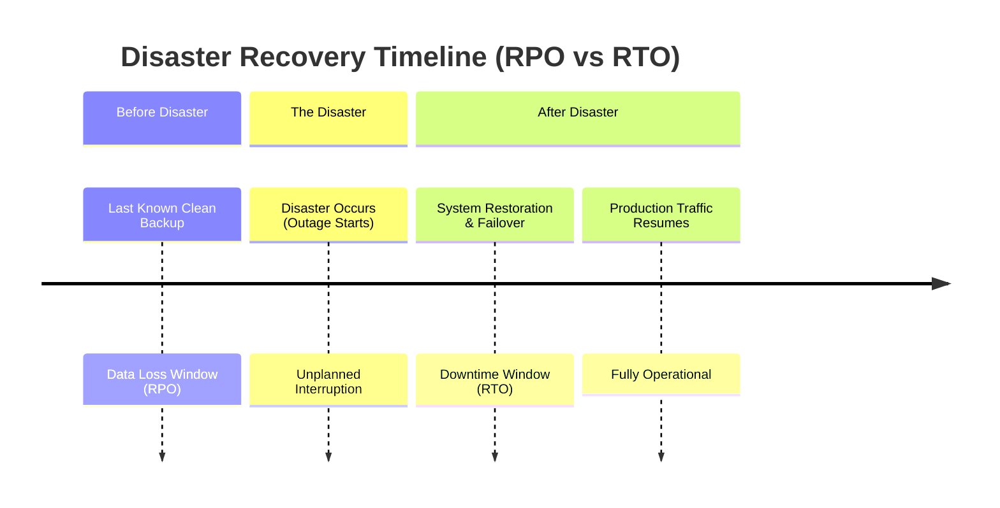
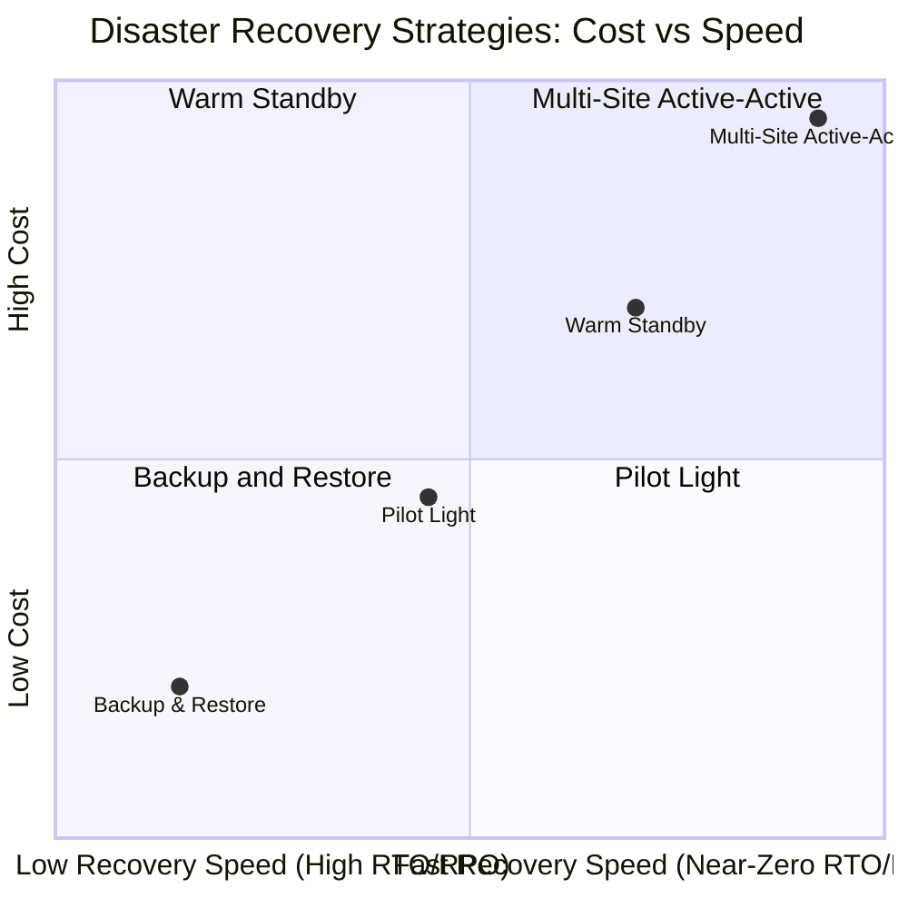

# Disaster Recovery and High Availability

> **Knowledge Area:** Cloud Concepts (Domain 1.1) & Technology (Domain 3.2, 3.6)  
> **Relevant Certifications:** [CLF-C02](../../phase0_step01_syllabus/CLF-C02_Master_Blueprint.md), SAA-C03, DVA-C02  
> **Tags:** `#aws/concepts` `#aws/resilience` `#clf-c02`

---

## 1. Resilience Terminology: HA vs. FT vs. DR

* **High Availability (HA):** Systems designed to operate continuously without failure for a long period of time (typically measured in 99.9% to 99.999% uptime). Achieved by eliminating single points of failure across multiple Availability Zones (Multi-AZ).
* **Fault Tolerance (FT):** The ability of a system to continue operating properly without interruption in the event of the failure of one or more components (e.g., seamless zero-downtime failover).
* **Disaster Recovery (DR):** The processes, policies, and tools to restore vital technology infrastructure and operations following a major natural or human-induced catastrophe (typically cross-Region).

---

## 2. Recovery Metrics: RPO vs. RTO

Every disaster recovery plan is governed by two business metrics: **RPO** and **RTO**.

| Metric | Full Name | Definition | Question Answered |
|---|---|---|---|
| **RPO** | **Recovery Point Objective** | The maximum acceptable amount of data loss measured in time backward from the disaster event. | *"How much data (hours/minutes of transactions) can the business afford to lose?"* |
| **RTO** | **Recovery Time Objective** | The maximum acceptable duration of time that the system can be down before normal operations must be restored. | *"How long can the application be offline before business revenue/reputation is critically harmed?"* |

> [!TIP]
> **Memory Trick:**
> * **RPO = Point in time / Data** (How many minutes/hours of database changes are lost).
> * **RTO = Time to restore / Downtime** (How many minutes/hours until servers are running again).

---

## 3. The 4 Disaster Recovery Strategies (Cost vs. Recovery Speed)

AWS defines 4 primary DR strategies ranging from low cost / high RTO/RPO to high cost / near-zero RTO/RPO:

### 1. Backup and Restore
* **Mechanism:** Data is backed up to Amazon S3 (or AWS Backup) regularly and replicated to a secondary AWS Region. If disaster strikes, new infrastructure (EC2, RDS) is provisioned from scratch and restored from backups.
* **RTO / RPO:** Hours to days.
* **Cost:** Lowest (no secondary compute servers running; only storage costs).
* **Best for:** Non-critical internal workloads, batch processing, development environments.

---

### 2. Pilot Light
* **Mechanism:** The **core data foundation** is kept constantly running and synchronized in the secondary Region (e.g., live replicated RDS database). Compute servers (EC2) are configured as templates (AMIs, CloudFormation) but are **turned off or not provisioned**. During a disaster, the compute tier is rapidly scaled up to process live traffic.
* **RTO / RPO:** Tens of minutes to hours.
* **Cost:** Low (only minimal storage and database synchronization instances run continuously).
* **Analogy:** A gas heater with a small pilot flame always burning; when you turn the dial, the entire furnace bursts into heat.

---

### 3. Warm Standby
* **Mechanism:** A **scaled-down, fully functional version** of the production environment is always running live in the secondary Region. It actively handles minimal test traffic or stands ready. During a disaster, the standby environment scales out (via Auto Scaling) to take 100% of production traffic.
* **RTO / RPO:** Minutes.
* **Cost:** Medium to high (a functioning system runs 24/7 in two regions).
* **Best for:** Business-critical workloads where minutes of downtime are acceptable.

---

### 4. Multi-Site Active-Active
* **Mechanism:** Fully redundant, full-scale production environments run simultaneously in two or more AWS Regions. Global traffic routing (Route 53 or Global Accelerator) splits incoming requests across all regions in real time. If one region fails, traffic is routed to the surviving region with zero human intervention.
* **RTO / RPO:** Near-zero (seconds or real-time).
* **Cost:** Highest (paying for full multi-region active infrastructure).
* **Best for:** Mission-critical financial systems, global e-commerce, healthcare life-safety systems.

---

## 4. Key AWS Services for Disaster Recovery

1. **AWS Elastic Disaster Recovery (AWS DRS):**
   * Automatically replicates on-premises, cloud, or virtual physical servers directly into AWS block storage (EBS).
   * In a disaster, AWS DRS automatically launches replacement EC2 instances in minutes.
2. **AWS Backup:**
   * Fully managed, centralized policy-based service to automate data protection across multiple AWS services (EBS, S3, RDS, DynamoDB, EFS).
   * Supports cross-Region and cross-account backup copies with compliance retention locks.
3. **Amazon Route 53:**
   * Offers DNS health checks and automated DNS failover routing policies to redirect traffic away from an unhealthy Region.

---

## 5. Exam Tip Matrix

| Question Scenario Keyword | Correct DR Strategy |
|---|---|
| *"Wants the lowest possible cost, willing to tolerate several hours of downtime and data loss"* | **Backup and Restore** |
| *"Database is continuously replicated to secondary Region, but web/app servers are only provisioned after disaster"* | **Pilot Light** |
| *"Scaled-down, minimal version of application runs 24/7 in secondary Region"* | **Warm Standby** |
| *"Requires near-zero downtime and zero data loss; customer cannot afford even a minute of interruption"* | **Multi-Site Active-Active** |
| *"Wants a centralized tool to enforce automated daily backups and retention across all AWS accounts"* | **AWS Backup** |
