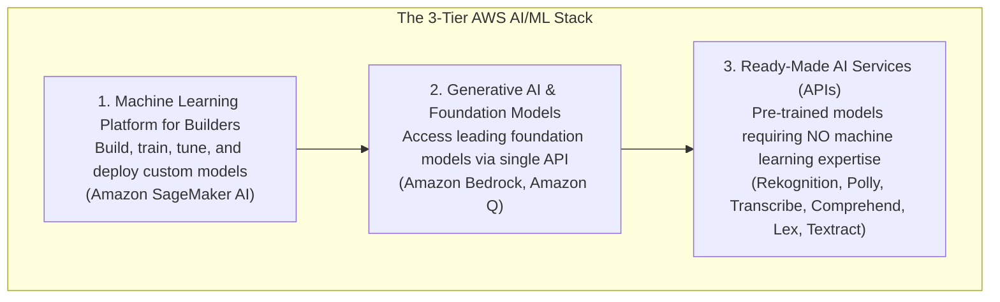
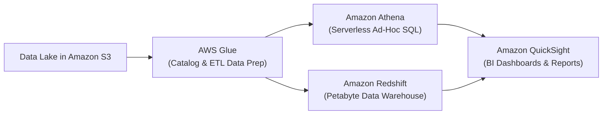

# AWS AI, Machine Learning & Analytics Services

> **Service Category:** AI / ML & Analytics (Domain 3.7)  
> **Relevant Certifications:** [CLF-C02](../../../phase0_step01_syllabus/CLF-C02_Master_Blueprint.md), [AIF-C01](../../../../../../AI/Practitioner/AIF-C01/phase0_step01_syllabus/AIF-C01_Exam_Guide_and_Blueprint.md), SAA-C03  
> **Tags:** `#aws/services` `#aws/ai` `#aws/analytics` `#clf-c02`

---

## 1. Overview of the AWS AI/ML Stack

AWS organizes its Artificial Intelligence and Machine Learning services into three distinct layers:

---

## 2. Pre-Trained Computer Vision, Speech & Language Services (No ML Expertise Needed)

These services provide REST API endpoints that developers call directly without needing data science training:

| Service | Category | Functionality | Key Exam Trigger Words |
|---|---|---|---|
| **Amazon Rekognition** | Vision | Analyzes images and videos to detect objects, people, faces, text, and inappropriate content. | *"Identify objects in images"*, *"Facial recognition"*, *"Inappropriate content moderation"*. |
| **Amazon Polly** | Speech | Converts **Text to Speech (TTS)** using deep learning to produce lifelike human speech in dozens of languages. | *"Read text out loud"*, *"Convert written articles to audio podcasts"*. |
| **Amazon Transcribe** | Speech | Converts **Speech to Text (STT)** using automatic speech recognition. Generates subtitles and transcripts from audio files. | *"Convert call center audio to text"*, *"Speech-to-text transcripts"*, *"Video subtitles"*. |
| **Amazon Translate** | Language | Neural machine translation service delivering fast, high-quality, and affordable language translation. | *"Translate text between languages"*, *"Multi-lingual website localization"*. |
| **Amazon Comprehend** | NLP | Natural Language Processing (NLP) that extracts insights, key phrases, entities, and sentiment from text documents. | *"Customer sentiment analysis"*, *"Detect positive/negative reviews"*, *"Extract medical entities"*. |
| **Amazon Lex** | Conversational AI| Conversational AI interface for building voice and text **chatbots** (the same technology that powers Amazon Alexa). | *"Build a customer service chatbot"*, *"Conversational voice/text agent"*. |
| **Amazon Textract** | OCR Document AI | Automatically extracts printed text, handwriting, and structured data (tables, forms) from scanned PDFs and images. | *"Extract data from scanned PDF forms or tax documents"*, *"Optical Character Recognition (OCR)"*. |

---

## 3. Generative AI & Custom Machine Learning

### Amazon Bedrock
* A fully managed service that makes high-performing **Foundation Models (FMs)** from leading AI startups (Anthropic Claude, Meta Llama, Mistral, Cohere, Amazon Titan) accessible via a single, unified API.
* Serverless; customize models privately with enterprise data using Retrieval-Augmented Generation (RAG).

### Amazon Q
* A generative AI-powered conversational assistant designed for work. Helps developers write code, troubleshoot architectures, analyze business data, and search enterprise repositories.

### Amazon SageMaker AI
* A fully managed platform that provides developers and data scientists with the tools to **build, train, validate, and deploy custom machine learning models** at scale.

---

## 4. Big Data & Analytics Services Overview

1. **Amazon Athena:**
   * An interactive, **serverless** query service that makes it easy to analyze data directly in **Amazon S3 using standard SQL**.
   * Pay only for the queries you run (billed per TB of data scanned). Zero servers to manage!
2. **AWS Glue:**
   * A serverless data integration service that makes it easy to discover, prepare, move, and integrate data from multiple sources (**ETL: Extract, Transform, Load**).
   * Features the **AWS Glue Data Catalog** (a persistent metadata store for your data assets).
3. **Amazon EMR (Elastic MapReduce):**
   * Big data platform for running large-scale distributed data processing frameworks like **Apache Spark, Apache Hadoop, Presto, and HBase**.
4. **Amazon Kinesis:**
   * Ingests, buffers, and processes massive streams of real-time streaming data (financial market feeds, IoT telemetry, application logs) in real time.
5. **Amazon QuickSight:**
   * A cloud-native, serverless **Business Intelligence (BI)** service that lets business analysts create interactive dashboards and visualizations with automated ML insights.

---

## 5. Exam Tip Matrix

| Question Scenario | Correct Service |
|---|---|
| *"Run ad-hoc SQL queries directly on CSV and JSON files stored in Amazon S3 without setting up a database"* | **Amazon Athena** |
| *"Build an interactive customer support chatbot using voice and text that integrates with backend systems"* | **Amazon Lex** |
| *"Analyze customer product reviews to determine whether sentiment is positive, neutral, or negative"* | **Amazon Comprehend** |
| *"Extract tabular data and filled form fields from thousands of scanned insurance PDF documents"* | **Amazon Textract** |
| *"Create visual business intelligence dashboards for executive reporting powered by machine learning"* | **Amazon QuickSight** |
| *"Serverless ETL service that discovers data schemas, transforms data formats, and populates a central catalog"* | **AWS Glue** |
| *"Access foundation models like Claude or Llama through a unified, serverless API"* | **Amazon Bedrock** |
