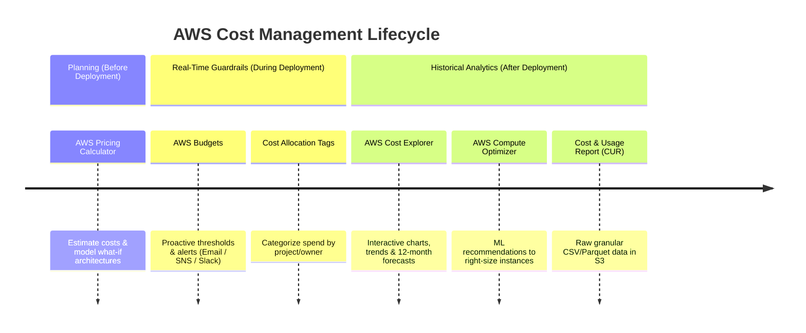
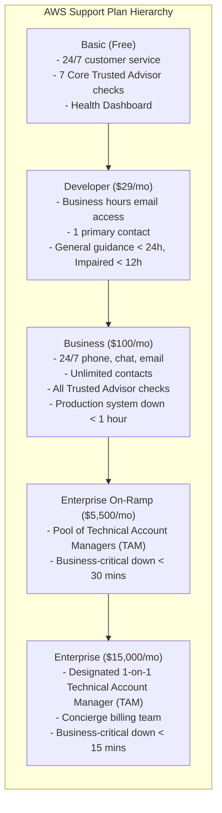

# AWS Billing, Pricing Tools & Support Plans

> **Service Category:** Cloud Financial Management & Support (Domain 4.1, 4.2, 4.3)  
> **Relevant Certifications:** [CLF-C02](../../../phase0_step01_syllabus/CLF-C02_Master_Blueprint.md), SAA-C03  
> **Tags:** `#aws/services` `#aws/billing` `#aws/support` `#clf-c02`

---

## 1. Cloud Financial Management Suite: Timeline Comparison

| Tool | Phase | Primary Function | Granularity / Output |
|---|---|---|---|
| **AWS Pricing Calculator** | **Pre-deployment** | Estimate monthly costs for planned architectures. No AWS account required. | Web-based estimate summary; export to PDF/link. |
| **AWS Budgets** | **Active monitoring** | Set custom cost, usage, RI, and Savings Plans limits; sends automated alerts when actual or forecasted spend exceeds threshold. | Email alerts, SNS notifications, automated SSM action. |
| **AWS Cost Explorer** | **Post-deployment** | Visualize, understand, and filter spending over past 12+ months and forecast spending up to 12 months out. | Interactive graphical charts, breakdowns by service/tag. |
| **Cost & Usage Report (CUR)** | **Post-deployment** | The most detailed and granular cost metadata available in AWS. | Raw CSV/Parquet files delivered to an **Amazon S3** bucket (queried via Amazon Athena). |
| **AWS Compute Optimizer** | **Optimization** | Analyzes CloudWatch utilization metrics using machine learning to recommend optimal instance types and right-sizing. | Actionable recommendations for EC2, EBS, Lambda, and Auto Scaling groups. |

---

## 2. Cost Allocation Tags

* **What they are:** Key-value pairs assigned to AWS resources (e.g., `Environment = Production`, `Department = Finance`, `Project = Falcon`).
* **Two Categories:**
  1. **AWS-Generated Tags:** Automatically applied by AWS (e.g., `createdBy`). Prefix: `aws:`.
  2. **User-Defined Cost Allocation Tags:** Created and managed by the customer. Prefix: `user:`.
* **Activation Requirement (Exam Trap):** Tags do **not** appear in billing reports until you **explicitly activate them in the Billing and Cost Management console!**

---

## 3. AWS Support Plans Comparison (Guaranteed Exam Questions!)

AWS offers 5 support tiers. Master their differences in response times, Technical Account Managers (TAM), and architecture reviews:

### Detailed Support Plan Breakdown:

| Support Feature | Basic | Developer | Business | Enterprise On-Ramp | Enterprise |
|---|:---:|:---:|:---:|:---:|:---:|
| **Monthly Cost** | **Free** | \$29 / mo | \$100 / mo (or % of spend) | \$5,500 / mo | \$15,000 / mo |
| **Case Access Hours** | N/A (Billing only) | Business hours (Web/Email) | **24/7 (Phone, Chat, Web)** | **24/7 (Phone, Chat, Web)** | **24/7 (Phone, Chat, Web)** |
| **Authorized Contacts**| N/A | 1 primary contact | **Unlimited contacts** | **Unlimited contacts** | **Unlimited contacts** |
| **General Guidance SLA**| N/A | < 24 business hours | < 24 hours | < 24 hours | < 24 hours |
| **System Impaired SLA** | N/A | < 12 business hours | < 12 hours | < 12 hours | < 12 hours |
| **Production System Down**| N/A | N/A | **< 1 hour** | **< 1 hour** | **< 1 hour** |
| **Business-Critical Down**| N/A | N/A | N/A | **< 30 minutes** | **< 15 minutes** |
| **Trusted Advisor Checks**| 7 Core Checks | 7 Core Checks | **Full (All checks)** | **Full (All checks)** | **Full (All checks)** |
| **Technical Account Manager**| NO | NO | NO | **Pool of TAMs** | **Designated 1-on-1 TAM** |
| **Concierge Support** | NO | NO | NO | NO | **YES (Billing Concierge)**|

---

## 4. Exam Tip Matrix

| Question Scenario | Correct Support Tier / Billing Tool |
|---|---|
| *"Requires 24/7 phone and chat access with a guaranteed response time under 1 hour for production system down outages"* | **Business Support Plan** |
| *"Requires a designated 1-on-1 Technical Account Manager (TAM) and a 15-minute response SLA for business-critical emergencies"* | **Enterprise Support Plan** |
| *"Receive proactive alerts when spending is forecasted to exceed \$1,000 before the end of the month"* | **AWS Budgets** |
| *"Visualize monthly spending trends over the past 6 months broken down by region and EC2 instance type"* | **AWS Cost Explorer** |
| *"Model the cost of running a proposed architecture on AWS before creating an account or launching resources"* | **AWS Pricing Calculator** |
| *"Machine learning recommendations to identify oversized EC2 instances and reduce compute waste"* | **AWS Compute Optimizer** |
| *"A dedicated team that provides specialized billing and account assistance for enterprise agreements"* | **AWS Support Concierge Team** (Enterprise Plan) |
