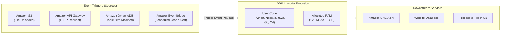
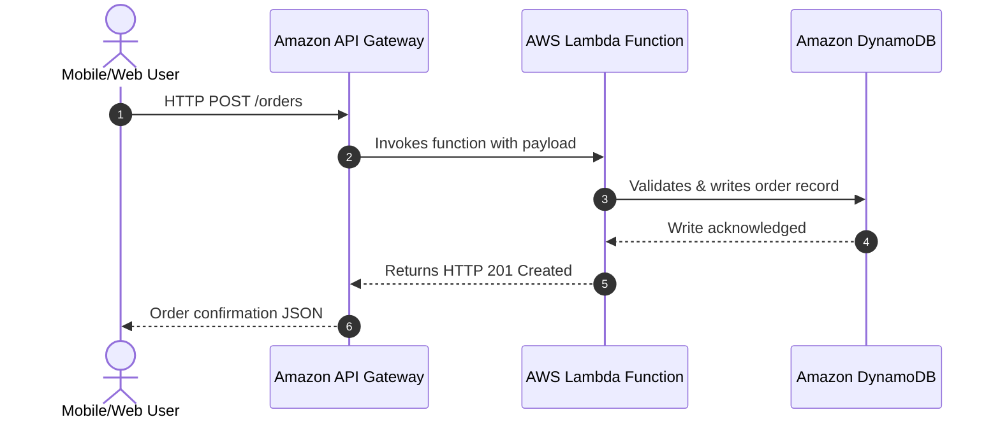

# Serverless Compute: AWS Lambda

> **Service Category:** Compute (Serverless)  
> **Relevant Certifications:** [CLF-C02](../../../phase0_step01_syllabus/CLF-C02_Master_Blueprint.md), SAA-C03, DVA-C02  
> **Tags:** `#aws/services` `#aws/serverless` `#clf-c02`

---

## 1. What is Serverless Computing?

In cloud computing, **Serverless** does not mean servers do not exist; it means **you never manage, provision, patch, or scale servers**.

### 4 Core Characteristics of Serverless:
1. **No Server Management:** No operating systems to install, configure, or patch.
2. **Continuous, Automatic Scaling:** Scales instantly from 0 to thousands of concurrent requests.
3. **Pay for Value (Consumption-Based):** Pay only for the milliseconds your code runs. If code does not execute, your bill is **\$0.00**.
4. **Built-in High Availability & Fault Tolerance:** Multi-AZ redundancy is managed automatically by AWS.

---

## 2. What is AWS Lambda?

**AWS Lambda** is an event-driven, serverless compute service that lets you run code for virtually any type of application or backend service without provisioning or managing servers.

### Key Lambda Operational Limits & Rules:
* **Maximum Execution Time:** **15 minutes (900 seconds)** per invocation. (Not intended for long-running batch jobs that take hours; use AWS Batch or EC2 for long jobs!).
* **Memory Allocation:** 128 MB to 10,240 MB (10 GB). (Allocating more memory proportionally increases CPU power and network bandwidth).
* **Billing Unit:** Billed based on the number of requests and execution duration rounded to the nearest **millisecond (1 ms)**.
* **Stateless:** Lambda functions are stateless; data must be stored externally in S3, DynamoDB, or RDS.

---

## 3. Common Architecture Patterns for AWS Lambda

* **Microservices & Web Backends:** Combined with **Amazon API Gateway** to build serverless REST APIs.
* **Real-Time Data Processing:** Triggered by file uploads to **Amazon S3** (e.g., resizing an image or generating a thumbnail immediately after upload).
* **Automated Operational Tasks:** Triggered by **Amazon EventBridge** on a recurring cron schedule (e.g., every night at 2:00 AM, shut down non-production EC2 instances).

---

## 4. Exam Tip Matrix

| Question Scenario | Correct Service |
|---|---|
| *"Run code in response to an image being uploaded to Amazon S3 without running servers 24/7"* | **AWS Lambda** |
| *"A lightweight backend API that costs \$0 when no customer requests are being processed"* | **AWS Lambda** + **Amazon API Gateway** |
| *"Maximum execution time allowed for a single AWS Lambda function invocation"* | **15 minutes** (900 seconds) |
| *"A batch job that takes 4 hours of continuous compute to process a large scientific simulation"* | **AWS Batch** or **Amazon EC2** (NOT Lambda due to 15-minute limit!) |
