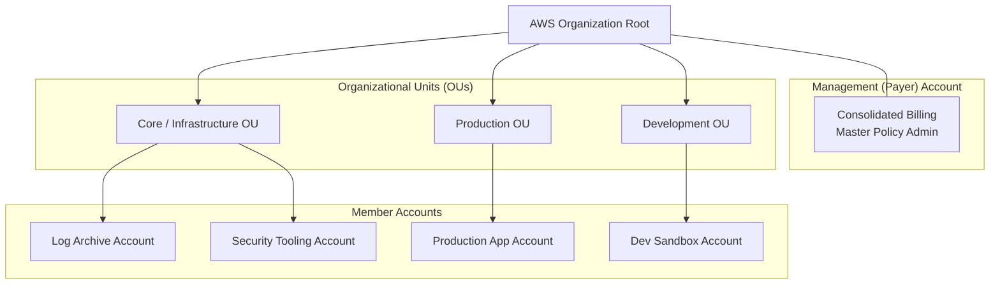
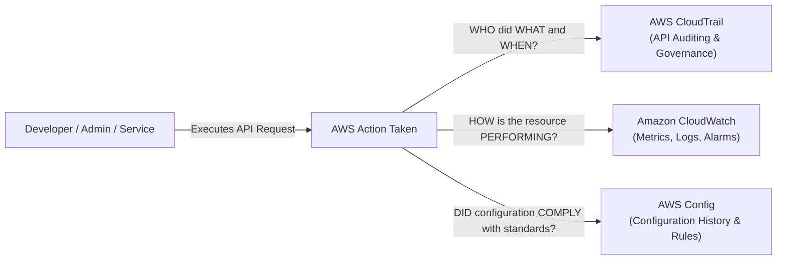

# AWS Organizations, Governance, Auditing & Monitoring

> **Service Category:** Management & Governance (Domain 2.2, 3.8, 4.2)  
> **Relevant Certifications:** [CLF-C02](../../../phase0_step01_syllabus/CLF-C02_Master_Blueprint.md), SAA-C03, SOA-C02  
> **Tags:** `#aws/services` `#aws/governance` `#clf-c02`

---

## 1. Multi-Account Management: AWS Organizations

**AWS Organizations** allows you to centrally manage and govern multiple AWS accounts from a single administrative master account.



### Key Benefits of AWS Organizations:
1. **Consolidated Billing:** One single monthly invoice for all accounts in the organization.
2. **Volume Discounts & Pricing Pooling:** AWS pools usage across all accounts (e.g., aggregating S3 storage or EC2 usage), allowing the organization to reach cheaper volume discount tiers faster!
3. **Sharing Savings Plans & Reserved Instances:** Unused Reserved Instances or Savings Plans in one account automatically apply to eligible usage in any other member account in the organization.
4. **Service Control Policies (SCPs):**
   * JSON policies that specify the **maximum available permissions** for accounts in an organization or OU.
   * **Crucial Rule:** An SCP acts as a guardrail. Even the root user of a member account **cannot bypass an explicit Deny in an SCP!**
   * *Note on Resource Control Policies (RCPs):* Introduced to enforce maximum permissions on AWS resources (like S3 buckets or KMS keys) across an entire organization.

---

## 2. Auditing & Monitoring: CloudTrail vs. CloudWatch vs. AWS Config

Candidates frequently confuse these three governance tools. Learn their distinct responsibilities:



| Dimension | AWS CloudTrail | Amazon CloudWatch | AWS Config |
|---|---|---|---|
| **Core Question Answered** | *"WHO made that API call, WHEN, and from which IP?"* | *"HOW is my CPU, memory, network, and app behaving?"* | *"WHAT changed in my resource settings, and is it COMPLIANT?"* |
| **Primary Data Type** | Audit event history & API call records. | Time-series metrics (CPU %), application logs, alarms. | Resource configuration snapshots, compliance evaluations. |
| **Example Alert** | *User 'Alice' deleted an S3 bucket at 2:15 PM from IP 198.51.100.22.* | *EC2 CPU utilization exceeded 85% for 5 consecutive minutes.* | *An S3 bucket was changed from private to public (Non-compliant rule alert).* |

---

## 3. AWS Trusted Advisor

**AWS Trusted Advisor** is an automated cloud advisor that inspects your AWS environment and provides real-time recommendations to follow AWS best practices across **6 Categories**:

```mermaid
mindmap
  root((AWS Trusted Advisor))
    Cost Optimization
      Idle RDS instances, unattached EBS volumes, underutilized EC2
    Performance
      High EC2 utilization, Service limits approaching threshold
    Security
      MFA on root account, open Security Group ports (0.0.0.0/0 on port 22/3389), S3 public bucket permissions
    Fault Tolerance
      Unbacked-up EBS volumes, single-AZ RDS deployments, Route 53 health checks
    Service Limits
      Usage exceeding 80% of account service quota
    Operational Excellence
      CloudFormation drift, Systems Manager agent health
```

* **Basic & Developer Support Plans:** Access to core security checks (MFA on root, open S3 buckets, common ports) and service limit checks.
* **Business & Enterprise Support Plans:** Full access to **all checks across all 6 categories** + automated programmatic notifications via API.

---

## 4. AWS Health Dashboard

* **AWS Service Health Dashboard (Public):** Displays the general operational status of all AWS services across all global regions (public status page).
* **AWS Personal Health Dashboard (Account-Specific):** Provides alerts and remediation guidance when AWS is experiencing events that **specifically impact your active resources** (e.g., planned maintenance on the specific physical host running your EC2 instance).

---

## 5. Resource Sharing: AWS Resource Access Manager (AWS RAM)

* **What it is:** A service that lets you securely share AWS resources with any AWS account or within your AWS Organization.
* **Solves:** Eliminates the need to duplicate resources across multiple accounts.
* **Sharable Resources:** Amazon VPC Subnets, AWS Transit Gateways, Route 53 Resolver rules, AWS License Manager configurations.
* **Exam Scenario:** Multiple application development teams in different AWS accounts need to deploy instances into a central, shared corporate VPC subnet without creating their own VPCs -> **AWS RAM**.

---

## 6. Exam Tip Matrix

| Question Scenario | Correct Governance Tool |
|---|---|
| *"Audit which IAM user terminated an Amazon EC2 instance yesterday"* | **AWS CloudTrail** |
| *"Trigger an automated alarm when EC2 instance CPU utilization exceeds 90%"* | **Amazon CloudWatch** |
| *"Evaluate whether all S3 buckets in an account have server-side encryption enabled and record configuration history"* | **AWS Config** |
| *"Enforce organizational guardrails that prevent member accounts from ever disabling CloudTrail or launching unauthorized instance types"* | **Service Control Policies (SCPs)** in **AWS Organizations** |
| *"Share a central AWS Transit Gateway across separate AWS accounts without replicating it"* | **AWS Resource Access Manager (AWS RAM)** |
| *"Automated recommendations for identifying unattached EBS volumes and underutilized EC2 instances to save costs"* | **AWS Trusted Advisor** (Cost Optimization check) |
| *"Receive proactive alerts about planned hardware maintenance on your specific EC2 instances"* | **AWS Personal Health Dashboard** |
