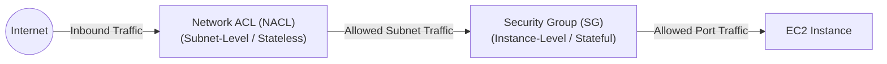
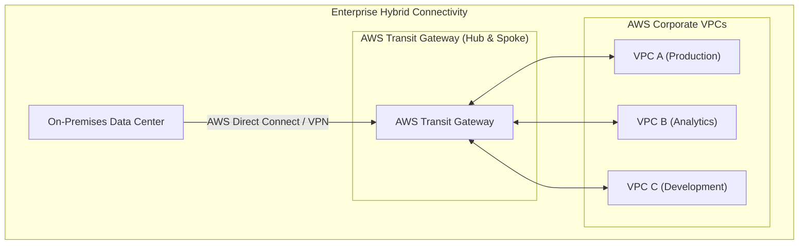

# Amazon VPC & Cloud Networking Fundamentals

> **Service Category:** Networking & Content Delivery  
> **Relevant Certifications:** [CLF-C02](../../../phase0_step01_syllabus/CLF-C02_Master_Blueprint.md), SAA-C03, SOA-C02  
> **Tags:** `#aws/services` `#aws/networking` `#clf-c02`

---

## 1. What is Amazon VPC?

**Amazon Virtual Private Cloud (Amazon VPC)** enables you to provision a logically isolated section of the AWS Cloud where you can launch AWS resources in a virtual network that you define.

You have complete control over your virtual networking environment, including selection of your own IP address range (CIDR block), creation of subnets, and configuration of route tables and network gateways.

```mermaid
graph TD
    subgraph AWSCloud ["AWS Cloud (Region: us-east-1)"]
        subgraph VPC ["Amazon VPC (CIDR: 10.0.0.0/16)"]
            
            subgraph PublicSubnet ["Public Subnet (CIDR: 10.0.1.0/24)"]
                ALB["Application Load Balancer"]
                NAT["NAT Gateway"]
            end
            
            subgraph PrivateAppSubnet ["Private App Subnet (CIDR: 10.0.2.0/24)"]
                EC2_App["EC2 Backend Instances\n(Security Group: App-SG)"]
            end
            
            subgraph PrivateDBSubnet ["Private Database Subnet (CIDR: 10.0.3.0/24)"]
                RDS_DB["Amazon RDS Multi-AZ DB\n(Security Group: DB-SG)"]
            end
        end
        
        IGW["Internet Gateway (IGW)"]
    end

    Internet((Public Internet)) <===> IGW
    IGW <===> PublicSubnet
    NAT <===>|Outbound Only (Updates)| PrivateAppSubnet
    PublicSubnet --> PrivateAppSubnet
    PrivateAppSubnet --> PrivateDBSubnet
```

---

## 2. Core VPC Networking Components

1. **Subnets:** Segments of a VPC's IP address range bound to a single Availability Zone.
   - *Public Subnet:* Has a route table entry pointing to an **Internet Gateway (IGW)**. Resources have public IP addresses and are directly accessible from the internet.
   - *Private Subnet:* Does **not** have a route to an Internet Gateway. Resources have only private IP addresses and are shielded from inbound internet access.
2. **Internet Gateway (IGW):** A horizontally scaled, redundant VPC component that enables communication between resources in your public subnets and the internet.
3. **NAT Gateway (Network Address Translation):**
   * Placed in a **public subnet**.
   * Enables EC2 instances in a **private subnet** to connect outbound to the internet (for software patches and OS updates) while **preventing the internet from initiating inbound connections** to those instances.
4. **Route Tables:** A set of rules (routes) that determine where network traffic from your subnet or gateway is directed.

---

## 3. Virtual Firewalls: Security Groups vs. Network ACLs (NACLs)

This is one of the most frequently tested security comparisons on all AWS exams:



| Dimension | Security Groups | Network ACLs (NACLs) |
|---|---|---|
| **Level of Operation** | **Instance Level** (virtual NIC) | **Subnet Level** (all instances in subnet) |
| **Rule Types** | **ALLOW rules only** (cannot explicitly DENY an IP) | **ALLOW and DENY rules** |
| **State Nature** | **Stateful:** If traffic is allowed in, return traffic is automatically allowed out regardless of outbound rules. | **Stateless:** Return traffic must be explicitly allowed by outbound rules. |
| **Rule Processing** | Evaluates **all rules** before deciding to allow traffic. | Processed in **numerical order** (lowest number first; e.g., Rule 100 before Rule 200). |
| **Default Behavior** | Denies all inbound traffic; allows all outbound traffic. | Default NACL allows all inbound and outbound traffic. |

> [!TIP]
> **Exam Trick:** If a question asks how to **block a specific malicious IP address** from reaching your web application, the answer is **Network ACL (NACL)**, because Security Groups do **NOT** support DENY rules!

---

## 4. Multi-VPC and Hybrid Connectivity



1. **VPC Peering:** A direct networking connection between two VPCs that enables routing traffic between them using private IPv4/IPv6 addresses. (Does **not** support transitive peering: if A peers with B, and B peers with C, A cannot talk to C!).
2. **AWS Transit Gateway (TGW):** A centralized cloud router (hub-and-spoke) connecting thousands of VPCs and on-premises networks together through a single gateway.
3. **AWS PrivateLink / VPC Endpoints:** Enables private connections between your VPC and supported AWS services (S3, DynamoDB) without requiring an Internet Gateway, NAT Gateway, or public IP addresses:
   - *Gateway Endpoints:* Free routing targets for **Amazon S3** and **Amazon DynamoDB**.
   - *Interface Endpoints (PrivateLink):* Uses an Elastic Network Interface (ENI) with a private IP for all other AWS services.
4. **AWS Direct Connect vs. Site-to-Site VPN:**
   - *Site-to-Site VPN:* Quick setup, encrypted IPsec tunnel over the public internet.
   - *Direct Connect (DX):* Dedicated physical fiber-optic connection bypassing the public internet for consistent high-throughput connectivity.

---

## 5. Exam Tip Matrix

| Question Scenario | Correct Networking Component |
|---|---|
| *"Allow private EC2 instances to download OS security patches from internet without allowing inbound internet access"* | **NAT Gateway** (placed in public subnet) |
| *"Block a specific malicious IP address (e.g., 203.0.113.50) from attacking your web servers"* | **Network ACL (NACL)** (using a DENY rule) |
| *"Connect hundreds of corporate VPCs and on-premises offices through a central hub-and-spoke router"* | **AWS Transit Gateway** |
| *"Securely connect EC2 instances in a private subnet to Amazon S3 without traversing the public internet"* | **VPC Gateway Endpoint for S3** |
| *"Dedicated, physical fiber-optic link between corporate headquarters and AWS for predictable performance"* | **AWS Direct Connect** |
