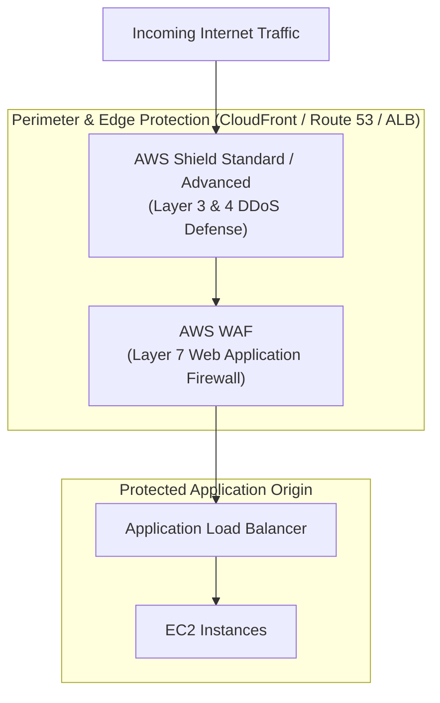
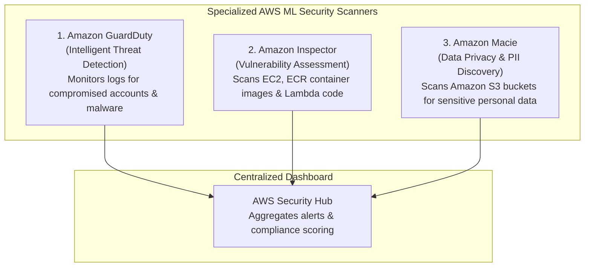
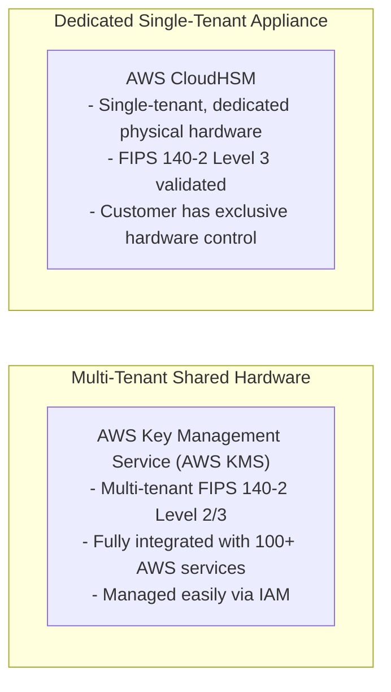

# AWS Security, Encryption & Compliance Services

> **Service Category:** Security, Identity & Compliance (Domain 2.2, 2.4)  
> **Relevant Certifications:** [CLF-C02](../../../phase0_step01_syllabus/CLF-C02_Master_Blueprint.md), SAA-C03, SOA-C02  
> **Tags:** `#aws/services` `#aws/security` `#clf-c02`

---

## 1. Perimeter & Application Protection: Shield vs. WAF

| Service | OSI Layer | Protection Focus | Key Features |
|---|:---:|---|---|
| **AWS Shield Standard** | Layer 3 & 4 (Network/Transport) | SYN floods, UDP reflection attacks, DDoS. | **Automatically enabled for all AWS customers at NO additional charge.** |
| **AWS Shield Advanced** | Layer 3 & 4 + Layer 7 | Targeted, sophisticated DDoS attacks. | Paid monthly subscription (\$3,000/mo); 24/7 access to AWS DDoS Response Team (DRT), financial cost-protection against DDoS scaling spikes. |
| **AWS WAF** | **Layer 7 (Application Layer)** | SQL Injection (SQLi), Cross-Site Scripting (XSS), HTTP flood attacks, bot scraping. | Inspects HTTP/HTTPS requests; allows/blocks based on IP addresses, HTTP headers, URI strings, or managed rulesets. |
| **AWS Firewall Manager** | Multi-Account Management | Centralizes security rule deployment across accounts. | Automatically enforces WAF rules, Shield Advanced protections, and Security Groups across all accounts in an **AWS Organization**. |

---

## 2. Threat Detection & Auditing Trio: GuardDuty vs. Inspector vs. Macie

AWS provides three specialized machine learning security scanning services. Do not confuse their functions:

| Security Service | What It Scans | How It Operates | Key Trigger Words |
|---|---|---|---|
| **Amazon GuardDuty** | CloudTrail logs, VPC Flow Logs, DNS query logs, S3 data events, EKS audit logs. | Continuous, intelligent threat detection using machine learning; identifies cryptocurrency mining, unusual API calls, compromised credentials. | *"Detect unauthorized behavior"*, *"Compromised EC2 instances"*, *"Cryptocurrency mining"*, *"Anomaly detection"*. |
| **Amazon Inspector** | Amazon EC2 instances, Amazon ECR container images, AWS Lambda functions. | Automated vulnerability management; scans for known software vulnerabilities (CVEs) and unintended network exposure. | *"Scan for software vulnerabilities"*, *"Common Vulnerabilities and Exposures (CVE)"*, *"Assess EC2 package security"*. |
| **Amazon Macie** | **Amazon S3 Buckets** exclusively. | Data security and data privacy service using machine learning to discover, classify, and protect sensitive data (PII, credit cards, passports). | *"Identify Personally Identifiable Information (PII) in S3"*, *"Credit card numbers"*, *"S3 data privacy audit"*. |

---

## 3. Cryptography & Key Management: KMS vs. CloudHSM

* **AWS Key Management Service (AWS KMS):**
  - Easily create and control cryptographic keys used to encrypt data across AWS services and in your applications.
  - Tightly integrated with AWS CloudTrail to log every single key usage for regulatory auditing.
  - *Customer Managed Keys (CMK):* You control key rotation policies, IAM key policies, and disablement.
  - *AWS Managed Keys:* Free default keys managed automatically by AWS (e.g., `aws/s3`, `aws/ebs`).
* **AWS CloudHSM:**
  - Dedicated Hardware Security Module (HSM) running in your VPC.
  - Used when strict regulatory compliance requires that AWS employees have **zero access** to encryption keys.

---

## 4. Compliance Documentation: AWS Artifact

* **What it is:** A self-service portal in the AWS Management Console providing **on-demand access to AWS’s compliance documentation and agreements**.
* **Two Key Sections:**
  1. **AWS Artifact Reports:** Download official compliance reports, such as Service Organization Control (SOC 1/2/3), Payment Card Industry (PCI DSS), and International Organization for Standardization (ISO 9001/27001/27017/27018) audit reports.
  2. **AWS Artifact Agreements:** Review, accept, and manage agreements between your organization and AWS, such as the **Business Associate Addendum (BAA)** required for **HIPAA** compliance in healthcare.

---

## 5. Exam Tip Matrix

| Question Scenario | Correct Security Service |
|---|---|
| *"Discover sensitive Personally Identifiable Information (PII) like credit cards and passport numbers stored in Amazon S3"* | **Amazon Macie** |
| *"Protect web applications from common Layer 7 vulnerabilities such as SQL injection and Cross-Site Scripting (XSS)"* | **AWS WAF** |
| *"Continuous automated monitoring for cryptocurrency mining or compromised AWS account credentials using machine learning"* | **Amazon GuardDuty** |
| *"Download AWS audit compliance reports (SOC, PCI DSS) or sign a HIPAA Business Associate Addendum (BAA)"* | **AWS Artifact** |
| *"Scan running EC2 instances and ECR container images for known Common Vulnerabilities and Exposures (CVEs)"* | **Amazon Inspector** |
| *"Centralized dashboard providing a comprehensive view of high-priority security alerts across GuardDuty, Inspector, and Macie"* | **AWS Security Hub** |
