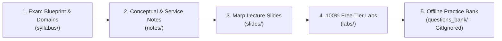

# AWS Certified Cloud Practitioner (CLF-C02) Track

> **Course Track:** Cloud Foundation  
> **Instructor:** Mohamed Fakhruldeen  
> **Target Certification:** AWS Certified Cloud Practitioner (CLF-C02)  
> **Repository:** `fakhruldeen/AWS` -> `cloud/foundation/`

---

## 🎯 Track Overview

The Cloud Foundation curriculum prepares learners for the **AWS Certified Cloud Practitioner (CLF-C02)** exam through foundational cloud architecture, security best practices, core AWS services, and cost management.



---

## 📁 Directory Structure

```text
cloud/foundation/
├── README.md                      <-- (This file)
│
├── syllabus/                      <-- Official CLF-C02 Exam Blueprint & Domain Roadmaps
│   ├── CLF-C02_Master_Blueprint.md
│   ├── Domain_1_Cloud_Concepts.md (24%)
│   ├── Domain_2_Security_Compliance.md (30%)
│   ├── Domain_3_Cloud_Technology.md (34%)
│   ├── Domain_4_Billing_Pricing.md (12%)
│   └── Exam_Distinction_CheatSheet.md
│
├── notes/                         <-- Atomic Study Notes & Architectural Deep Dives
│   ├── concepts/                  (Global Infra, Well-Architected, Shared Responsibility, CAF)
│   └── services/                  (Compute, Storage, Database, Networking, Security, Billing, AI)
│
├── slides/                        <-- Student Presentation Slide Decks (Marp Format)
│   └── Module_01_Cloud_Concepts_and_Architecture_Slides.md
│
├── labs/                          <-- Hands-On Student Lab Manuals (100% Free-Tier Compliant)
│   ├── Lab_01_AWS_IAM_Least_Privilege_and_MFA.md
│   ├── Lab_02_Static_Website_S3_and_CloudFront.md
│   ├── Lab_03_Resilient_MultiAZ_Web_Tier_EC2.md
│   └── Lab_04_Proactive_Budget_Alerts_AWS_Budgets.md
│
└── questions_bank/                <-- 2,924 Offline Practice Questions (GitIgnored)
    ├── README.md                  (Catalog index and source attribution)
    ├── EXAM_OBJECTIVES_ALIGNMENT_REPORT.md
    ├── CloudCertPrep_Questions/   (1,050 questions)
    ├── AwsCcpTrainer_Questions/   (987 questions)
    ├── ExamTopics_Questions/      (290 questions)
    ├── Quban301_Practice_Questions/ (174 questions)
    ├── CertPrep_Offline_Questions/ (136 questions)
    ├── Edurely_Questions/         (115 questions)
    ├── CertSafari_Questions/      (79 questions)
    ├── SecByte_Questions/         (72 questions)
    ├── FreeCram_Questions/        (13 questions)
    └── ExamDumpsNet_Questions/    (8 questions)
```

---

## 🚀 Hands-On Student Labs

All labs are designed to run within the **AWS Free Tier** with zero infrastructure cost:
1. **[Lab 1: IAM Least Privilege & MFA](./labs/Lab_01_AWS_IAM_Least_Privilege_and_MFA.md)**
2. **[Lab 2: Static S3 & CloudFront Distribution](./labs/Lab_02_Static_Website_S3_and_CloudFront.md)**
3. **[Lab 3: Fault-Tolerant Multi-AZ EC2 Tier](./labs/Lab_03_Resilient_MultiAZ_Web_Tier_EC2.md)**
4. **[Lab 4: Proactive Budget Alerts with AWS Budgets](./labs/Lab_04_Proactive_Budget_Alerts_AWS_Budgets.md)**
