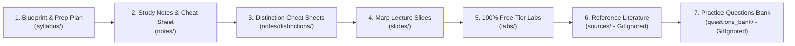

# AWS Cloud Foundation (CLF-C02) Course Repository

> **Target Certification:** AWS Certified Cloud Practitioner (CLF-C02)  
> **Course Author & Lead Trainer:** Mohamed Fakhruldeen  
> **Repository:** `fakhruldeen/AWS` (`cloud/foundation/`)  
> **Version:** 2.0.0 (Post-Ingestion & Comprehensive Alignment)

---

## 🎯 Course Overview & Learning Architecture

The Cloud Foundation curriculum prepares learners for the **AWS Certified Cloud Practitioner (CLF-C02)** exam through an evidence-based pedagogical approach:



---

## 📁 Repository Directory Structure

```
cloud/foundation/
├── README.md                      <-- (This curriculum overview)
│
├── syllabus/                      <-- Official Exam Blueprints & Preparation Plans
│   ├── CLF-C02_Master_Blueprint.md
│   ├── SkillBuilder_Prep_Plan.md  (AWS Official 4-Step Prep Framework & 50 Flashcards)
│   ├── Domain_1_Cloud_Concepts.md
│   ├── Domain_2_Security_Compliance.md
│   ├── Domain_3_Cloud_Technology.md
│   ├── Domain_4_Billing_Pricing.md
│   └── Exam_Distinction_CheatSheet.md
│
├── notes/                         <-- High-Yield Study Notes & Rapid Review Sheets
│   ├── Rapid_Review_Cheatsheet.md (Ultra-dense quick reference sheet)
│   ├── concepts/                  (Global Infra, Well-Architected, Shared Responsibility, CAF)
│   ├── services/                  (Compute, Storage, Database, Networking, Security, Billing, AI)
│   └── distinctions/              (Pairwise "X vs Y" Comparison Cheat Sheets)
│       ├── Security_Services_Four_Guardians_Shield_WAF_GuardDuty_Inspector_Macie.md
│       ├── KMS_vs_CloudHSM_vs_SecretsManager_vs_ParameterStore.md
│       ├── VPC_Endpoints_Gateway_vs_Interface_vs_PrivateLink.md
│       ├── Hybrid_Networking_DirectConnect_vs_SiteToSiteVPN_vs_TransitGateway.md
│       ├── Monitoring_Governance_Trio_CloudWatch_vs_CloudTrail_vs_Config.md
│       ├── Disaster_Recovery_Strategies_Comparison.md
│       ├── AWS_Support_Plans_Comparison_Matrix.md
│       ├── Developer_and_Mobile_Amplify_vs_DeviceFarm_vs_AppSync.md
│       ├── Storage_and_Hybrid_AWS_Backup_vs_DataSync_vs_StorageGateway.md
│       └── AWS_Health_Dashboard_Global_vs_Account.md
│
├── slides/                        <-- Student Presentation Slide Decks (Marp Format)
│   ├── Module_01_Cloud_Concepts_and_Architecture_Slides.md
│   ├── Module_02_Compute_Storage_and_Databases_Slides.md
│   ├── Module_03_Networking_Security_and_Identity_Slides.md
│   ├── Module_04_Monitoring_Governance_and_DevOps_Slides.md
│   └── Module_05_Billing_Pricing_and_Support_Slides.md
│
├── labs/                          <-- Hands-On Student Lab Manuals (100% Free-Tier Compliant)
│   ├── Lab_01_AWS_IAM_Least_Privilege_and_MFA.md
│   ├── Lab_02_Static_Website_S3_and_CloudFront.md
│   ├── Lab_03_Resilient_MultiAZ_Web_Tier_EC2.md
│   ├── Lab_04_Proactive_Budget_Alerts_AWS_Budgets.md
│   ├── Lab_05_Decoupled_Messaging_SNS_and_SQS.md
│   ├── Lab_06_Serverless_Thumbnail_Generator_S3_Lambda.md
│   ├── Lab_07_CloudWatch_Alarms_and_Monitoring_Dashboard.md
│   └── Lab_08_Infrastructure_as_Code_AWS_CloudFormation.md
│
├── sources/                       <-- Offline Reference Literature (GitIgnored / Local Only)
│   ├── Rajesh Daswani - AWS Certified Cloud Practitioner Certification (Packt)
│   └── Tom Taulli - AWS Certified Cloud Practitioner Study Guide (O'Reilly)
│
└── questions_bank/                <-- 4,954 Offline Practice Questions (GitIgnored)
    ├── README.md                  (Comprehensive catalog of all 14 banks)
    ├── Kananinirav_Exams/         (1,142 questions across 23 modular exams)
    ├── DevOpsKing_Questions/      (597 verified practice questions across 6 sets)
    ├── GustavoFreze_Questions/    (165 domain questions with documentation citations)
    ├── OReilly_Taulli_Questions/  (126 questions - Textbook Quizzes & Mock Exam)
    ├── CloudCertPrep_Questions/   (450 questions & JSON datasets)
    ├── AwsCcpTrainer_Questions/   (240 questions & option notes)
    ├── CertSafari_Questions/      (674 questions)
    ├── Quban301_Practice_Questions/ (301 questions & exam dumps)
    ├── SecByte_Questions/         (296 questions)
    ├── Edurely_Questions/         (300 questions)
    ├── ExamDumpsNet_Questions/    (230 questions)
    ├── CertPrep_Offline_Questions/ (200 questions)
    ├── FreeCram_Questions/        (128 questions)
    └── ExamTopics_Questions/      (105 questions)
```

---

## 🛠️ Hands-On Student Labs (100% Free-Tier)

All labs are designed to run within the **AWS Free Tier** with zero infrastructure cost when torn down properly:

1. **[Lab 1: IAM Least Privilege & MFA Enforcement](./labs/Lab_01_AWS_IAM_Least_Privilege_and_MFA.md)** - Setting up administrative users, custom policies, and virtual MFA devices.
2. **[Lab 2: Static S3 & CloudFront Distribution](./labs/Lab_02_Static_Website_S3_and_CloudFront.md)** - Global HTTPS content delivery using CloudFront Origin Access Control (OAC).
3. **[Lab 3: Fault-Tolerant Multi-AZ EC2 Tier](./labs/Lab_03_Resilient_MultiAZ_Web_Tier_EC2.md)** - Deploying dual Availability Zone Apache instances behind an Application Load Balancer.
4. **[Lab 4: Proactive Budget Alerts with AWS Budgets](./labs/Lab_04_Proactive_Budget_Alerts_AWS_Budgets.md)** - Setting automated actual and forecasted spending thresholds.
5. **[Lab 5: Decoupled Messaging with SNS & SQS](./labs/Lab_05_Decoupled_Messaging_SNS_and_SQS.md)** - Fan-out pub/sub messaging and asynchronous worker queue buffering.
6. **[Lab 6: Serverless Event-Driven Processing with S3 & Lambda](./labs/Lab_06_Serverless_Thumbnail_Generator_S3_Lambda.md)** - Automating serverless Python execution on object creation events.
7. **[Lab 7: Monitoring with CloudWatch Alarms & Dashboards](./labs/Lab_07_CloudWatch_Alarms_and_Monitoring_Dashboard.md)** - Setting metric thresholds, SNS email alerts, and executive telemetry dashboards.
8. **[Lab 8: Infrastructure as Code with AWS CloudFormation](./labs/Lab_08_Infrastructure_as_Code_AWS_CloudFormation.md)** - Declarative YAML template provisioning and Change Set preview verification.
